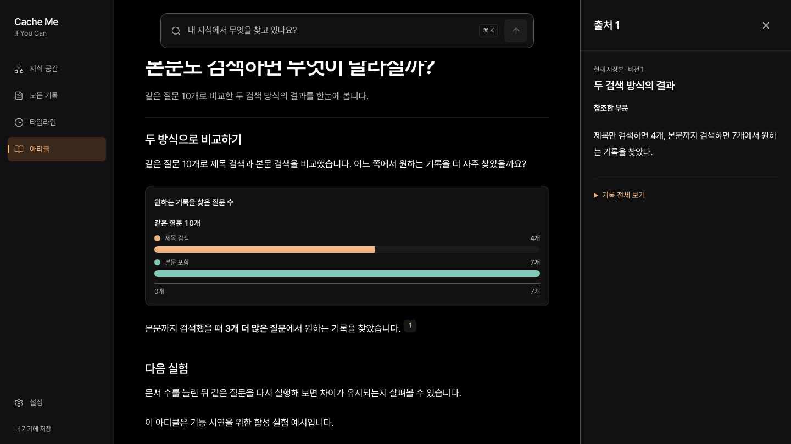

# Cache Me If You Can

[](https://github.com/jhpark324/cache-me-if-you-can/actions/workflows/repository-ci.yml) [](https://github.com/jhpark324/cache-me-if-you-can/actions/workflows/frontend-ci.yml)

**“TCP에 대해 알려줘.”** AI와 TCP·UDP의 차이를 공부하고 “지금까지 배운 걸 cache-me로 정리해줘”라고 말하면 내 컴퓨터에 두 기록이 남습니다. 그래프에서 한 문단을 열거나, 기억나는 말로 검색하거나, 두 기록을 비교 아티클로 엮을 수 있습니다.

**[TCP·UDP 이야기 따라보기](https://jhpark324.github.io/cache-me-if-you-can/)** · [스킬과 MCP 한눈에 보기](https://jhpark324.github.io/cache-me-if-you-can/guide-skills.html) · [휴대폰용 QR](showcase/media/intro-qr.png) · [아키텍처와 설계 문서](https://jhpark324.github.io/cache-me-if-you-can/guide.html) · [빠른 시작](#빠른-시작)

졸업작품 발표 자료 · [AI와 공부한 기록, 면접 전날 다시 찾기 (PDF, 17장)](assets/cache-me-if-you-can-graduation-presentation.pdf)



## 빠른 시작

Git, Python 실행기, [uv](https://docs.astral.sh/uv/), Node.js 22와 npm을 준비한 뒤 실행하세요. `setup`이 Python 3.12 환경과 웹 화면을 준비합니다.

```sh
git clone https://github.com/jhpark324/cache-me-if-you-can.git
cd cache-me-if-you-can
python3 scripts/manage.py setup
python3 scripts/manage.py start
```

[내 컴퓨터의 캐시미 열기](http://127.0.0.1:52761/) → **모든 기록 → 새 기록**에서 첫 문장을 저장하세요. Codex에서도 쓰려면 같은 폴더에서 다음 명령을 실행하고 새 Codex 대화를 여세요.

```sh
python3 scripts/manage.py install-codex
python3 scripts/manage.py doctor
```

기록 작성은 로그인 없이 할 수 있습니다. 의미 검색은 설정에서 **검색 기능 준비**를 눌러 시작합니다. 웹 AI 답변과 자동 주제 분류는 ChatGPT 로그인과 모델 선택이 필요하며, 이 기능을 사용할 때 질문이나 관련 기록 내용이 외부 모델로 전달될 수 있습니다. [설치·설정 가이드](guides/local-development.md) · [지원 환경](architecture/platform-support.md)

## Codex에서 이렇게 씁니다

- **저장** · `$cache-me` 이 대화에서 공부한 TCP와 UDP를 각각 캐시미 해줘.
- **다시 찾기** · `$cache-me` 전송 계층을 공부하면서 어떤 내용을 기록했지?
- **아티클 쓰기** · `$cache-me-article` 방금 저장한 두 기록으로 「TCP와 UDP, 언제 무엇을 쓸까?」라는 아티클을 써줘.

`cache-me`는 기록을 저장하고 찾아줍니다. `cache-me-article`은 그 기록과 필요한 외부 원문을 인용해 별도의 아티클을 발행합니다. 웹에서는 글을 읽던 자리에서 출처를 펼쳐볼 수 있습니다.

## 더 알아보기

- **구조** — Codex는 로컬 MCP 서버를 통해, 브라우저는 웹 API를 통해 같은 저장소를 사용합니다. SQLite에는 기록·아티클과 버전이, LanceDB에는 검색용 색인이 들어갑니다. [아키텍처 도식](https://jhpark324.github.io/cache-me-if-you-can/guide-system.html#overview) · [서비스 계약](architecture/service-contracts.md)
- **기여와 문의** — 동작을 제안하거나 문제를 재현했다면 사용 환경과 기대 결과를 알려주세요. 코드 변경 시 프로젝트 루트에서 `python3 scripts/manage.py check`로 점검할 수 있습니다. [이슈](https://github.com/jhpark324/cache-me-if-you-can/issues) · [기여 가이드](guides/index.md) · [전체 문서](index.md)
- **라이선스** — 소스 코드를 열람할 수 있도록 공개합니다. 프로젝트 코드의 배포 라이선스는 아직 정하지 않았으며, 포함된 글꼴과 외부 의존성에는 각자의 라이선스가 적용됩니다. [라이선스 안내](guides/repository-readiness.md#의존성과-라이선스)
