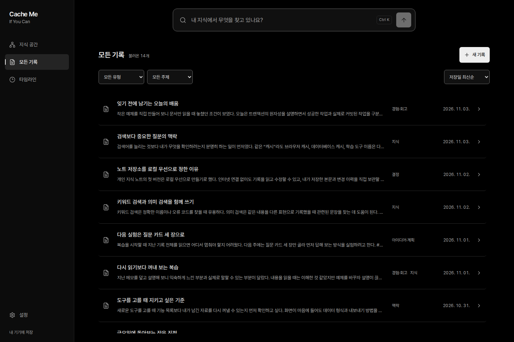
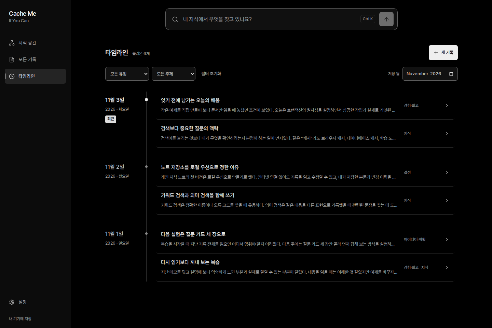
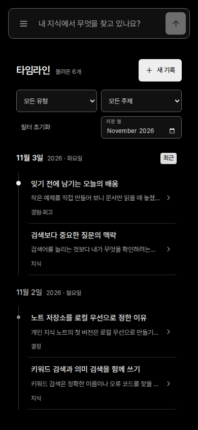
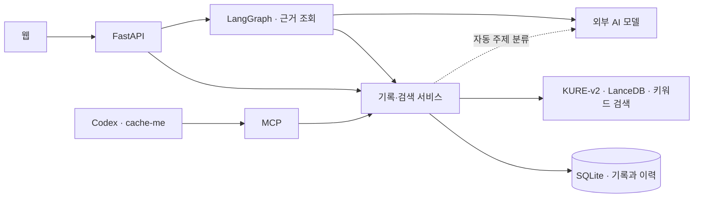

<div align="center">

# Cache Me If You Can

**대화에서 배운 것을 저장하고, 출처와 함께 다시 찾는 개인 지식 저장소.**

로컬 저장 · 한국어 검색 · 3D 지식 그래프 · Codex MCP

[빠른 시작](#빠른-시작) · [화면](#화면-둘러보기) · [Codex 연결](#codex에서-사용하기) · [문서](index.md) · [기여](#기여하기)

</div>


Cache Me If You Can은 AI와 대화하며 정리한 지식, 선택의 이유, 경험과 아이디어를 내 기기에 보관하는 세컨브레인입니다. 웹에서 기록을 직접 쓰거나 Codex의 `cache-me` 스킬로 저장하고, 같은 저장소를 검색·수정할 수 있습니다. 질문의 답변에는 근거가 된 기록과 저장 버전이 연결됩니다.

**개발 상태: 로컬 MVP.** WSL의 Linux x64·CPU 환경에서 실행을 확인했습니다. 네이티브 운영체제별 지원 범위는 [플랫폼 문서](architecture/platform-support.md)를 참고하세요.

## 주요 기능

| 기능 | 설명 |
| --- | --- |
| 기록 저장·정정 | Markdown 본문과 변경 이력을 보존하고, 지식·경험·맥락·아이디어·결정·자료로 정리 |
| 한국어 검색과 답변 | KURE-v2 벡터 검색과 키워드 검색을 결합하고, 기록을 근거로 답변 |
| 출처 확인 | 답변이 참조한 정확한 저장본과 본문 구간을 조회 |
| 목록·타임라인 | 유형·주제·저장 월로 좁히고, 목록 정렬이나 저장일별 묶음으로 탐색 |
| [아티클](specs/articles.md) | Codex에서 공부한 주제를 아티클로 등록하고, 표·흐름도와 문단별 출처를 한 화면에서 읽기 |
| 3D 지식 그래프 | 기록·주제·본문 맥락과 검색 근거의 연결을 탐색 |
| Codex 연동 | `cache-me` 스킬과 MCP로 저장·조회·정정·확인 후 삭제 |
| 백업 내보내기 | 기록과 이력을 담은 SQLite snapshot을 ZIP으로 다운로드 |

대화 전체를 자동 수집하지 않습니다. 저장을 요청한 내용만 남기며, 웹의 질문과 답변도 자동으로 영구 저장하지 않습니다.

## 화면 둘러보기

### 모든 기록

기록을 목록으로 훑고 유형·주제로 좁힙니다. 제목·저장일로 정렬하거나 기록을 열어 본문과 변경 이력을 확인할 수 있습니다.



### 기록과 출처

저장한 내용에 관해 질문하고, 답변 옆에서 근거가 된 본문을 확인합니다. 출처 패널은 답변에 사용된 저장 버전과 현재 기록을 구분합니다.


[기록 상세 화면](assets/readme/record-detail.png)에서는 Markdown 본문과 메타데이터를 함께 확인할 수 있습니다.

<details>
<summary><strong>타임라인과 모바일 화면</strong></summary>

저장일별로 기록을 돌아보는 타임라인입니다. 좁은 화면에서는 메뉴와 상세 패널을 필요할 때 엽니다.





</details>

화면은 별도 임시 저장소에 합성 데이터를 넣고 실행한 서비스에서 촬영했습니다. 검색 화면에는 해당 기록을 검색한 실제 AI 답변과 출처가 표시됩니다. 실제 사용자 기록이나 계정 정보는 포함하지 않습니다. [이미지 안내](assets/readme/index.md)

## 빠른 시작

Git, Python 실행기, [uv](https://docs.astral.sh/uv/), Node.js 22와 npm이 필요합니다. uv가 제품용 Python 3.12 환경을 관리하며, GPU는 필수가 아닙니다.

```sh
git clone https://github.com/jhpark324/cache-me-if-you-can.git
cd cache-me-if-you-can
python3 scripts/manage.py setup
python3 scripts/manage.py run
```

서버 실행 후 [http://127.0.0.1:52761/](http://127.0.0.1:52761/)를 엽니다. 캐시미 전용 기본 포트는 `52761`이며 `CACHE_ME_PORT`로 변경할 수 있습니다.

1. **새 기록**에서 첫 내용을 저장합니다. 기록 관리에는 모델 로그인이 필요하지 않습니다.
2. 설정의 **검색 모델 준비**를 실행합니다. 처음에는 KURE-v2를 내려받습니다.
3. AI 답변·자동 주제 분류를 사용하려면 **Continue with ChatGPT**로 로그인하고 모델을 선택합니다.
4. 저장한 내용에 관해 질문하고 답변의 출처를 확인합니다.

`setup`은 잠금 파일에 맞춰 의존성을 설치하고 웹을 빌드합니다. 현재 배포 방식은 소스 체크아웃 실행입니다. Windows의 Python 실행기·설정과 문제 해결은 [설치 가이드](guides/local-development.md)를 참고하세요. 연습용 기록은 [합성 예제](examples/conversations/index.md)에서 별도로 제공합니다.

## Codex에서 사용하기

프로젝트 루트에서 준비된 서버를 시작하고 연결을 설치합니다. `start`는 같은 서버가 실행 중이면 재사용하며, `doctor`는 설정과 실행 상태를 읽기 전용으로 진단합니다.

```sh
python3 scripts/manage.py start
python3 scripts/manage.py install-codex
python3 scripts/manage.py doctor
```

새 Codex 세션에서 기록을 저장하거나 아티클을 작성할 수 있습니다.

```text
$cache-me 오늘 배운 트랜잭션 격리 수준을 정리해서 저장해줘.
$cache-me 지난번 복습 계획을 줄인 이유를 찾아줘.
$cache-me 그 기록에 직접 예제로 확인한 내용을 추가해줘.
$cache-me-article 트랜잭션 격리 수준을 비교표와 예시로 정리해줘.
```

아티클을 요청하면 저장한 기록과 필요한 원문 자료를 바탕으로 글을 작성하고 **아티클**에서 열 수 있는 링크를 줍니다. 두 스킬은 같은 `cache_me` MCP 연결에서 기록을 `capture_create`, 아티클을 `article_create`로 각각 저장합니다. 일반 기록 목록·지식 검색·그래프는 원자료를 대상으로 합니다. 서버 표시 이름은 `Cache Me If You Can`이며 기록 삭제는 사용자 재확인을 거칩니다.

설치된 현재 이름의 관리 설정·스킬을 갱신할 때는 `install-codex --replace`를 사용한 뒤 Codex 연결을 다시 읽거나 새 대화를 엽니다. Python 패키지는 `cache_me`, 환경 변수는 `CACHE_ME_*`, 기본 데이터 디렉터리는 `CacheMe`입니다. 이전 제품 이름의 별칭이나 자동 이전은 제공하지 않습니다. [연결 설정](guides/local-development.md#codex-mcp) · [포트 변경](guides/local-development.md#포트-변경) · [백업과 데이터 배치](guides/local-development.md#백업과-새-환경의-데이터-배치) · [기록·아티클 스킬](skills/index.md)

## 동작 구조



웹은 React·TypeScript·Vite, 3D 화면은 Three.js·3d-force-graph를 사용합니다. FastAPI와 MCP는 같은 기록·검색 서비스를 호출합니다. 검색은 키워드·벡터 후보를 결합하고 명시적 관계를 1홉 확장합니다. [현재 아키텍처](architecture/current-system.md) · [검색 설계](architecture/search-and-embedding.md)

### 데이터 처리와 현재 범위

- **기록·임베딩·검색 색인은 로컬에 저장합니다.** AI 답변과 자동 주제 분류에는 필요한 모델 입력이 외부로 전달됩니다.
- **`public` / `private`은 기록 메타데이터입니다.** 현재 외부 공유 기능은 없고, `private`이 외부 AI 호출을 차단하지는 않습니다. 개인정보 자동 처리는 일부 항목에 한정됩니다.
- **삭제는 확인 후 soft delete로 처리합니다.** 제품에서 조회되지 않지만 내부 이력과 기존 백업에 남을 수 있습니다. 휴지통·복원·자동 영구 삭제는 제공하지 않습니다.

다중 사용자, 대화 세션 자동 수집, 일정·알림은 현재 범위에 포함하지 않습니다. 상세 계약은 [기능 명세](specs/index.md), 검토 중인 방향은 [발전 제안](project/evolution-proposals.md)에 있습니다.

## 기여하기

버그 제보, 문서 개선, 기능 제안을 환영합니다. [이슈](https://github.com/jhpark324/cache-me-if-you-can/issues)에 운영체제·재현 단계·기대 동작을 적어 주세요. 사용자 DB·인증 파일·실제 대화는 첨부하지 않습니다.

1. 저장소를 fork하고 변경할 기능의 [명세](specs/index.md)와 [구조](architecture/index.md)를 확인합니다.
2. 위의 빠른 시작으로 개발 환경을 준비합니다. 동작을 바꾸면 관련 명세도 함께 갱신합니다.
3. 변경 범위에 맞는 검사를 실행하고 [PR 작성 규칙](guides/pull-request-convention.md)에 따라 PR을 제출합니다.

```sh
# 문서 링크·스크립트·백엔드 검사와 웹 빌드
python3 scripts/manage.py check

# 브라우저 검사
npm --prefix frontend exec -- playwright install chromium
npm --prefix frontend test
```

[GitHub Actions](https://github.com/jhpark324/cache-me-if-you-can/actions)의 자동 검사는 외부 계정 로그인 없이 실행됩니다. 실제 임베딩 모델·API 통합·Codex 검사는 [테스트 가이드](guides/testing.md)를 따릅니다. 데이터 생성·수정·삭제 검사는 별도 저장소에서 수행합니다.

## 문서

[설치·설정](guides/local-development.md) · [기능 명세](specs/index.md) · [아키텍처](architecture/index.md) · [기술 결정](decisions/index.md) · [테스트](guides/testing.md) · [전체 문서](index.md)

## 라이선스

프로젝트 코드의 배포 라이선스는 아직 선택하지 않았습니다. 라이선스가 정해지면 이 문서에 명시합니다. 포함된 글꼴과 의존성에는 각각의 라이선스가 적용됩니다. [의존성·라이선스 안내](guides/repository-readiness.md#의존성과-라이선스)
