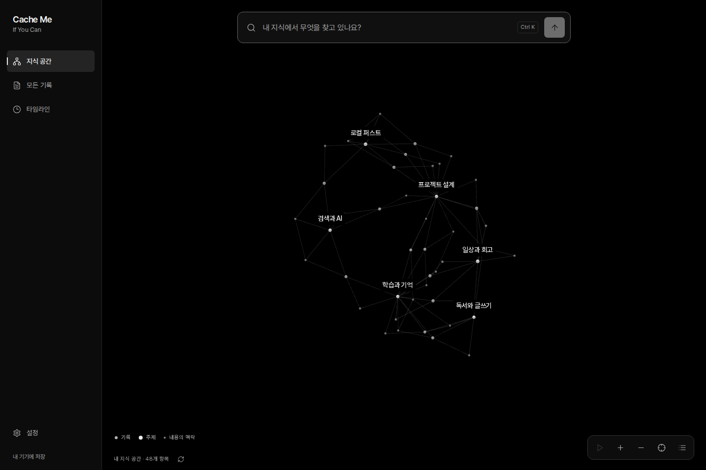
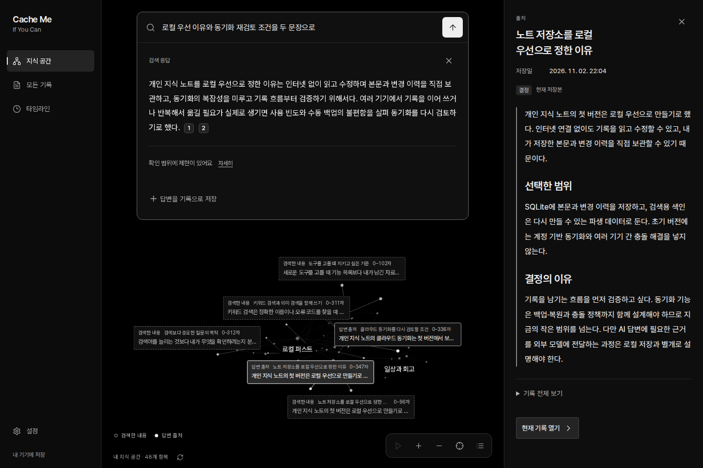
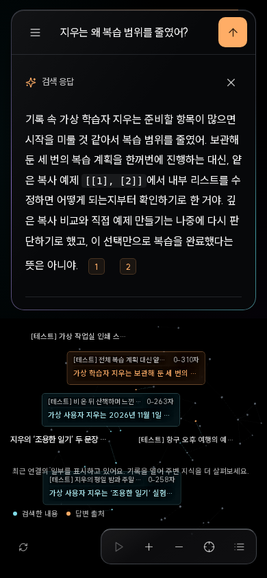
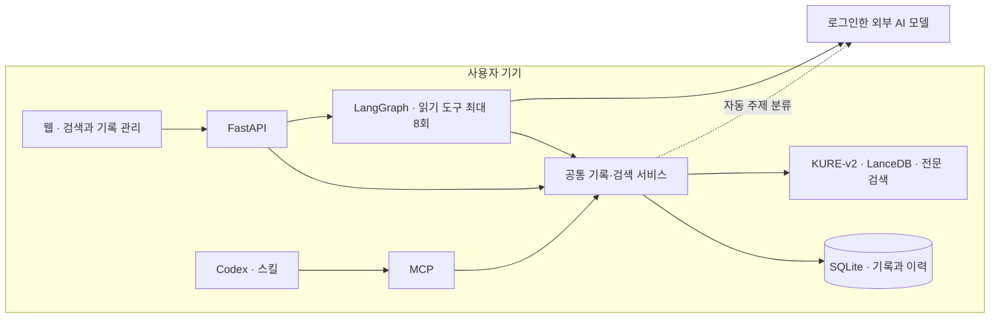

<div align="center">

# Cache Me If You Can

**대화는 지나가도, 배운 건 다시 찾을 수 있게.**

AI와 정리한 지식·경험·생각을 내 기기에 쌓고,<br>
출처와 함께 꺼내 쓰는 세컨브레인.

**로컬 저장 · 한국어 검색**<br>
**Codex MCP · 지식 그래프**

[화면 둘러보기](#화면으로-둘러보기) · [시작하기](#시작하기) · [Codex 연결](#codex에서-사용하기) · [구조](#구조) · [개발과 검증](#개발과-검증)

</div>



대화에서 이해한 개념, 선택의 이유, 하루의 경험을 다시 찾고 싶을 때가 있습니다. Cache Me If You Can은 그 대화에서 **남길 내용만 정리해 저장**하고, 웹과 Codex가 같은 기록을 검색하도록 연결합니다. 답변을 읽다가 작은 출처를 누르면, 오른쪽 패널에서 근거가 된 내용을 바로 확인할 수 있습니다.

> **현재는 로컬 MVP입니다.** WSL/Linux x64·CPU 환경에서 검증했으며 Windows·macOS·Linux 네이티브 지원 범위는 [플랫폼 문서](architecture/platform-support.md)에서 추적합니다. 기록 저장·임베딩은 로컬에서, AI 답변·자동 주제 분류는 로그인한 외부 모델을 통해 동작합니다.

## 이런 순간에 사용하세요

| 대화에서 남기고 싶은 것 | 다음에 꺼내 쓰는 방법 |
| --- | --- |
| 공부하며 이해한 개념과 헷갈렸던 예제 | “얕은 복사를 어떤 예제로 이해했지?” |
| 프로젝트에서 내린 결정과 보류한 조건 | “왜 이 방법을 선택했고, 어떤 조건이 남아 있지?” |
| 하루의 경험과 감정, 나에게 맞았던 방식 | “최근 기록에서 내가 편하게 느꼈던 방식은?” |
| 다시 활용할 초안·프롬프트·참고 자료 | “지난번에 만든 질문 카드를 찾아줘.” |

기록 유형은 **지식 · 경험·회고 · 맥락 · 아이디어·계획 · 결정 · 자료** 여섯 가지입니다. 하나의 기록에 여러 유형을 붙일 수 있고, 아직 분류하지 않아도 저장할 수 있습니다. 주제는 기록을 연결하는 별도 계층으로 관리합니다.

## 화면으로 둘러보기

### 질문 하나, 이어지는 답변 하나

검색창 아래에서 기록을 바탕으로 풀어 쓴 답변을 읽습니다. 작은 출처 번호를 누르면 해당 저장본의 본문과 날짜가 오른쪽에 열립니다. 그래프에는 검색한 내용과 실제 답변 출처가 구분되어 표시됩니다.



<details>
<summary><strong>모바일 화면도 보기</strong></summary>
<br>


좁은 화면에서는 검색과 답변을 먼저 읽고, 메뉴와 출처 패널을 필요할 때 엽니다.

</details>

화면은 **합성 테스트 기록 52개가 있는 실제 앱**에서 촬영했습니다. 답변도 실제 선택 모델의 실행 결과이며, 개인 기록·계정 화면은 포함하지 않았습니다. [촬영 범위](assets/readme/index.md) · [패널을 닫은 검색 화면](assets/readme/search-answer.png)

### 저장에서 다시 찾기까지

1. **남길 내용을 정리합니다.** Codex 대화 중 저장을 요청하거나 웹에서 Markdown 기록을 작성합니다. 대화 전체를 자동 수집하지 않습니다.
2. **기록을 연결합니다.** 본문을 청크로 나눠 로컬에서 임베딩하고, 주제와 관계를 통해 지식을 묶습니다.
3. **질문하고 근거를 확인합니다.** AI가 기록을 검색해 답변하고, 출처 패널과 그래프로 사용한 내용을 보여줍니다.
4. **필요할 때 정정합니다.** 웹과 Codex에서 같은 기록을 수정합니다. 이전 답변의 출처는 당시 저장본을 가리킵니다.

## 무엇이 들어 있나요?

| 기능 | 현재 동작 |
| --- | --- |
| **Codex와 이어지는 저장** | MCP와 `second-brain` 스킬로 추가·검색·정정·확인 후 삭제 |
| **내 기기에 쌓이는 기록** | Markdown 본문과 변경 이력은 SQLite, 검색용 벡터는 LanceDB에 저장 |
| **한국어 하이브리드 검색** | KURE-v2 CPU 임베딩과 전문 검색을 함께 사용 |
| **출처를 확인할 수 있는 답변** | LangGraph 에이전트가 읽기 도구를 최대 8회 호출하고 근거를 답변에 연결 |
| **탐색 가능한 지식 그래프** | 기록·주제·본문 맥락과 검색 근거를 연결해 탐색 |
| **백업 내보내기** | 웹에서 SQLite 정본과 manifest를 ZIP으로 내보내기 |

## 시작하기

현재 배포 방식은 **소스 체크아웃에서 실행**하는 방식입니다. Python 3.12 실행 환경, Git, [uv](https://docs.astral.sh/uv/), Node.js 22와 npm을 준비하세요. GPU는 필수가 아닙니다. 현재 저장소는 비공개이므로 접근 권한이 있는 GitHub 계정으로 인증해야 내려받을 수 있습니다.

```sh
git clone https://github.com/jhpark324/cache-me-if-you-can.git
cd cache-me-if-you-can
python3 scripts/manage.py setup
python3 scripts/manage.py run
```

Windows에서는 `python3` 대신 `py -3` 또는 설치된 `python` 실행기를 사용하세요. `setup`은 잠금 파일에 맞춰 Python·웹 의존성을 설치하고 웹을 빌드합니다. Python wheel 단독 설치에는 웹 화면이 포함되지 않습니다.

서버 실행 후 [http://127.0.0.1:8000/](http://127.0.0.1:8000/)를 엽니다.

1. **새 기록**으로 첫 내용을 저장합니다. 기록 관리에는 모델 로그인이 필요하지 않습니다.
2. 설정에서 **검색 모델 준비**를 실행합니다. 처음에는 KURE-v2를 내려받으므로 시간과 디스크 공간이 필요합니다.
3. AI 답변·자동 분류를 쓰려면 **Continue with ChatGPT**로 로그인하고 모델을 선택합니다.
4. 검색창에서 저장한 내용에 관해 질문하고, 답변의 출처를 열어 확인합니다.

검색 모델은 서버를 다시 실행할 때도 준비해야 하며, 내려받은 파일은 로컬 캐시를 재사용합니다. 계정·플랜에 따른 모델 사용 가능 범위는 연결한 계정에 따릅니다.

[상세 설치·설정·문제 해결](guides/local-development.md) · [운영체제별 검증 범위](architecture/platform-support.md)

## Codex에서 사용하기

서버를 실행한 상태에서 프로젝트 루트에서 연결 설정과 스킬을 설치합니다.

```sh
python3 scripts/manage.py install-codex
```

설치 후 새 Codex 세션에서 스킬을 사용할 수 있습니다. 실행 중인 클라이언트는 설정을 다시 불러와야 할 수 있습니다.

```text
$second-brain 방금 얕은 복사와 깊은 복사를 비교하며 배운 내용을 저장해줘.
이해한 내용과 아직 실험하지 않은 부분을 구분해줘.

$second-brain 지난번 복습 범위를 줄인 이유와 보류한 내용을 찾아줘.

$second-brain 그 기록에 직접 예제를 만들어 확인한 내용을 추가해줘.
```

제품 이름과 별개로 스킬 이름은 `second-brain`, MCP 서버 키는 `second_brain`을 유지합니다. 설치기는 기존 Codex 설정을 보존하며 인증 토큰을 저장소에 복사하지 않습니다.

[Codex 연결 가이드](guides/local-development.md#codex-mcp) · [스킬의 저장·검색 규칙](skills/second-brain/SKILL.md)

<details>
<summary><strong>먼저 체험하고 싶다면: 가상 대화에서 만든 테스트 데이터</strong></summary>

학습·회고·기획·결정·자료 정리 등 40개 시나리오를 제공합니다. “Codex와 대화하다가 남길 내용을 저장해 달라고 요청한 경우”를 가정했으며, 대화 전체는 시험 자료에만 있고 런타임에는 정리한 기록을 저장합니다.

먼저 데이터 자체를 검증합니다. 이 명령은 기록을 추가하지 않습니다.

```sh
python3 scripts/seed_conversations.py validate
```

실행 중인 서버의 검색 모델을 준비한 뒤 다음 명령을 실행하면 **현재 로컬 저장소에 테스트 기록 40개가 추가됩니다.** 제목에 `[테스트]`가 붙으며 같은 데이터의 재실행은 중복을 만들지 않습니다.

```sh
backend/.venv/bin/python scripts/seed_conversations.py import
```

저장 후 색인과 자동 분류 작업이 끝날 때까지 기다린 뒤 검색을 검증합니다. `verify`는 모든 기록의 색인 준비를 확인하므로 준비 중에는 실패할 수 있습니다.

```sh
backend/.venv/bin/python scripts/seed_conversations.py verify
```

Windows의 가상환경 실행기 경로는 `backend\.venv\Scripts\python.exe`입니다. [데이터 구성·검색 평가·사용법](specs/004-local-runtime/record-kinds-and-scenarios.md)을 참고하세요. 소개 화면의 52개 기록에는 기존 데모 12개도 포함되어 있습니다.

</details>

## 구조



| 영역 | 기술 |
| --- | --- |
| 웹 | React · TypeScript · Vite · Radix UI |
| 그래프 | 3d-force-graph · Three.js |
| 서버·에이전트 | FastAPI · LangGraph · LangChain `create_agent` |
| 기록·검색 | SQLite · SQLAlchemy · LanceDB · KURE-v2 |
| 에이전트 연결 | MCP Python SDK v2 · Streamable HTTP |

[현재 시스템 상세](architecture/current-system.md) · [실행 흐름 다이어그램](architecture/runtime-flows.md) · [구조 시각 자료](architecture/overview.html)

## 데이터와 현재 범위

- **로컬 저장과 외부 AI 호출을 구분합니다.** 본문·이력·검색 인덱스는 로컬에 보관하지만, 답변 생성·자동 주제 분류에는 모델 입력이 외부로 전달됩니다. 완전한 오프라인 AI 서비스는 아닙니다.
- **PII 처리는 제한적입니다.** 현재 미들웨어는 모델 입력·출력의 사본에서 이메일·카드 번호·IP 주소를 처리하며 저장 원문을 바꾸지 않습니다. 모든 개인정보가 자동 익명화된다고 보장하지 않습니다.
- **`public` / `private`은 공개 범위 메타데이터입니다.** 현재 외부 공유 기능은 없으며, `private`이 외부 AI 호출 차단을 뜻하지는 않습니다.
- **삭제는 확인 후 soft delete입니다.** 휴지통·복원·자동 영구 삭제는 없고, 내부 이력과 기존 백업에는 내용이 남을 수 있습니다.
- **검색 중심의 단일 턴 응답을 제공합니다.** 일정 관리·알림, 대화 세션 자동 수집, 다중 채팅 이력, 공유·다중 사용자 기능은 현재 범위에 포함하지 않습니다.

## 개발과 검증

명세를 먼저 확인하고 구현·검증 결과를 문서에 반영하는 SDD 방식을 사용합니다. 문서는 모두 `docs/`에서 관리하며, 에이전트와 개발자는 [문서 인덱스](index.md)에서 필요한 문서만 탐색합니다.

```sh
# 등록 후보 검사 · 스크립트/백엔드 시험 · 웹 타입 검사와 빌드
python3 scripts/manage.py check

# 브라우저 회귀 시험
cd frontend
npx playwright install chromium
npm test
```

실제 KURE-v2 CPU 시험에는 모델 snapshot 경로 설정이 필요합니다. 실제 API 통합은 데이터를 생성·수정·삭제하므로 격리된 저장소에서 실행합니다. [검사 재현 방법](guides/repository-readiness.md)을 참고하세요.

2026-11-03 로컬 점검에서 백엔드 **260개**, 웹 회귀 **74개**, 격리 실제 API **3개**가 통과했습니다. 실계정 로그아웃·재로그인과 네이티브 OS는 별도 관문입니다. 로컬 근거와 한계는 [리모트 등록 전 점검 기록](specs/004-local-runtime/prepublish-review-2026-11-03.md), 커밋별 원격 CI 결과는 [GitHub Actions](https://github.com/jhpark324/cache-me-if-you-can/actions)에서 확인합니다.

버그를 제보하거나 변경을 제안할 때는 운영체제·재현 단계·기대 동작을 함께 남겨주세요. 동작을 바꾸는 수정에는 관련 명세와 검증 결과를 함께 갱신하고, 사용자 DB·인증 파일·실제 대화는 저장소에 포함하지 않습니다.

PR은 [PR 작성 규칙](guides/pull-request-convention.md)에 따라 표준 제목과 한글 단답형 본문으로 작성합니다. [PR 템플릿](pull_request_template.md)은 새 PR 작성 시 자동으로 제공됩니다.

## 다음 단계

현재 구현 이후 검토할 방향입니다. 확정된 출시 일정이나 이미 제공하는 기능은 아닙니다.

- 네이티브 운영체제별 설치·실행 검증
- 주제 분류 품질과 많은 기록에서의 검색·그래프 성능 개선
- Markdown·JSON 내보내기, 에이전트용 맥락 묶음 등 기록의 재사용성 확대

[발전 제안과 우선순위](project/evolution-proposals.md) · [다른 세컨브레인 도구와의 비교](research/second-brain-comparison-2026-11.md)

## 라이선스

프로젝트 코드의 배포 라이선스는 아직 선택하지 않았습니다. 공개 배포 전에 저작권자가 결정해야 합니다. 사용 중인 글꼴·의존성·보존한 프로토타입의 라이선스 고지는 유지하며, 모델 가중치·사용자 데이터·인증 파일은 저장소에 포함하지 않습니다. [의존성·라이선스 점검 범위](guides/repository-readiness.md)
