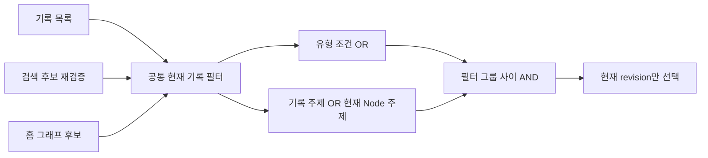
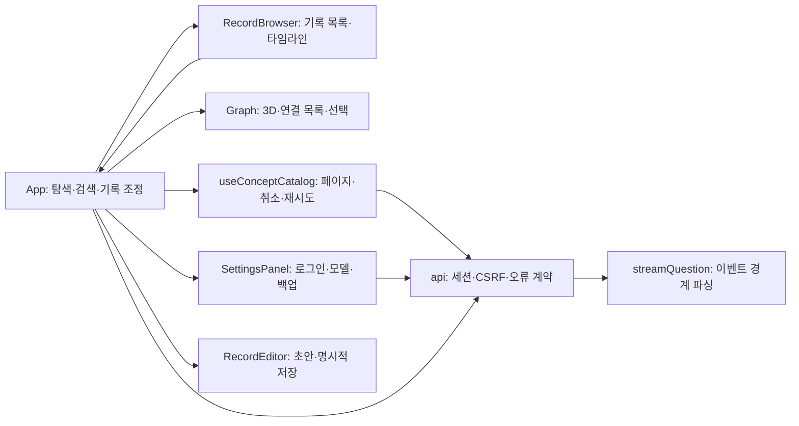

# 목록·검색과 웹 컴포넌트 경계

## 공통 필터 의미

목록·검색·홈 그래프는 [record_filters.py](../../backend/src/cache_me/record_filters.py)의 현재 기록 선택 규칙을 공유한다. 여러 유형은 OR, 여러 주제는 OR로 묶고 유형 그룹과 주제 그룹 사이는 AND로 결합한다. 주제는 현재 revision의 기록 또는 현재 Node에 연결된 주제를 포함한다. 과거 revision의 Node 연결을 현재 기록의 주제로 복제하지 않는다.

목록의 저장일 기간·정렬과 검색의 사건 시점 조건은 구분한다. [RecordBrowser.tsx](../../frontend/src/RecordBrowser.tsx)는 사용자의 현지 월 경계를 UTC 반개구간으로 변환해 목록 API에 보낸다. 타임라인은 기록의 저장일로 묶으며 본문에 적힌 사건 날짜를 대신 사용하지 않는다.

## 웹 컴포넌트 경계

[App.tsx](../../frontend/src/App.tsx)는 홈·기록·타임라인 탐색, 질문과 답변, 기록 상세·출처를 조정한다. 목록 표시와 날짜 묶기는 RecordBrowser, 초안은 RecordEditor, 로그인·모델·백업은 SettingsPanel이 담당한다. 브라우저 뒤로가기와 상세 닫기는 기록을 열었던 보기로 돌아간다.

기록 목록의 필터·기간·정렬과 질문·그래프의 조건은 독립적으로 관리한다. 보이지 않는 그래프는 렌더링을 쉬고 다시 표시할 때 재사용한다. 읽기 요청은 취소·버전을 확인하여 늦은 응답이 현재 화면을 덮지 않게 한다. 저장·삭제 확인·초안 보호의 상태는 단순한 표시 로딩과 구분한다.

공통 네트워크 처리는 [api.ts](../../frontend/src/api.ts)가 맡는다. SSE는 네트워크 청크 경계와 이벤트 경계가 같다고 가정하지 않는다. 모델 답변·근거·한계를 구조화해 받고 출처의 정확한 저장 버전은 서버 계약으로 확인한다.

[시스템 구조](current-system.md) · [실행 흐름](runtime-flows.md) · [작업 공간 명세](../specs/workspace.md)
