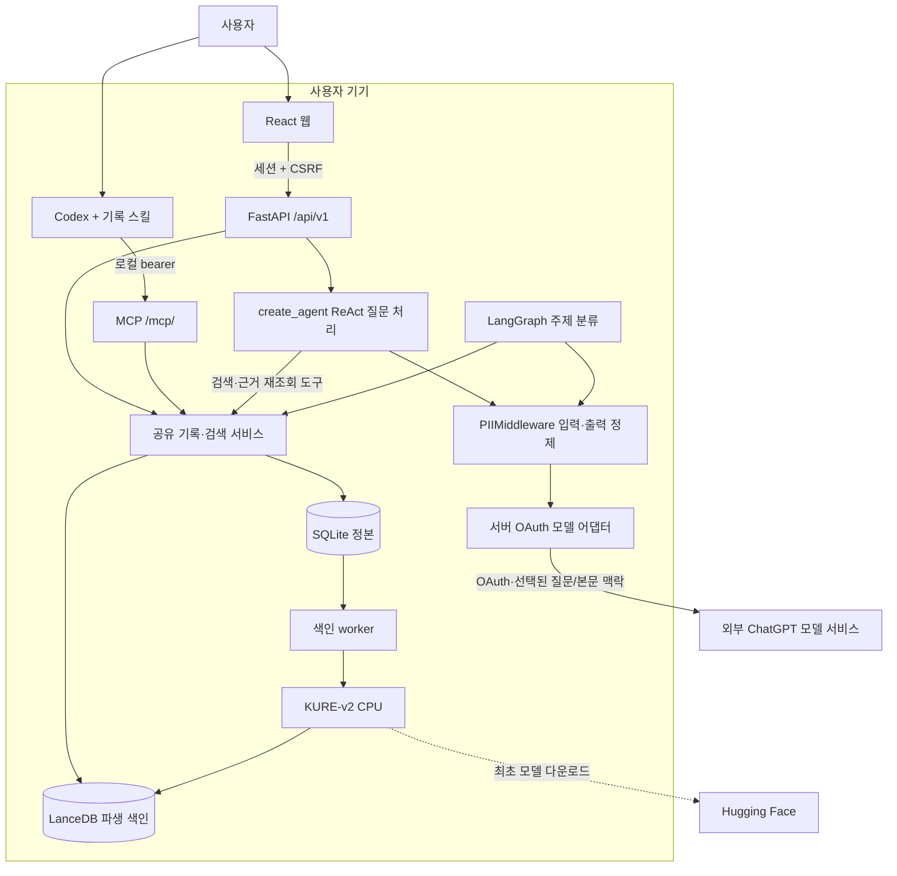
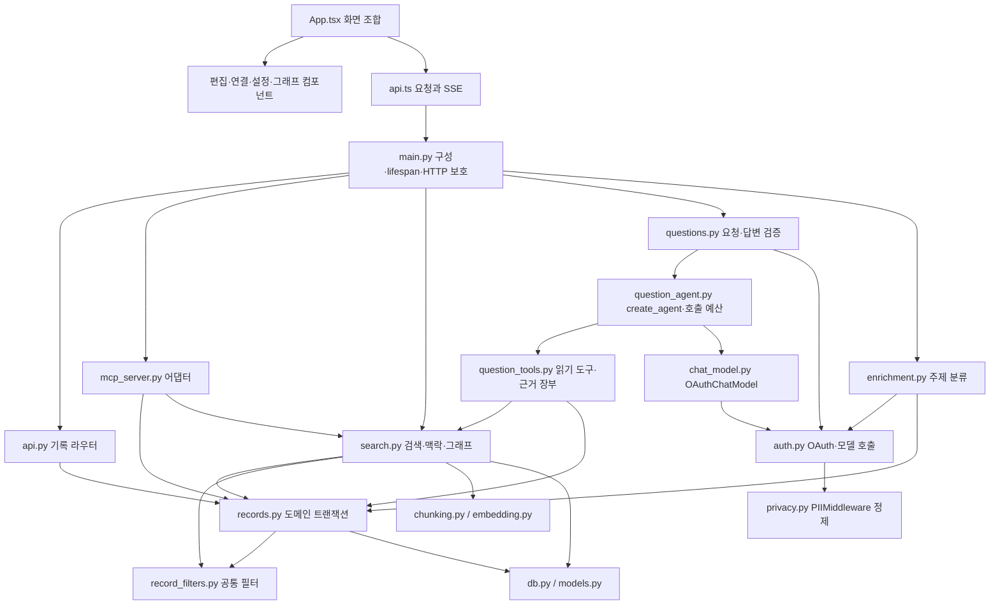
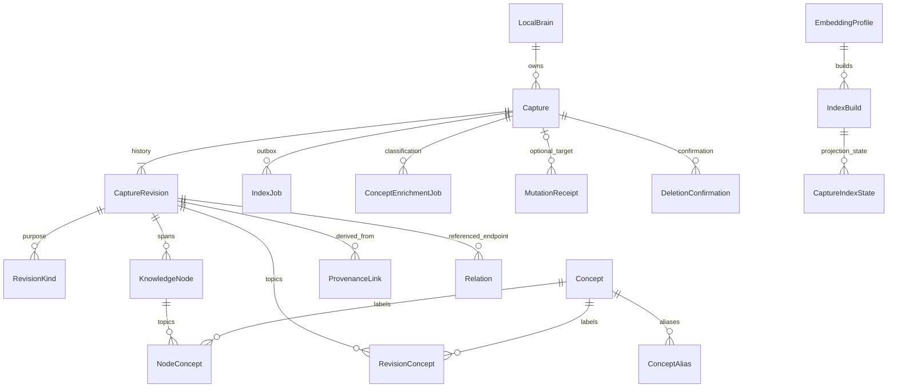
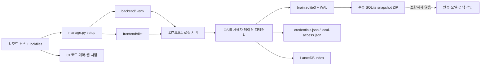

# 현재 구현 구조

2026-11-02 코드 기준이다. 이 문서는 현재 실행 구조를 설명한다. 선택 이유는 ADR, API 제약은 [서비스 계약](service-contracts.md), 종전 통합 결과는 [최종 점검](../specs/004-local-runtime/final-review.md), 이후 실행 변경은 [ReAct·PII 후속 기록](../specs/004-local-runtime/react-agent.md)이 기준이다. Windows·macOS·Linux 전체 지원 완료를 의미하지 않는다.

## 시스템과 신뢰 경계

기록과 검색 색인은 로컬에 저장하지만 답변과 자동 주제 분류는 외부 모델 호출이다. 따라서 **완전한 오프라인 AI 제품으로 표현하지 않는다**. 자체 로그인은 모델 계정 연결이며 로컬 웹 사용자 간 접근 제어·다중 사용자 인증과 다르다. `visibility=public`은 미래 공유를 위한 메타데이터이고 현재 인터넷 공개를 실행하지 않는다. `private`도 현재 모델 전송 금지를 뜻하지 않는다. 공유/전송 정책은 별도 후속 설계다.

모델 경계에서는 내장 `PIIMiddleware`의 이메일·신용카드·IP 탐지 결과를 `redact`로 대체한다. 질문·도구 결과·도구 인수·응답의 전송용 사본에 적용하며 SQLite 정본·revision·SourceRef 위치·출처 패널은 유지한다. 이것은 저장 허용 여부의 판정이나 모든 개인정보의 익명화를 뜻하지 않는다. 이름·전화번호·의미 기반 민감성 판정과 기존 저장 자료의 소급 정제는 포함하지 않는다.

## 실행 모듈

| 경계 | 실제 코드 | 책임·변경 시 함께 확인할 항목 |
| --- | --- | --- |
| 조립·수명 | [main.py](../../backend/src/second_brain/main.py) | 서버 lock, 작업 취소, 세션/CSRF·Origin·Host, 정적 웹, 백업 |
| 계약 | [schemas.py](../../backend/src/second_brain/schemas.py), [outputs.py](../../backend/src/second_brain/outputs.py) | 웹/MCP 입력·출력. 프런트 [types.ts](../../frontend/src/types.ts)는 수동 동기화이므로 계약 변경 시험 필요 |
| 정본 변경 | [records.py](../../backend/src/second_brain/records.py) | 요청 멱등성, expected revision/state, 저장·삭제·주제·관계와 출처 검증 |
| 공통 선택 | [record_filters.py](../../backend/src/second_brain/record_filters.py) | 여러 유형은 OR, 여러 주제는 OR, 두 그룹은 AND. 현재 Node의 주제도 부모 기록 선택에 반영 |
| 파생 색인 | [search.py](../../backend/src/second_brain/search.py), [embedding.py](../../backend/src/second_brain/embedding.py) | 색인 세대, 모델 프로필, 검색 후 SQLite 재검증. 현재 제품은 정확 벡터 검색이며 ANN 실험과 구분 |
| 질문 실행 | [questions.py](../../backend/src/second_brain/questions.py), [question_agent.py](../../backend/src/second_brain/question_agent.py), [question_tools.py](../../backend/src/second_brain/question_tools.py) | ReAct 읽기 도구 총 8회, 에이전트 모델 9회와 별도 검토 1회, 요청 90초. 근거 ID·버전·필터는 서버 소유 |
| 모델 연결·PII | [chat_model.py](../../backend/src/second_brain/chat_model.py), [auth.py](../../backend/src/second_brain/auth.py), [privacy.py](../../backend/src/second_brain/privacy.py) | 기존 OAuth, 메시지·function call 왕복, 완료 후 응답 반환, 내장 PII 탐지. 인증 비밀은 그래프 상태에 넣지 않음 |
| 자동 분류 | [enrichment.py](../../backend/src/second_brain/enrichment.py) | 기존 LangGraph 분류·커밋 흐름 유지. 본문 저장·로그인·임베딩과 독립 실패 가능 |
| 데이터 수명 | [db.py](../../backend/src/second_brain/db.py), [마이그레이션](../../backend/alembic/versions/0001_canonical_records.py) | 짧은 `BEGIN IMMEDIATE`, WAL, 외래키, immutable trigger, 복원 금지 |
| 웹 상호작용 | [App.tsx](../../frontend/src/App.tsx), [RecordEditor.tsx](../../frontend/src/RecordEditor.tsx), [RecordConnections.tsx](../../frontend/src/RecordConnections.tsx) | 단일턴 검색, 필터, 출처 drawer, 명시적 CRUD. 저장 여부와 로딩·실패 표시 |

한 로컬 서버 프로세스에서 동작한다. 분산 큐·별도 벡터 서버·그래프 DB·LangSmith·영구 대화 체크포인터는 필수가 아니다. 두 DB의 작업을 하나의 원자적 트랜잭션으로 간주하지 않는다.

## 정본 데이터 관계

ER 도식은 주요 연관을 압축했다. 정확한 FK·복합 키·제약은 [models.py](../../backend/src/second_brain/models.py)와 migration이 기준이다. 특히 `Relation`은 양 끝점과 근거, `ProvenanceLink`는 파생 revision과 원출처 revision/구간을 참조한다.

`Capture`는 삭제·공개 범위·현재 revision 포인터를 가진다. 본문은 immutable `CaptureRevision`에만 보관한다. Node는 본문의 Unicode code point 반개구간을 가리키며 별도 원문이 아니다. Concept는 자유 주제와 별칭, RecordKind는 정리본의 재사용 목적, 청크는 모델 토큰 상한에 맞춘 파생 검색 단위다. 네 가지를 한 태그 필드로 합치지 않는다.

## 배포 파일과 실행 데이터

현재 지원하는 설치 경로는 **소스 checkout + uv 환경 + 프런트 빌드**다. Python wheel에는 migration이 들어가지만 프런트 번들은 포함하지 않는다. wheel 하나를 완성된 데스크톱 제품처럼 배포해서는 안 된다. 실제 로그인·모델·네이티브 OS 검증은 CI의 모형 기반 검사와 별도다.

상태 전이와 시간 순서는 [실행 흐름](runtime-flows.md), 기술 부채와 우선순위는 [유지보수 점검](maintenance-review.md)을 참고한다.
