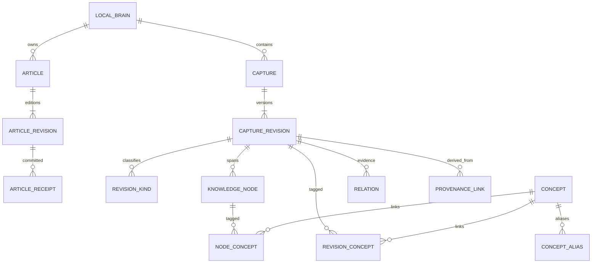

# 데이터 스키마

- 상태: 현재 공통 논리 스키마. 실행 DDL은 코드와 migration이 기준
- 작성일: 2026-11-02
- 기준: [제품 기획](../project/product-brief.md), [기록·공개 범위](../project/record-and-visibility.md), [지식 계층](knowledge-layer.md), [검색 설계](search-and-embedding.md)
- 용어: [도메인 용어](../project/domain-language.md)
- 입출력 계약: [MCP·웹 서비스 계약](service-contracts.md)

기존 계층을 필드·타입·제약으로 옮긴 공통 설계다. 실제 [ORM](../../backend/src/cache_me/models.py), [고정 baseline 0001](../../backend/alembic/versions/0001_canonical_records.py), [주제 보강 테이블 추가 0002](../../backend/alembic/versions/0002_topic_backfill.py), [아티클 메타데이터 추가 0003](../../backend/alembic/versions/0003_article_metadata.py), [독립 아티클로 이전하는 0004](../../backend/alembic/versions/0004_independent_articles.py)가 구현되어 있다. 0002는 기존 주제를 작업으로 등록하지 않는다. 0003은 기존 기록 버전의 본문과 출처를 보존한다. 이 문서의 논리 이름·범위와 물리 테이블은 구분하며 [현재 ER 도식](current-system.md#정본-데이터-관계)과 [검증 안내](../guides/testing.md)을 함께 확인한다.

## 공통 규약

| 항목 | 규약 |
| --- | --- |
| ID | 서버가 생성하는 UUID 문자열. SQLite에서는 TEXT. 제목·내용 해시를 기록 ID로 쓰지 않는다. |
| 시각 | 시스템 시각은 UTC RFC 3339, 밀리초 정밀도. 사건·계획 시각은 별도 부분 날짜 타입을 사용한다. |
| 본문 | `body_markdown`에 사용자가 저장하기로 한 전체 정리본을 보존한다. 원본 AI 대화·세션·숨은 추론은 저장하지 않는다. |
| 문자열 위치 | 저장한 본문의 Unicode code point 기준, 0부터 시작하는 반개구간 `[start, end)`. UTF-8 바이트나 JS UTF-16 인덱스와 구분한다. 저장 후 공백·개행·Unicode를 임의 정규화하지 않는다. |
| enum | API에서 문자열 enum, SQLite에서 TEXT + CHECK. 알 수 없는 값은 검증 오류이며 임의로 기본값으로 바꾸지 않는다. |
| JSON | 선택적 구조 필드만 버전이 있는 타입으로 검증한다. 전체 도메인을 임의 JSON 하나로 저장하지 않는다. |
| 소유 범위 | 단일 로컬 `brain_id`를 서버 실행 맥락에서 정한다. 모델 입력이나 MCP `clientInfo`를 소유권 증거로 사용하지 않는다. 다중 사용자·공유 계정 스키마는 후속 범위다. |
| 동시성 | 기록 버전(`revision`)과 별도로 상태 버전(`state_version`)을 둔다. 모든 사용자 변경은 기대 버전과 비교하고 다르면 충돌을 반환한다. |

주제 연결·Node·관계 양 끝점·근거 revision·출처·검색 프로필/build·삭제 확인은 모두 같은 `brain_id` 범위여야 한다. UUID가 존재한다는 확인만으로 다른 범위의 참조를 허용하지 않는다. 복합 FK와 생성/변경 트랜잭션에서 같은 범위를 검증한다. 삭제한 기록도 정본과 이력을 보존하므로 출처와 작업의 FK 참조를 유지할 수 있다. 단일 brain 운영이라는 가정으로 이 검증을 생략하지 않는다.

## 핵심 저장 구조 — SQLite

### `local_brain` — 로컬 저장소 경계

- `id: UUID PK`, `created_at: datetime`
- `active_index_build_id: UUID?` → 현재 검색 테이블을 가리키는 `index_builds.id`
- 현재는 한 개만 사용한다. 이 테이블은 로그인 토큰이나 대화 기록을 저장하지 않는다.

### 아티클과 발행 이력

| 테이블 | 저장 내용 |
| --- | --- |
| `articles` | 글의 고정 ID, `brain_id`, 현재 버전 ID, 생성·수정·삭제 시각. 현재 버전은 이 글의 버전만 가리키며 커밋 시점에 검증한다. |
| `article_revisions` | 버전별 제목·요약·Markdown 본문, 순서를 유지하는 인용과 주제 배열, 버전 번호와 생성 시각. 동일 글의 버전 번호는 유일하며 발행 후에는 수정·삭제할 수 없다. |
| `article_receipts` | 호출자 범위와 요청 ID별로 발행·수정 요청의 지문, 아티클 ID와 커밋한 버전 ID를 보존한다. |

0004는 0003 형식으로 발행한 글과 아티클 버전을 같은 ID로 옮긴다. 버전별 인용과 연결 주제, 이미 삭제한 글의 삭제 시각을 보존한다. 이전 기록 사본에는 삭제 표시를 하고 색인 제거 작업을 등록한다. 기존 출처 참조의 무결성을 위해 이전 `capture_revisions.article` 값은 보관한다. 이후 쓰기와 읽기의 계약은 [학습 아티클 명세](../specs/articles.md)를 따른다.

### `captures` — 기록의 안정적인 식별자·현재 상태

| 필드 | 타입·기본값 | 의미·제약 |
| --- | --- | --- |
| `id` | UUID PK | 수정해도 유지하는 기록 ID |
| `brain_id` | UUID FK | 로컬 소유 범위 |
| `current_revision_id` | UUID FK | 이 기록에 속한 현재 revision; 서로 다른 기록의 revision 금지 |
| `visibility` | `public \| private`, 기본 `public` | 별도 `private` boolean 없음. 공개 게시 여부와 구분 |
| `deleted_at` | UTC datetime 또는 null, 기본 null | null이면 조회 대상. 삭제 시 서버가 시각을 설정하며 제품 경로에서 null로 되돌리지 않음 |
| `state_version` | integer ≥ 1 | 본문·공개 범위·삭제·서버 주제 연결 등 커밋된 내용·상태 변경에서 증가 |
| `index_generation` | integer ≥ 1 | 검색 내용·자격에 영향을 주는 변경마다 증가하는 기록별 세대 |
| `created_at`, `updated_at` | datetime | 시스템 생성·변경 시각 |

`current_revision_id`는 같은 `capture_id`의 revision만 가리키도록 복합 외래키와 트랜잭션으로 보장한다. 최초 기록과 첫 revision은 같은 트랜잭션에서 생성하며 커밋 시 현재 revision이 없는 기록을 허용하지 않는다. 이를 위한 지연 외래키 설정은 마이그레이션 검증 항목이다.

삭제는 사용자 재확인 후 `deleted_at`에 서버의 현재 UTC 시각을 설정하는 soft delete다. 같은 트랜잭션에서 `state_version/index_generation`을 증가시킨다. 목록·상세·이력·Node·그래프·검색·QA·수정은 `deleted_at IS NULL`인 기록만 대상으로 한다. 삭제한 데이터는 내부적으로 보존하지만 삭제 목록·`include_deleted`·복원·undo 경로는 제공하지 않는다. 보관 기한이나 자동 삭제도 두지 않는다.

### `capture_revisions` — 불변 기록 버전

| 필드 | 타입·기본값 | 의미·제약 |
| --- | --- | --- |
| `id` | UUID PK | 저장본 참조에 사용하는 revision ID |
| `capture_id` | UUID FK | 부모 기록 |
| `revision_no` | integer ≥ 1 | `UNIQUE(capture_id, revision_no)` |
| `title` | string? | 제목 없이 저장 가능 |
| `body_markdown` | 비어 있지 않은 string | 실제 저장한 전체 내용; 임베딩 입력 길이로 자르지 않음 |
| `concept_hints` | 검증한 string 배열, 기본 `[]` | 요청자가 준 선택적 분류 힌트. 실제 주제 연결은 revision_concepts에 저장 |
| `completion_state` | `incomplete \| completed` 또는 null, 기본 null | 내용에 완료 여부가 있을 때만 사용; 생성 시 미완료를 추정하지 않음 |
| `event_time` | `EventTime?` | 본문이 말하는 사건·계획의 시각; 알 수 없으면 null |
| `node_status` | `absent \| current \| stale`, 서버 계산 | Node가 없는 기록과 본문 변경으로 기존 구조가 유효하지 않은 기록을 구분 |
| `change_kind` | `create \| edit \| merge \| completion_change \| source_review \| concept_enrichment` | 서버가 수행한 변경 유형. 자동 주제 연결은 concept_enrichment |
| `review_reason` | string? | `source_review`에서는 비어 있지 않은 변경 이유 필수. 그 외에는 null |
| `created_via` | `web \| mcp \| import \| system` | 입력 경로. system은 서버 후속 주제 연결에 사용하며 발화자·사실 검증 여부를 뜻하지 않음 |
| `created_at` | datetime | 이 저장본의 생성 시각 |

수정·병합·완료 변경·출처 재검토는 새 revision을 추가한다. 공개 범위나 삭제 여부만 바꿀 때에는 본문 revision을 복제하지 않고 Capture의 상태 버전과 색인 세대를 갱신한다. 이전 revision도 현재 부모 기록의 공개 범위를 따르며 부모가 삭제되면 제품 경로로 조회할 수 없다.

주제·유형·Node·출처 등 내용 메타데이터 변경의 `change_kind`는 `edit`다. 완료 상태만 바꾸면 `completion_change`, 다른 내용 변경이 함께 있으면 `edit`, 병합 전용 명령은 `merge`, 출처 재검토 전용 명령은 `source_review`로 기록한다. 과거 revision과 그 Node는 변경하지 않는다. 새 revision에 Node를 승계하거나 제출할 때에는 새 Node ID를 만들며, 구조 상태와 안전한 승계 범위는 아래 규칙을 따른다.

서버의 저장 후 분류나 주제 정의 변경 보강으로 주제 연결만 수행한 변경은 위 일반 수정과 구분해 `concept_enrichment`로 남긴다. 본문·의미 필드를 유지하면서 새 revision의 주제 연결만 바꾼다. 저장 후 분류는 작업의 `applied_revision_id`, 보강은 정의·내용·정책별 판단을 연결 변경과 함께 기록한다. 상세한 원자적 반영·재시도·실패·명시적 정정 규칙은 [주제 연결 계약](ingestion-and-chunking.md)을 따른다.

`EventTime`은 `{expression?, precision, value?, timezone?}` 형태다. `precision`은 `unknown | year | month | day | instant`, `value`는 정밀도에 맞는 ISO 표현이다. 예를 들어 `2026-11`은 월 단위 값으로 보존하며 11월 1일 자정으로 바꾸지 않는다. 해석하지 못한 “지난 여름”은 원래 표현과 `unknown`으로 남긴다. 입력 경로만 보고 사건 시각을 저장 시각으로 채우지 않는다.

### `revision_kinds` — 여러 기록 목적

- `revision_id: UUID FK`, `kind: knowledge | context | episode | idea | decision | artifact`
- 위 6개는 현재 입력·출력 기준이다. 불변 이력의 DB 제약은 과거 `procedure/reflection/plan`도 보존하며, 조회·필터에서 `knowledge/episode/idea`로 해석한다. 기존 이력 행을 직접 갱신하지 않는다.
- 복합 PK `(revision_id, kind)`, 기본은 빈 집합. 기록 전체의 재사용 목적이며 여러 유형을 함께 지정할 수 있다. 미분류 `[]`도 본문으로 검색 가능해야 한다.
- 각 값의 의미·예외·입력 별칭의 정규화는 [기록 유형](../project/record-types.md)을 따른다. DB 이력을 재작성하는 마이그레이션 없이 입력 정규화·조회·필터 호환 계층으로 적용한다.
- `idea`는 구상·목표·향후 단계를 포함하며 일정·알림·반복 일정 테이블을 만들지 않는다. `context`는 특정 대상·상황의 조건이지 모든 대화에 항상 적용되는 지시가 아니다. `artifact`는 현재 Markdown 안의 재사용할 텍스트·코드를 뜻한다.
- 유형이 Node의 종류·발화자·확인 상태·완료 여부를 대신하지 않는다. `decision`에는 명시적으로 선택한 내용이 있어야 하며 유형만으로 선택·실행 사실을 추정하지 않는다.

### `knowledge_nodes` — 선택적인 세부 항목

- `id: UUID PK`, `revision_id: UUID FK`, `ordinal: integer`
- `UNIQUE(revision_id, ordinal)`. 같은 본문과 의미를 승계할 때 ordinal과 필드 비교로 이전 Node와 새 Node를 대응시킨다.
- `kind: explanation | interpretation | hypothesis | question | event | emotion | proposal | decision | action | result`
- `body_start: integer`, `body_end: integer`, `label: string?`
- `concept_hints: string[]`, 기본 `[]`: Node 구간의 선택적 분류 힌트이며 실제 연결은 node_concepts에 저장
- `origin: user_report | user_interpretation | ai_explanation | unspecified`, 기본 `unspecified`
- `verification_state: unknown | unverified | verified`, 기본 `unknown`; `verification_note: string?`
- 본문 범위가 실제로 존재해야 한다. 내용은 부모 본문을 가리키며 별도 정본으로 복제·독립 편집하지 않는다.
- 짧은 메모는 Node 없이 저장할 수 있다. 모든 본문을 의미 Node로 분류할 의무도 없다.
- `origin`과 사실 검증은 별개다. `verified`는 입력에서 명시한 확인 상태와 근거 설명이 있을 때만 보존하며 AI 작성·출처 존재만으로 자동 부여하지 않는다.

`node_status`는 서버가 다음 규칙으로 계산하며 모델이 임의로 `current`를 선언하지 않는다.

| 입력·변경 | 새 revision의 Node·상태 |
| --- | --- |
| 최초 저장에 Node가 없거나 사용자가 Node 분류 제거를 명시해 `nodes=[]` 제출 | Node 없음, `absent` |
| 유효한 본문 범위의 Node를 명시적으로 제출 | 새 ID로 저장, `current` |
| 본문이 같고 Node 입력 생략 | 기존 Node·Node 주제를 새 ID로 복제하고 기존 상태 유지 |
| 본문 변경, Node 입력 생략, 이전에 구조가 있었거나 이미 stale | 옛 span을 복제하지 않음, Node 없음, `stale` |
| 본문 변경, Node 입력 생략, 이전 상태가 absent | Node 없음, `absent` |

`current`는 제출한 구조가 현재 본문 범위를 가리킨다는 뜻이며 내용의 사실성이나 의미 추출 정확성을 검증했다는 뜻이 아니다. `stale`은 응답과 화면에서 구조 재정리가 필요함을 표시한다. 전체 본문과 검색 청크는 계속 사용할 수 있지만 이전 Node·Node 주제·관계를 새 본문에 연결하지 않는다. 재정리는 명시적인 수정으로 Node를 제출해 처리하며 서버의 추가 LLM 호출을 필수로 하지 않는다.

### `concepts`, `concept_aliases`, `revision_concepts`, `node_concepts` — 주제와 연결

| 테이블 | 필드·제약 |
| --- | --- |
| `concepts` | `id: UUID PK`, `brain_id: UUID FK`, `name: string`, `description: string?`, `state_version: integer ≥ 1`, `created_at`, `updated_at`. 수정은 기대 state_version과 비교 |
| `concept_aliases` | `concept_id: UUID FK`, `alias: string`; PK `(concept_id, alias)` |
| `revision_concepts` | `revision_id: UUID FK`, `concept_id: UUID FK`; PK `(revision_id, concept_id)` |
| `node_concepts` | `node_id: UUID FK`, `concept_id: UUID FK`; PK `(node_id, concept_id)`. 선택적인 Node별 주제 연결 |

주제 이름·별칭에 전역 UNIQUE를 걸지 않는다. 이름이 같다는 이유로 합치지 않고 ID로 구분한다. 현재 기록에 적용할 주제 목록도 해당 revision에 묶는다. 일반 기록/Node 입력은 `concept_hints[]`를 사용하고 서버가 결정한 ID를 FK로 저장한다. 조회 응답은 실제 Concept 객체·ID를 반환하며 명시적 연결 정정과 검색 필터에는 ID를 사용한다. 기록 주제를 모든 Node에 자동 복제하지 않는다. Node 주제가 기록 주제와 같아야 할 의무는 없지만 같은 brain에 속해야 한다. `absent/stale`에는 현재 Node 주제가 없다. 표시 가능한 기록·Node와 연결되지 않은 주제를 그래프에 무조건 노출하지 않는다.

### `relations` — 저장본 사이의 근거 있는 관계

- `id: UUID PK`, `brain_id: UUID FK`
- `source_revision_id: UUID FK`, `source_node_id: UUID?`
- `source_body_start/end: integer?`: 둘 다 null이거나 유효한 본문 구간. Node도 있으면 해당 Node 안의 구간
- `target_revision_id: UUID FK`, `target_node_id: UUID?`
- `target_body_start/end: integer?`: source와 같은 구간 규칙
- `relation_type: related_to | clarifies | corrects | supports | contradicts | merged_from | supersedes`. 한국어 표시는 [관계 유형과 표시 이름](../project/domain-language.md#관계-유형과-표시-이름)을 따른다.
- `evidence_revision_id: UUID FK`, `evidence_start/end: integer?`, `created_at`
- `scope_note: string?`, `evidence_note: string?`: `supersedes`에서는 둘 다 비어 있지 않아야 함
- `withdrawn_at: datetime?`, `withdrawal_reason: string?`: 기본 null. 명시적인 `relation_retract`에서 최초 철회 시각·이유를 기록
- Node·span이 모두 없으면 그 저장본 전체를, 있으면 지정한 구간을 끝점으로 사용한다. Node와 revision의 소속을 복합 FK로 확인한다. 관계 방향은 source → target이다. 관계를 찾을 때 양쪽 끝점을 조회할 수 있지만 `related_to` 외의 관계에서 의미 방향을 뒤집지 않는다.
- 지식 그래프에서는 revision을 부모 Capture로 묶어 표현한다. 기록 주제는 `revision_concepts`, Node 주제는 `node_concepts`에서 구성하므로 종류가 다른 ID를 하나의 검증 없는 외래키 필드에 섞지 않는다.
- `withdrawn_at IS NULL`이고 양 끝점·근거 기록의 `deleted_at IS NULL`인 관계만 조회·맥락 해석에 사용한다. 현재 revision 또는 아래의 엄격한 근거 동등성을 확인한다. 기록 삭제나 관계 철회 뒤에도 행은 내부 보존한다. 유사도를 인과관계로 바꾸는 relation type은 두지 않는다.

`corrects`는 이전 설명·주장에 오류가 있어 정정한다는 관계다. `supersedes`는 이전 조건이 당시에는 맞았더라도 사용자가 적용 조건·선호·결정을 명시적으로 변경했음을 나타내며 **새 내용 → 이전 내용** 방향이다. `scope_note`에 적용 대상·상황·알려진 시점을, `evidence_note`와 근거 본문 구간에 명시적인 변경 발언을 보존한다. 주제 이름이나 저장 시각만으로 이 관계를 생성하지 않는다.

`supersedes`의 양 끝점은 각각 Node 또는 명시적인 본문 span으로 대체할 범위를 한정한다. 혼합 기록의 한 조건을 대체했다고 부모 기록 전체를 무효화하지 않는다. Node가 없고 해당 구간·적용 범위도 불명확하면 현재 조건의 대체를 확정하지 않는다. 순환 대체 관계를 허용하지 않으며, 검색에서 관련 변경을 찾을 때에는 양방향으로 확인하되 새→이전이라는 의미 방향은 유지한다. 조건 대체 자체는 기록 병합·내용 수정·완료 처리·삭제를 수행하지 않는다.

관계의 끝점·종류·근거·scope/evidence note는 생성 후 불변이다. 잘못된 관계는 `relation_retract`로 한 번 철회하고 이유를 남긴다. `withdrawn_at`과 `withdrawal_reason`은 둘 다 null이거나 시각과 비어 있지 않은 이유를 함께 가진다. 별도 관계 버전은 두지 않으며 관계 ID·request ID로 최초 철회를 원자적으로 처리한다. 같은 요청 재시도는 최초 철회 결과를 반환하고 이유를 덮어쓰지 않는다. 이미 철회된 관계를 다른 요청으로 수정·재활성화하지 않는다. 필요한 새 관계는 별도 ID로 생성하며, 철회 시 모든 끝점과 근거의 현재 조회 자격을 검증한다.

### 본문 의미가 바뀌지 않은 메타데이터 수정의 승계

유형·기록/Node 주제 같은 분류 메타데이터만 바뀌어 새 revision이 생겼다는 이유로 기존 관계와 파생 출처를 모두 무효화하지 않는다. 다음 항목이 모두 동일할 때만 두 revision을 **근거가 동등한 저장본**으로 취급한다.

- 제목·전체 본문 문자열·완료 상태·사건 시각이 동일하다.
- `node_status`가 같고, Node를 ordinal로 대응했을 때 span·kind·label·origin·verification 상태와 설명이 모두 동일하다. Node ID·revision ID는 비교에서 제외한다.
- 직접·알려진 상위 SourceRef 집합이 동일하고, 그 출처가 현재도 조회 가능하며 유효하다. 출처 재검토 명령은 동등성을 이용한 자동 검토 완료 대상에서 제외한다.

이 기준은 LLM이 의미가 비슷하다고 판단하는 방식이 아니라 저장 필드의 엄격한 비교다. 따라서 본문·Node 의미·채택/완료 상태·시점·출처가 바뀌면 자동 승계하지 않는다. 분류 값 자체를 사실성·채택 여부의 대체 표현으로 사용하지 않는 규칙도 유지한다.

저장된 Relation·SourceRef의 원래 revision·Node·본문 위치는 변경하지 않는다. 조회 시 현재의 동등한 revision·Node로 대응시켜 읽을 수 있지만 원래 참조와 현재 대응 참조를 구분한다. 최종 응답은 대응 관계와 현재 삭제·공개 범위·상위 출처를 검증한다. 본문이 달라진 기록의 옛 Node나 과거 관계를 이 경로로 되살리지 않는다. 검색 청크와 색인 세대는 메타데이터 수정에서도 현재 revision 기준으로 갱신한다.

### `provenance_links` — 파생 정리본의 출처

- `id: UUID PK`, `derived_revision_id: UUID FK`
- `source_capture_id: UUID FK`, `source_revision_id: UUID FK`, `source_node_id: UUID FK?`: 출처 revision이 해당 Capture에, Node가 해당 revision에 속하는지 복합 FK로 검증한다.
- `source_body_start: integer?`, `source_body_end: integer?`: 둘 다 null이거나 둘 다 존재해야 한다. 지정하면 원본 revision 본문 범위 안에 있어야 하고, Node도 지정하면 해당 Node 범위에 포함돼야 한다. Node가 없는 청크 출처의 사용 구간도 보존한다.
- `review_state: valid | needs_review`, `reason: source_changed | source_deleted | upstream_invalid` 또는 null
- 생성 시 SourceRef가 존재하고 접근 가능하며 사용한 저장본과 맞는지 확인한다. 파생 정리본을 재요약하면 알려진 상위 출처 관계도 이어간다. 순환 의존성을 허용하지 않는다.
- 출처가 soft delete되어도 정본·revision·Node와 출처 연결을 모두 내부 보존한다. 이 연결을 없애서 파생 기록을 독립 지식처럼 취급하지 않는다. 본문·제목은 이 표에 복사하지 않으며 삭제된 출처의 제품 조회를 허용하지 않는다.
- 일반 수정은 기존 출처와 제출된 SourceRef의 합집합을 새 revision에 이어간다. 빈 `sources` 배열이나 생략으로 알려진 의존성·재검토 사유를 지우지 않는다. 출처 집합 교체는 아래 전용 명령으로만 처리한다.
- 현재 원본의 `deleted_at`·revision·상위 출처를 읽어 검증한다. `review_state=valid`라는 캐시 값만 믿지 않는다. 원본 revision이 다르더라도 위의 엄격한 근거 동등성을 만족하면 `source_changed`를 자동 부여하지 않는다. 내용이 달라졌거나 삭제됐거나 상위 출처가 무효하면 의존하는 파생 내용을 QA 근거에서 제외한다.
- 미래 공유 시에도 본문 `visibility=public`만으로 파생 결과를 공유하지 않는다. 필요한 출처의 접근 범위까지 확인하는 정책은 공유 명세에서 정한다.

### 명시적인 출처 재검토

`capture_review_sources`는 삭제되지 않은 대상의 기대 revision·상태 버전, 비어 있지 않은 `review_reason`, 검토 후의 전체 `replacement_sources`와 필요 시 새 본문·Node를 받는다. 새 대상 revision을 `change_kind=source_review`로 만들고 그 revision의 출처 집합을 교체한다. 과거 대상 revision과 당시 출처 연결은 그대로 보존한다. 일반 PATCH와 이 명령의 의미를 섞지 않는다.

대체할 출처는 같은 brain에 존재하고 삭제되지 않았으며, 현재 또는 근거 동등성이 검증된 revision이어야 한다. 상위 의존성과 순환 여부를 다시 확인한다. 출처 제거·교체 이유와 수정한 내용이 서로 맞는지 재검토하며, 단순히 `replacement_sources=[]`를 제출했다는 이유로 독립 지식이나 확인된 사실로 승격하지 않는다.

삭제된 원본에 대한 의존성을 없애려면 그 원본에만 의존하던 내용을 재작성·제외하고 변경 이유를 남긴다. 이 경우 서버는 기존과 다른 `body_markdown`과 비어 있지 않은 `review_reason`을 최소 요건으로 확인한다. 필요하면 접근 가능한 대체 근거를 연결하고, 남은 내용을 사용자 진술·독립적으로 확인한 내용·AI 보충 설명 중 실제 성격에 맞게 보존한다. 삭제된 원본을 다시 노출하거나 원문 대조가 이뤄졌다고 주장하지 않는다. API의 ID·span·본문 변경 검증은 내용의 진실성과 독립성을 자동 검증하는 절차가 아니며 재검토 때문에 `verification_state=verified`를 자동 부여하지 않는다.

새 출처 집합이 유효하고 위 재검토 요건을 충족한 경우에만 새 revision을 QA 근거로 다시 사용할 수 있다. 명령에 제출한 출처나 그 상위 의존성이 무효하면 요청을 거부하고 기존 재검토 상태를 유지한다. 검토 이후 출처가 다시 바뀌면 일반 출처 검증 규칙을 적용한다. 동시 변경·새 색인 작업·멱등성 영수증은 다른 수정과 같은 트랜잭션 규칙을 따른다.

## 검색·작업 상태 — SQLite

| 테이블 | 핵심 필드·제약 |
| --- | --- |
| `embedding_profiles` | `id`, `brain_id FK`, `model_id`, `model_revision`, `representation=multi_vector`, `token_dimension=128`, `dtype=float32`, `normalization`, `metric=cosine`, `scoring=maxsim`, `query_tokens=64`, `document_tokens=512`, `overlap_tokens=64`(강제 분할 시 최대값), `context_prefix_tokens=64`, `small_section_tokens=128`, `input_rules_version`, `chunk_rules_version=markdown-v1`, `runtime_versions`, `created_at`. 생성 후 불변 |
| `concept_enrichment_jobs` | `id`, `brain_id FK`, `capture_id FK`, `requested_revision_id FK`, `expected_state_version`, `policy_version`, `status: pending \| running \| completed \| needs_review \| failed \| superseded`, `applied_revision_id? FK`, `unresolved_hints[]`, `attempt_count`, `available_at`, `lease_token?`, `lease_until?`, `error_code?`, `created_at`, `completed_at?`. UNIQUE `(capture_id, requested_revision_id, expected_state_version, policy_version)`; 본문을 복제하지 않음 |
| `topic_backfill_jobs` | `id`, `brain_id`, `concept_id`, `definition_hash`, `policy_version`, `status: pending \| running \| completed \| partial \| failed \| superseded`, `candidate_ids[]`(최대 20개), `attempt_count`(최대 3), `call_count`(최대 4), `available_at`, `lease_token?`, `lease_until?`, `error_code?`, `created_at`, `completed_at?`. UNIQUE `(concept_id, definition_hash, policy_version)`, 같은 brain의 Concept를 복합 FK로 참조하며 호출 수는 재시도를 포함 |
| `topic_backfill_decisions` | PK `(concept_id, definition_hash, capture_id, content_hash, policy_version)`, `brain_id`, `outcome: attach \| reject`, `created_at`. Concept·Capture를 같은 brain의 복합 FK로 참조하는 판단 캐시이며 본문·모델 응답 전문을 복제하지 않음 |
| `index_builds` | `id`, `brain_id FK`, `profile_id FK`, `table_name UNIQUE`, `status: building \| active \| retired \| failed`, `created_at`, `activated_at?`. 전체 재색인용 물리 테이블 식별자 |
| `capture_index_states` | PK `(capture_id, build_id)`, `revision_id`, `index_generation`, `status: pending \| ready \| failed \| excluded`, `error_code?`, `updated_at` |
| `index_jobs` | `id`, `capture_id FK`, `revision_id FK`, `profile_id FK`, `build_id FK`, `index_generation`, `operation: upsert \| remove`, `status: pending \| running \| done \| failed \| superseded`, `attempt_count`, `available_at`, `lease_token?`, `lease_until?`, `last_error_code?` |
| `mutation_receipts` | PK `(principal_scope, request_id)`, `operation`, `request_fingerprint`, `capture_id?`, `concept_id?`, `relation_id?`, `committed_revision_id?`, `committed_state_version?`, `committed_deleted_at: datetime?`, `outcome`, `created_at`. 명령에 해당하는 엔터티 ID·커밋 버전만 기록. principal_scope는 서버가 정한 brain·호출자 범위이며 재시도 중복 방지에 사용 |
| `deletion_confirmations` | `token_hash PK`, `brain_id`, `principal_scope`, `capture_id FK`, `expected_revision_id`, `expected_state_version`, `expires_at`, `used_at?`. 삭제 전 사용자 재확인에 사용하며 본문을 복사하지 않음 |

주제 보강 작업은 새 주제·실제 정의 변경에만 등록한다. lease와 호출 수를 영속화해 재시작·재시도에도 작업 예산을 유지하고, 미준비 지연·부분 처리를 유효한 후보가 없는 완료와 구분한다. 캐시 판단을 적용할 때에도 현재 정의·기록 버전과 삭제·출처를 검증하고 `mutation_receipts.operation=capture_set_concepts`인 기록은 제외한다. 일반 분류가 `ready`인 기록만 보강하며 `pending/running`은 대기, `failed`는 제외해 실제 실패의 재시도 경로를 유지한다. 일부 후보를 보류한 완료 및 이전 `needs_review`는 공개 상태 `ready`로 취급하므로 다른 자격 조건을 충족하면 보강할 수 있다. 기존 주제를 일괄 예약하거나 기존 연결을 제거하는 작업은 아니다.

`index_generation`은 기록이 바뀔 때 증가하는 값이고 `index_builds.id`는 전체 검색 테이블을 다시 만들 때의 값이다. 두 값을 같은 개념으로 쓰지 않는다. 검색 준비 완료는 `(capture_id, revision_id, profile_id, build_id, index_generation)`가 모두 현재와 맞을 때만 유효하다.

기록 변경·현재 revision·검색 상태·색인 작업은 같은 SQLite 트랜잭션에 저장한다. 활성/생성 중 build에 필요한 작업을 함께 만들고 `UNIQUE(capture_id, revision_id, build_id, index_generation, operation)`로 동일 작업을 중복 처리하지 않는다. 전체 재색인 시작·끝과 신규 변경이 겹칠 때도 `deleted_at IS NULL`인 모든 기록의 현재 revision이 같은 build에서 준비되고 삭제한 기록은 제외됐는지 확인한 뒤 활성 build를 전환한다.

작업의 Capture·revision은 삭제 후에도 내부 보존한다. 모델 추론 중 트랜잭션을 열어 두지 않고 Lance 쓰기 전후에 원본·세대·작업 lease를 재확인한다. `upsert`는 원본의 `deleted_at IS NULL`이고 revision·세대가 현재와 일치할 때만 실행하고 검색 준비 완료로 표시한다. 삭제 전 작업이 늦게 끝나도 삭제한 기록을 현재 검색 결과로 재노출하지 않는다.

`remove`는 검색용 파생 행을 제외하는 작업이다. 원본의 `deleted_at IS NOT NULL`인 상태를 허용하며, 작업의 삭제 세대가 현재 세대와 일치할 때 해당 Capture·build의 삭제 세대보다 이전인 행만 대상으로 실행한다. 원본·세대·build 조건이 달라진 오래된 작업은 `superseded`로 처리하며 다른 대상이나 새로운 세대의 행·준비 상태를 제거하지 않는다. 삭제는 SQLite 커밋 시 즉시 적용되고 `capture_index_states.status=excluded`가 되며, 검색 행 정리 완료를 기다리지 않는다.

요청 fingerprint는 정규화한 요청의 해시이며 요청 전문을 저장하지 않는다. 같은 request ID·같은 요청은 같은 변경의 재시도로 처리하고, 같은 ID·다른 요청은 충돌이다. 서로 다른 ID의 의미가 비슷한 메모는 별도 기록으로 추가한다. receipt 재사용 시에도 현재 공개 범위·`deleted_at`과 관련 엔터티의 조회 자격을 검증하며 삭제한 본문·Node·출처를 재응답으로 노출하지 않는다. 삭제 이후 과거 저장·수정 요청을 재시도해도 새 기록을 만들거나 해당 기록을 다시 수정하지 않는다.

삭제 receipt는 최초 커밋의 `committed_deleted_at`과 상태 버전을 보존한다. 같은 요청의 재시도는 최초 삭제 성공의 최소 식별자·시각·결과만 돌려주고 삭제 시각·버전을 다시 변경하지 않는다. 다른 request ID로 이미 삭제한 기록에 접근해 추가 변경을 수행하지 않는다. 삭제 receipt가 일반 상세·이력 조회를 허용하는 우회 경로가 되어서는 안 된다. 관계 철회도 같은 방식으로 최초 철회 결과를 보존하며 재시도가 철회 이유를 변경하지 않는다.

## 검색 청크 — LanceDB

활성 프로필/build별 테이블을 사용한다. LanceDB는 정본 저장소가 아니며 SQLite 저장본으로 재생성할 수 있다.

| 필드 | 타입·의미 |
| --- | --- |
| `chunk_id` | `capture/revision/chunk ordinal/profile/build/generation`으로 만든 결정적 문자열 키 |
| `brain_id`, `capture_id`, `revision_id` | 소유 범위·원본 저장본 참조 |
| `profile_id`, `build_id`, `index_generation` | 검색 프로필과 정합성 식별자 |
| `chunk_ordinal` | 기록 내 청크 순번 |
| `body_start`, `body_end` | 전체 정리본에서 이 청크의 범위 |
| `section_refs` | 청크와 만나는 섹션의 원문 범위·헤더 경로 배열. 작은 형제 구간을 묶어도 경로 유지 |
| `context_prefix`, `context_truncated` | 실제 임베딩에 사용한 제목·헤더 등의 보조 맥락과 축약 여부. 원문 인용 span과 분리 |
| `split_reason` | `whole_record \| section \| packed_sections \| block \| sentence \| token`; 분할 근거 |
| `text` | 검색용 제목·본문 조각; 원본 확인 전에 사용자나 LLM에 노출하지 않음 |
| `kinds`, `concept_ids`, `visibility` | 기록 수준 검색 후보 필터용 복제 메타데이터. Node 주제는 SQLite의 `node_concepts`와 span 대응으로 확인. 최종 권한·상태의 정본은 SQLite |
| `vector` | `list<fixed_size_list<float32, 128>>`; 토큰별 다중 벡터 |
| `token_count` | 저장한 유효 벡터 개수; 마스킹 전 입력 토큰 길이와 구분 |

모든 본문 구간이 청크에 포함되어야 한다. [Markdown 청크 규칙](ingestion-and-chunking.md#청크의-기준과-예산)에 따라 헤더·블록·문장·토큰 순서로 분할한다. 512토큰에는 제목·헤더 맥락·마커·특수 토큰도 포함하며, 초과한 나머지를 조용히 버리지 않는다. 최대 64토큰 겹침은 같은 구간의 블록을 강제로 나눌 때만 사용한다. 청크 겹침과 Node의 의미 구간은 별개다. 청크 규칙 변경으로 citation의 원본 revision·본문 위치가 바뀌어서는 안 된다.

Lance의 일반 `add`를 UNIQUE 제약으로 간주하지 않는다. 결정적 키로 upsert하고 SQLite 현재 상태를 최종 검증한다. 본인 검색에는 private도 포함하며, `deleted_at IS NOT NULL`인 기록·낡은 revision·옛 generation·다른 build·유효하지 않은 파생 근거를 반환하지 않는다.

## 삭제에서 유지할 조건

1. 삭제는 대상과 기대 버전을 제시하고 사용자에게 재확인한 뒤 `deleted_at`을 설정한다. 정본·모든 revision·Node·주제 연결·Relation·출처 연결을 보존한다.
2. 삭제 커밋과 함께 `state_version/index_generation`을 증가시키고 목록·상세·이력·Node·그래프·검색·QA·수정에서 즉시 제외한다. 검색용 `remove` 작업이 늦어져도 이 조회 제한을 유지한다.
3. 삭제한 기록의 제품 조회나 추가 변경을 허용하지 않는다. 삭제 목록·복원·undo·자동 삭제·수동 영구 삭제 기능은 두지 않는다.
4. 정본·revision·Node·관계·출처 연결은 내부 보존하며 FK 참조도 유지한다. 이 내부 보존을 사용자에게 노출하는 별도 보관함으로 취급하지 않는다.
5. 다른 기록이나 공통 Concept을 연쇄 삭제하지 않는다. 파생 기록의 출처가 삭제됐으면 `source_deleted`로 해당 파생 내용을 QA 근거에서 제외하되 저장 내용과 출처 이력은 유지한다. 독립성을 다시 판단할 때에는 명시적인 출처 재검토 절차를 사용한다.

## 구현·검증에서 추적할 세부값

기본 식별자·부모 관계·상태 분리·공개 범위는 위 공통 설계를 따른다. 입력 최대 바이트/글자 수, 페이지 최대 크기, 확인 토큰 만료 시간의 시작값은 [서비스 계약](service-contracts.md#입력-제한과-상세-조회)에 정의했다. 검색·모델 호출 예산은 [검색·맥락 계약](retrieval-and-context.md#한-요청의-범위와-초기-예산)을 따른다. 작업 lease·재시도 수와 백업 파일 포맷은 구현되어 있으며 실제 값과 검증은 [실행 명세](../specs/runtime.md) 및 도메인 코드에서 확인한다. 구현 세부값을 조정해도 본문 필수 입력이나 삭제·출처 상태의 의미를 임의로 바꾸지 않는다.

SQL DDL·Pydantic 모델 생성 단계에서는 FK·CHECK·복합 고유성, 동시 수정, 본문 span과 Node 상태 전이, 메타데이터 수정의 근거 동등성, 출처 재검토 전후의 이력·의존성, 조건 대체 범위와 관계 철회, soft delete 후 조회 제외·출처 보존, 재색인 중 저장·삭제 경합을 실제로 검증한다. 해당 항목의 자동·실제 연동 결과는 [검증 안내](../guides/testing.md)과 [검증 안내](../guides/testing.md)에서 관리한다. 이 논리 설계표만으로 모든 OS와 실제 사용자 자료의 검증을 대체하지 않는다.
