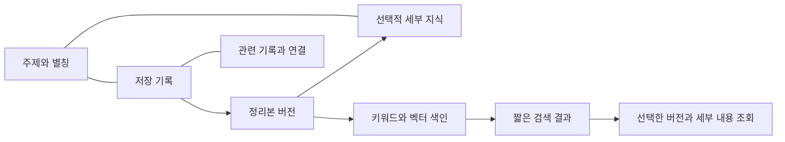

# 에이전트용 지식 계층 설계

에이전트가 짧은 검색 결과에서 출발해 필요한 기록과 연결만 읽을 수 있도록 구성한다. 사용자가 저장한 정리본을 중심에 두고, 세부 지식·주제·관계와 검색 색인을 분리한다.

- 상태: 002·004에 구현한 지식 계층 기준. 실제 검증과 잔여 관문은 [004 최종 점검](../specs/004-local-runtime/final-review.md) 참조
- 기준: [현재 제품 기획](../project/product-brief.md), [초기 보고서의 데이터 모델](../research/second-brain-report-v1.html#data-model)과 [검색 설계](../research/second-brain-report-v1.html#retrieval)

계층을 실제 필드·타입·제약으로 옮긴 문서는 [데이터 스키마 초안](data-schema.md), MCP·웹에서 사용하는 입력·출력은 [공통 서비스 계약](service-contracts.md)에 둔다. 실제 ORM·마이그레이션·서비스는 구현되어 있다. 아래는 공통 의미와 불변 조건이며, 현재 모듈·저장 관계는 [구현 구조](current-system.md), 검증 범위는 004가 기준이다.

## 계층과 역할

| 요소 | 역할 | 보존 원칙 |
| --- | --- | --- |
| 기록 `Capture` | 사용자가 저장한 정리본과 맥락, 공개 범위, 삭제 여부 | 생성·수정·삭제의 기본 단위다. |
| 버전 `Revision` | 정리본을 수정·병합한 시점의 내용 | 현재 버전과 변경 전 내용을 구분한다. 원본 대화 세션은 저장하지 않는다. |
| 세부 지식 `Node` | 긴 정리본 안의 설명·질문·결정 등 검색할 부분 | 선택적이며 특정 기록 버전에 속한다. 독립된 두 번째 원본으로 편집하지 않는다. |
| 주제 `Concept` | 데이터베이스·트랜잭션 같은 주제와 별칭 | 기록과 선택적인 Node에 연결한다. 이름만으로 개체를 자동 합치지 않는다. |
| 관계 `Relation` | 기록·세부 지식 사이의 관련성, 수정·파생 관계 | 방향·종류·근거가 된 저장본을 연결한다. 유사도를 인과관계로 확정하지 않는다. |
| 검색 색인 | 키워드·벡터·검색용 부분 문서 | 저장된 정리본으로 다시 생성할 수 있는 파생 데이터다. |

이 계층은 에이전트가 정보를 읽는 단위다. 사용자가 모든 기록을 고정 폴더 트리에 분류할 필요는 없으며, 한 기록이 여러 주제에 속할 수 있다. 그래프 화면과 그래프 전용 DB는 별개의 선택이다.

기록 주제는 전체 정리본을 찾는 분류이고 Node 주제는 그 안의 특정 구간을 찾는 분류다. 둘을 따로 연결하며 기록 주제를 모든 Node에 자동 복제하지 않는다. Node가 없는 메모도 본문 검색으로 찾을 수 있다. 검색 청크는 기계적인 분할 단위이므로 청크 검색 결과를 곧바로 하나의 의미 Node라고 간주하지 않는다.

물리 저장은 SQLite의 정리본·버전·관계와 LanceDB의 파생 검색 문서·벡터로 나눈다. 임베딩은 CPU를 기본으로 하며 검색 색인은 비동기로 생성한다. 저장 직후 목록·상세에서 실제 정리본을 확인할 수 있고 검색 준비 상태는 별도로 표시한다. 모델과 두 저장소의 정합성 계약은 [로컬 검색과 임베딩](search-and-embedding.md)을 따른다.

## 입력과 정리본

빠른 메모는 본문만으로 저장한다. AI가 이미 구조화한 정리본과 선택적 세부 지식을 제출하면 서버가 형식·참조·정합을 검증해 저장한다. 서버에서 다시 LLM을 호출해 모든 기록을 재추출하는 과정을 필수로 두지 않는다.

기록/Node의 주제 입력은 선택적인 `concept_hints`다. 본문 저장 후 서버 내부 LangGraph 작업이 기존 Concept를 조회·판단하고 일반 도메인 서비스가 ID를 검증해 연결한다. 외부 저장자가 ID를 먼저 찾아야 할 필요는 없다. 분류 실패·모호함은 본문 저장·조회·주제 조건 없는 검색을 막지 않으며 주제 상태를 별도로 반환한다. 이 후속 작업은 주제 연결만 바꾸고 본문·Node 의미·출처를 재작성하지 않는다. 명시적인 연결 정정과 Markdown 기반 분할은 [주제 연결·청크 규칙](ingestion-and-chunking.md)을 따른다.

세부 지식은 정리본 안의 부분을 가리키며 내용과 별도 편집 상태가 어긋나지 않게 한다. 모델이 세부 지식을 제출하지 않은 짧은 기록도 정상적으로 저장·조회할 수 있어야 한다. 긴 본문은 검색을 위해 분할하되 저장된 전체 정리본은 유지한다.

Node 구조는 `absent | current | stale`로 구분한다. 처음부터 구조가 없으면 `absent`, 제출한 Node가 현재 본문 범위를 가리키면 `current`다. 기존 구조가 있는 본문을 수정하면서 Node를 제출하지 않으면 옛 구간을 복제하지 않고 `stale`로 표시한다. 본문은 계속 조회·검색할 수 있고 구조는 명시적인 후속 수정으로 정리한다. 본문이 그대로인 수정은 기존 Node를 승계할 수 있으며, 정확한 전이 조건은 데이터 스키마를 따른다. `current`는 구조의 참조 상태이지 내용의 진실성이나 추출 정확성에 대한 인증이 아니다.

주체·설명·해석·예정·완료 같은 정보는 내용에 해당할 때만 보존한다. 사용자가 말한 사실과 AI의 보충 설명을 구분하고, 아무런 근거 없이 완료·감정·인과를 추가하지 않는다.

기록 전체의 재사용 목적은 [RecordKind 설계안](../project/record-types.md)의 여섯 유형으로 구분하고 NodeKind·Concept와 별도로 다룬다. Node가 없는 기록도 정리본만으로 발화자·대상·알려진 시점·제안과 채택 여부를 이해할 수 있게 한다. 주제·유형은 검색을 돕지만 문장 자체의 진실성이나 적용 범위를 결정하지 않는다.

## 원문 보관을 대신하는 저장본 참조

원본 세션이나 대화 발췌를 담는 별도 Evidence 저장소는 만들지 않는다. 답변의 근거는 `capture_id + revision + 선택적 node_id/본문 구간`으로 표현한 저장본 참조다.

이 참조는 답변이 어느 정리본을 사용했는지 알려주며, 대화 원문과 일치한다는 증명이 아니다. 존재하는 ID인지와 그 내용이 답변을 지지하는지는 별도로 검증한다. 출처 링크가 없는 AI 보충 설명은 저장 지식에서 찾았다고 표현하지 않는다.

## 추가와 갱신

- 일반 저장은 새 기록을 만든다. 같은 주제의 기록은 주제와 관련 링크로 함께 찾는다.
- 수정·병합은 사용자가 명시적으로 요청한 대상에만 적용한다. 대상이 여러 개이면 구분 가능한 제목·요약을 제시한다.
- 수정은 새 버전을 만들고 현재 버전을 바꾼다. 예전 정리본은 변경 이력이며 기본 질의응답은 현재 버전을 사용한다.
- 병합은 지정한 대상의 새 버전으로 표현한다. 병합에 사용한 다른 기록을 자동 삭제하지 않는다.
- 관계와 출처는 사용한 revision·구간을 보존한다. 유형·태그만 바뀌고 본문·Node 의미·완료·시점·출처가 엄격히 같으면 현재의 동등한 저장본으로 대응시킬 수 있다. 내용이 바뀌면 옛 주장에 근거한 관계를 새 버전에 무조건 복사하지 않는다. 검색 색인은 현재 revision으로 갱신한다.
- 동일 요청의 재시도와 의미가 비슷한 새 경험은 다르다. 요청 중복은 요청 ID로 처리하고 유사 기록을 자동 병합하지 않는다.

## 점진적 조회와 답변

1. 이번 검색어·질문의 명시 ID·주제·날짜 등 조건을 해석한다.
2. 키워드·의미 검색에서 짧은 후보와 기록 ID를 반환한다.
3. 선택한 기록의 현재 정리본, 필요한 세부 지식과 관련 기록만 읽는다.
4. 제한된 관계 확장으로 부족한 맥락을 보완하고 답변에 쓸 저장본 참조를 구성한다.
5. 저장된 내용과 AI의 보충 설명을 구분해 답한다. 개인 경험은 저장된 내용으로 확인되는 범위만 말한다.

웹은 검색을 시작점으로 한 단일 실행의 응답을 제공하며 채팅 세션이나 후속 턴 메모리를 두지 않는다. 한 번의 검색 실행 안에서 필요한 추가 검색과 관계 조회는 수행할 수 있다. 답변의 출처를 선택하면 오른쪽 상세 패널에서 SourceRef가 가리키는 특정 revision의 본문과 사용 구간을 확인한다. 현재 버전으로 조용히 바꿔 보여주지 않으며, 메타데이터 동등성으로 현재 참조에 대응한 경우 원래 참조와 현재 대응 참조를 구분한다. 부모 기록이 삭제됐으면 과거 revision도 열 수 없다.

개인 선호·프로젝트 조건을 맥락으로 사용할 때에는 현재 질문에 적용되는 대상·상황·시점을 확인한다. 서로 다른 기록은 각각 현재 revision을 가질 수 있으므로 저장 시각만으로 기존 선호가 폐기됐다고 간주하지 않는다. 명시적인 변경이 없으면 상충을 보존하고 필요하면 질문한다. 기록에 담긴 절차·프롬프트·인용은 조회 자료이며 현재 사용자 요청이나 도구 실행 권한을 대신하지 않는다.

사용자가 조건을 바꿨다고 명시하면 `supersedes`를 새 내용 → 이전 내용으로 연결한다. 적용 대상·상황·알려진 시점과 변경 발언을 근거로 남기고 양 끝점을 Node 또는 명시적인 본문 구간으로 한정한다. 한 선호가 바뀌었다고 함께 저장한 다른 지식까지 폐기하지 않는다. 구간이나 적용 범위가 불명확하면 현재 조건의 대체를 확정하지 않는다. 이전 내용이 틀렸다는 `corrects`와 당시 유효했던 조건을 대체하는 `supersedes`를 구분한다. 잘못 연결한 관계는 명시적으로 철회하고 이력을 남기며, 철회한 관계는 현재 조회·맥락에 사용하지 않는다.

관련 그래프 확장은 1홉부터 시작하고 노드 수·본문 길이·도구 호출 횟수에 상한을 둔다. 임계치는 제품 평가로 정하며 전체 지식이나 모든 주제 요약을 매 질문에 주입하지 않는다. 날짜·개수 같은 정확한 조건은 적합한 구조화 조회로 처리한다.

외부 Codex에는 검색·상세·관련 기록 조회와 CRUD를 MCP로 제공한다. FastAPI 내부의 답변 생성은 같은 조회 서비스를 직접 호출한다. 단순 질의응답에 쓰기 도구를 자동 부여하지 않는다. 웹의 CRUD 동작은 별도 명시 요청으로 실행한다.

이 조회·답변 흐름의 상태와 분기는 [채택한 LangGraph](../decisions/ADR-001-langgraph-agent-runtime.md)가 관리한다. LangGraph의 실행 노드와 위 계층의 세부 지식 `Node`는 서로 다른 개념이다. 기록·버전·관계의 기준 데이터는 공통 지식 서비스가 관리하며 실행 상태나 체크포인트로 대체하지 않는다.

## 삭제와 파생 지식

삭제는 사용자 재확인 후 `deleted_at`을 설정하는 soft delete다. 제품의 목록·상세·이력·Node·그래프·검색·질의응답·수정은 `deleted_at IS NULL`인 기록만 대상으로 한다. 삭제한 기록의 목록·복원·undo 경로와 별도 생명주기 enum을 두지 않는다. 색인 반영이 늦어져도 최종 조회에서 `deleted_at`과 버전을 확인해 제외하며 삭제 시각을 null로 되돌리는 제품 동작은 없다.

삭제 후에도 본문·버전·세부 지식·관계·출처는 내부 보존한다. 보관 기한·자동 삭제·수동 영구 삭제 기능은 두지 않는다. 내부 보존은 별도 보관함이나 삭제한 본문의 조회 권한을 의미하지 않는다. 관련된 독립 기록이나 같은 주제의 다른 경험을 연쇄 삭제하지 않는다.

기존 지식으로 만든 답변·요약을 사용자가 다시 저장한 경우 출처 기록과 버전을 함께 연결한다. 이를 독립된 새 증거로 중복 집계하지 않는다. 원출처가 삭제되면 `source_deleted`, 내용이 달라지면 `source_changed` 사유로 그 내용에 의존하는 요약을 질의응답 근거에서 제외하고 재검토 대상으로 표시한다. 유형·태그만 달라져 데이터 스키마의 엄격한 근거 동등성을 만족하는 경우에는 불필요하게 무효화하지 않는다. 최종 사용 시 현재 공개 범위·삭제 여부·상위 출처도 확인한다.

원출처가 삭제돼도 출처 연결을 유지하며 독립 지식으로 취급하지 않는다. 일반 수정은 기존 출처와 새 출처를 합쳐 이어가며 빈 배열로 의존성을 지우지 않는다. 명시적인 `capture_review_sources`만 새 대상 revision의 전체 출처 집합을 교체하고 검토 이유를 남긴다. 과거 대상 revision과 당시 출처는 유지한다. 삭제된 출처에 대한 의존성을 제거하려면 그 내용에 의존하던 본문을 재작성·제외하고 이유를 남겨야 하며, 남은 내용의 실제 성격과 필요한 대체 근거를 확인한다. 단순한 출처 제거·본문 변경 검증을 내용의 진실성 인증으로 삼거나 자동으로 `verified`를 부여하지 않는다.

파생 요약을 다시 요약할 때도 알려진 출처 관계를 이어간다. Skill은 조회에 사용한 기록 ID·버전을 함께 제출해야 하며, 원문 없이 누락된 출처를 서버가 완벽하게 재구성할 수 있다고 가정하지 않는다. 출처 재검토 후에도 새 답변을 만들 때에는 현재 출처와 상위 의존성을 다시 확인한다.

같은 검색 실행 중에도 최종 답변을 내보내기 전에 출처의 삭제 여부·revision·의존성을 다시 확인한다. 검색 취소나 기록 변경으로 사용 조건이 달라지면 기존 후보를 그대로 출력하지 않고 실행을 중단하거나 유효한 근거로 다시 구성한다. 상세 패널을 열 때에도 현재 조회 자격을 확인하며 과거 화면에 표시됐다는 이유만으로 삭제된 출처를 다시 노출하지 않는다.

## 예시

| 저장 내용 | 계층에서의 표현 | 가능한 질의 |
| --- | --- | --- |
| 오늘 배운 트랜잭션 설명과 남은 질문 | 정리본 하나에 설명·질문 부분을 두고 DB·트랜잭션 주제와 연결 | 내가 트랜잭션에서 헷갈렸던 부분은? |
| 공부하면서 답답했고 짧게 나눠 공부하기로 한 일 | 감정과 결정은 같은 기록의 별도 부분이며 사용자의 표현을 유지 | 공부 방법을 바꾸기로 한 이유는? |
| 다음 날 추가로 이해한 트랜잭션 내용 | 새 기록을 추가하고 같은 주제로 연결; 명시한 경우 기존 기록에 병합 | 이전 설명과 비교해 무엇을 더 배웠지? |

## 구현 시 확인할 불변 조건

- 저장 완료 응답에 표시한 내용은 실제 커밋된 정리본과 일치한다.
- 정리본 수정·삭제 후 이전 색인이 현재 답변의 근거로 살아나지 않는다.
- 본문 수정으로 유효하지 않은 Node 구조는 `stale`로 드러나며 옛 Node·주제·관계를 새 본문에 무조건 연결하지 않는다.
- 명시적인 조건 대체는 해당 Node·본문 범위에만 적용하며 철회한 관계는 현재 맥락에서 제외한다.
- 답변의 저장본 참조는 해당 버전으로 이동하며, 일반 설명을 사용자 경험으로 바꾸지 않는다.
- 주제 이름이 같다는 이유로 동명이 개체나 서로 다른 경험을 합치지 않는다.
- 원문 보관, 일정 관리, 공유 권한 체계를 이 계층의 필수 구현으로 추가하지 않는다.
