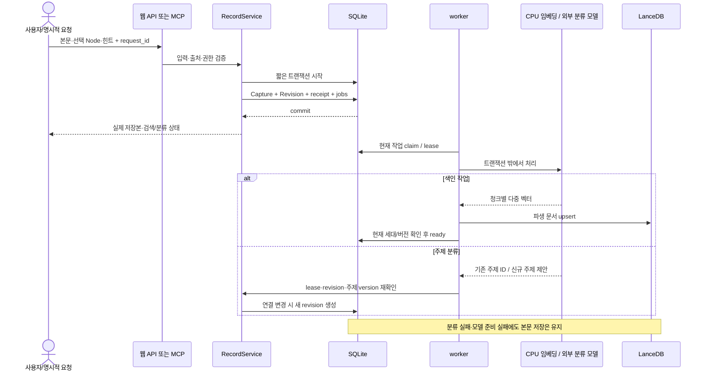
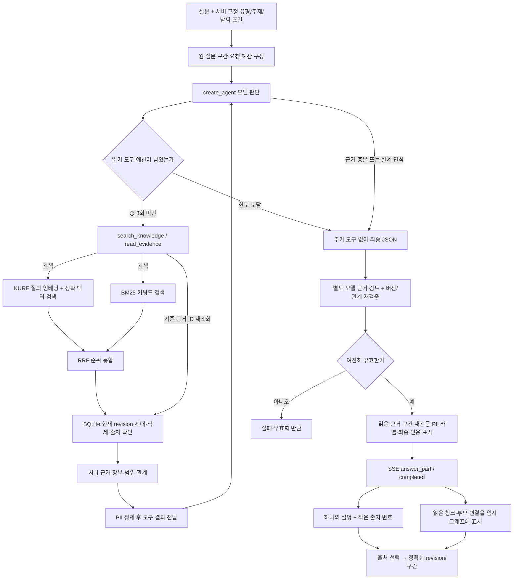
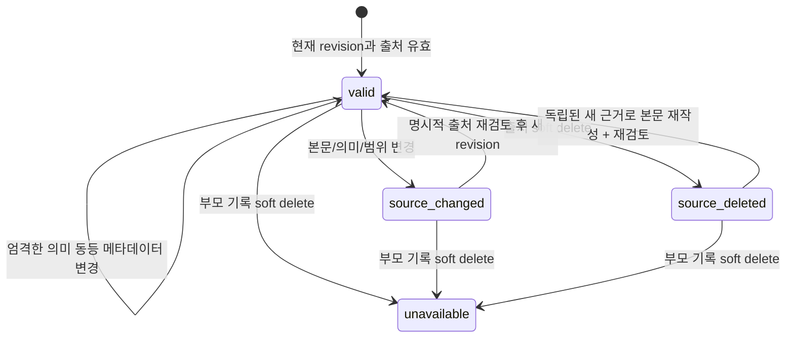
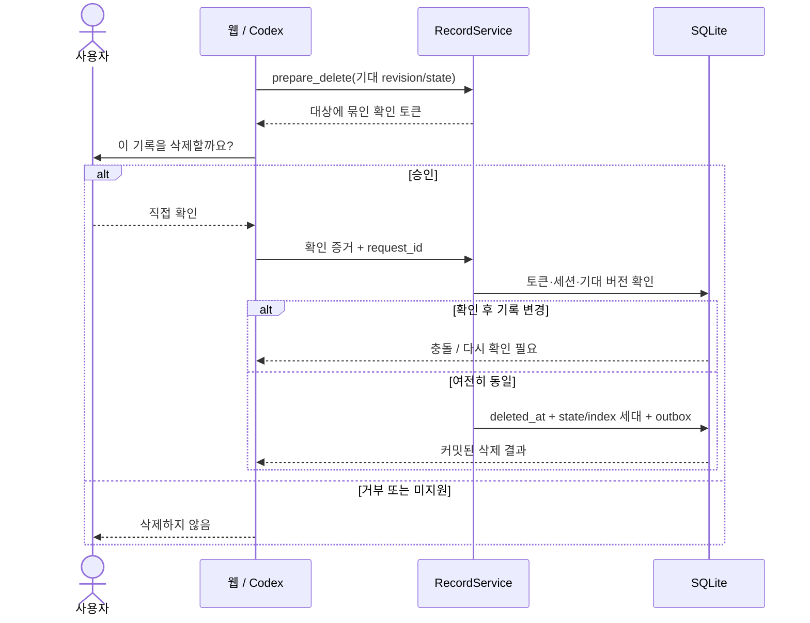
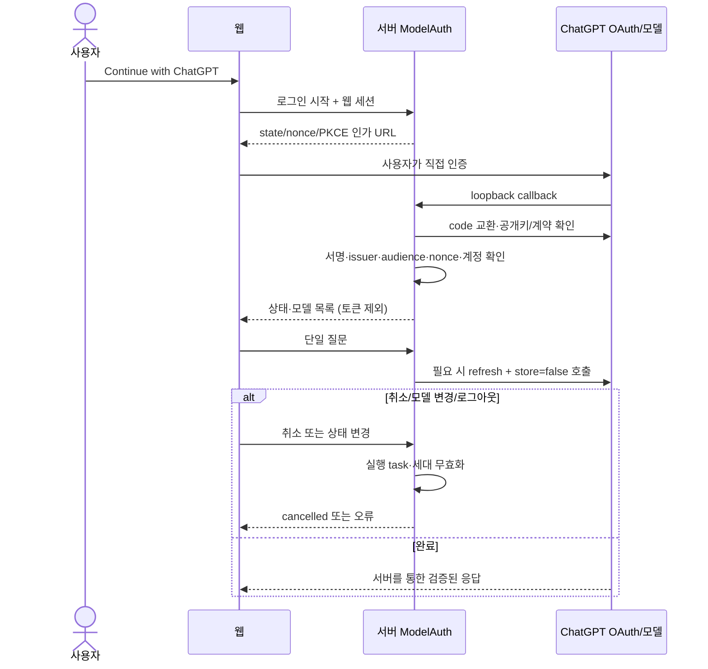

# 저장·검색·출처의 실행 흐름

2026-11-02 구현 기준이다. [현재 시스템](current-system.md)의 모듈과 [공통 계약](service-contracts.md)을 시간 순서로 설명한다. 다이어그램의 실패 경로는 데이터 폐기를 뜻하지 않는다.

## 저장과 비동기 처리

사용자 수동 주제 정정은 진행 중인 자동 분류보다 우선한다. 분류 결과가 늦게 와도 이전 본문으로 새 revision을 덮지 않는다. 주제 정정으로 revision과 Node ID도 달라질 수 있으므로 다음 작업은 응답의 최신 참조를 사용한다.

## 단일 질문과 답변

현재 질문 실행은 LangGraph 기반 `create_agent`의 모델→읽기 도구→모델 ReAct 루프다. 모델이 재검색 순서와 질의를 선택하며, `search_knowledge`와 이미 찾은 근거의 `read_evidence`만 호출한다. 같은 응답에서 여러 도구를 요청해도 각각 집계하여 요청 전체 총 8회만 실행한다. 잘못된 인수·실패한 도구도 예산을 소비한다. 에이전트 모델 호출 최대 9회와 별도 검토 1회, 전체 요청 90초를 적용한다. 도구 한도에 도달하면 도구를 제거하고 현재 근거로 최종 응답을 작성하게 한다. 읽기 도구의 본문·기록 수 및 모델 입력 예산도 별도로 검사한다.

원 질문의 정확한 정제 후 질의와 일치하는 검색만 해당 구간의 coverage를 완료로 표시한다. 모델이 전달한 구간 ID나 요약만으로 완료 처리하지 않으며, 검색하지 않은 구간은 limitations에 남긴다. 질문·답변은 자동 영구 저장하지 않고 수정·삭제 도구도 연결하지 않는다. 이후 별도 검토는 주장·주체·시점·범위의 근거를 검사하고, 전송 직전에는 결정적인 버전·관계 재검증을 수행한다. 두 검사는 모든 문장의 사실 정확도를 보증하지 않는다. [구체적인 후속 계약](../specs/004-local-runtime/react-agent.md)

이메일·신용카드·IP는 내장 `PIIMiddleware`로 모델 입력과 반환 응답을 정제한다. 웹으로 내보내는 답변은 공급자 스트림 완료와 PII 정제·근거 검토를 마친 결과다. 원본 도구 결과를 스트리밍으로 먼저 노출하지 않는다. 저장 정본과 출처 위치는 바꾸지 않으며 자동 분류는 기존 LangGraph 흐름에서 같은 모델 경계의 PII 정제를 사용한다.

웹은 질문마다 `/questions`만 호출하고 완료된 답변을 하나의 글로 보여준다. 관련 기록을 위한 별도 `/search` 요청은 보내지 않는다. 작은 출처 번호는 검증된 문단과 연결되며, 선택하면 기존 오른쪽 패널을 연다. [읽기 경험 수용 기준](../specs/004-local-runtime/answer-reading.md)

`completed`에는 요청의 서버 근거 장부에서 가져온 검색 구간도 포함한다. 그래프는 읽은 청크와 실제 인용된 청크를 구별하며, 출처 번호와 청크 노드는 같은 SourceRef 전체 좌표를 사용한다. 저장된 지식 그래프를 변경하지 않고 화면에서만 합성하며, 별도 검색 호출을 추가하지 않는다. [검색 근거 그래프](../specs/004-local-runtime/retrieval-graph.md)

## 수정과 출처 자격

이 도식은 출처 조회 자격의 개념 상태다. 별도 `lifecycle_state` 필드를 추가하지 않는다. 저장된 옛 revision은 불변이며, “재검토 후 valid”는 새 revision의 자격이다. 의존 출처를 제거할 때는 본문 재작성이 필수이며, 출처 버전을 갱신하는 모든 재검토에 본문 변경을 강제하지는 않는다. 삭제한 부모 기록에는 조회·복원·실행 취소 경로가 없다. 출처 삭제는 독립 기록을 연쇄 삭제하지 않으며 의존 기록을 답변 근거에서 제외한다.

## 삭제 확인과 동시성

MCP 모델 입력의 `confirmed=true` 같은 값으로 사람의 확인을 대체하지 않는다. 웹은 CSRF로 보호된 session-bound 확인 경로, MCP는 SDK의 elicitation 경로를 사용한다. 같은 요청 재시도는 mutation receipt를 재사용하고 다른 내용으로 request ID를 재사용하면 충돌한다.

## 로그인과 요청 취소

브라우저에는 공급자 토큰을 전달하지 않는다. HTTP callback query·질문·본문을 접근 로그에 기록하지 않도록 한다. 취소 후 결과가 도착해도 새 요청을 덮지 않아야 하며, 공급자의 원격 연산이 즉시 중단됐다고 보증하지 않는다. 실계정 로그아웃→재로그인 검증은 사용자가 보류한 상태다.
