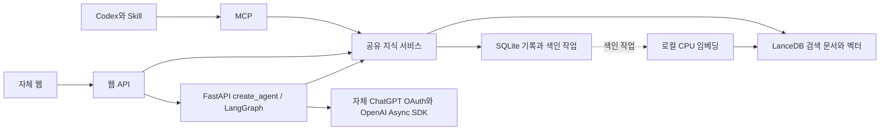

# 기술 스택 선정

Windows·macOS·Linux에서 로컬 서버를 직접 실행하고 Codex와 자체 웹이 같은 지식을 사용하는 구조를 목표로 한다. FastAPI, 자체 OAuth 로그인, LangGraph, LanceDB와 임베딩의 CPU 기본 실행은 사용자 확정 사항이다. 임베딩은 WSL CPU 실험 후 KURE-v2 + MultiVectorEncoder를 한국어 MVP 개발 기준으로 조건부 채택했다. 그래프 시각화는 사용자 결정에 따라 3d-force-graph + Three.js + three-spritetext를 채택하고 기존 디자인 시안은 폐기했다. 나머지 구성은 위임된 기획을 마무리하는 초기 구현 기준으로 아래 조합을 사용한다. 구체적인 버전 호환·전체 OS 배포와 실제 사용자 기록 품질은 미검증이다.

- 상태: 로컬 제품 구현·WSL 통합 검증. 실제 설치 버전은 backend/uv.lock·frontend/package-lock.json, 검증 범위는 [004](../specs/004-local-runtime/validation.md)가 기준
- 확인일: 2026-11-02
- 설계 기준: [제품 기획](../project/product-brief.md), [에이전트용 지식 계층](knowledge-layer.md)
- 채택 결정: [ADR-001: LangGraph 기반 AI 실행](../decisions/ADR-001-langgraph-agent-runtime.md), [ADR-002: 로컬 검색과 임베딩](../decisions/ADR-002-local-search-and-embedding.md), [ADR-003: KURE-v2 임베딩](../decisions/ADR-003-kure-v2-embedding.md), [ADR-004: 3D 그래프 라이브러리](../decisions/ADR-004-graph-visualization-library.md), [ADR-005: MCP Python SDK v2](../decisions/ADR-005-mcp-python-sdk-v2.md)

## 초기 구현 조합

| 영역 | 추천 | 선택 이유와 감수할 점 |
| --- | --- | --- |
| 서버와 DTO | Python + FastAPI + Pydantic | 확정한 서버 구조를 따르고 MCP·웹·모델 도구의 입력 계약을 공유한다. |
| MCP | 공식 MCP Python SDK v2 + Streamable HTTP | 채택. `MCPServer`를 FastAPI에 통합한다. 초기 검증 후보는 mcp 2.3.0이며 규격 2026-07-28과 이전 클라이언트 호환은 SDK가 처리한다. 실제 Codex 연결과 사용자 삭제 승인 경로는 004에서 검증했다. 네이티브 OS별 왕복은 별도 관문이다. |
| 기록 저장 | SQLite + WAL | 기록·버전·주제·관계·soft delete와 색인 작업을 관리한다. 쓰기는 짧은 트랜잭션으로 구성한다. |
| 데이터 접근과 변경 | SQLAlchemy + Alembic | SQLite 도메인 모델과 마이그레이션을 관리한다. LanceDB는 별도 검색 저장소 어댑터로 접근한다. |
| 검색 | LanceDB OSS | 채택 확정. 로컬 토큰별 다중 벡터 MaxSim + BM25 + RRF로 검색하며 SQLite와의 비동기 정합성을 관리한다. |
| 임베딩 | KURE-v2 + Sentence Transformers MultiVectorEncoder | 조건부 채택. CPU float32·토큰별 128차원·공식 마스킹·질문 확장을 사용한다. 다중 벡터 공간·ANN 누락·긴 질문 처리를 관리한다. |
| 로그인과 모델 | 자체 ChatGPT OAuth + OpenAI Async SDK | 웹 로그인으로 모델을 연결하고 FastAPI가 직접 호출한다. OAuth 갱신과 요청 제약을 관리해야 한다. |
| 답변 흐름 | LangChain 1.4.7 `create_agent` + LangGraph + Pydantic 계약 | 읽기 도구를 선택하는 ReAct 루프, 도구 총 8회·에이전트 모델 9회·별도 검토 1회·90초 제한. 자체 OAuth `BaseChatModel` 어댑터와 내장 PII middleware를 연결한다. |
| 웹 | React + TypeScript + Vite | 로컬 SPA로 구성하고 빌드 결과를 FastAPI가 제공한다. 라우팅·상태 관리는 앱에서 선택한다. |
| 웹 UI | Radix Themes + Lucide React | 검색·출처 패널 디자인 개정의 초기 구현 기준. 실제 컴포넌트·아이콘을 사용해 상태와 시각 규칙을 통일한다. [선정 근거](../prototypes/knowledge-space/ui-library-selection.md)를 따르며 사용자 디자인 최종 채택이나 전체 접근성 검증을 의미하지 않는다. |
| 지식 그래프 시각화 | 3d-force-graph + Three.js + three-spritetext | 사용자 채택 확정. 기록·관계를 3D로 표현한다. 기존 디자인 시안은 폐기하고 세부 디자인·화면 범위는 별도 명세에서 정한다. |
| 의존성과 배포 | uv + 프론트 lockfile + 정적 웹 번들 | 개발 의존성을 고정하고 실행 시 Python 서버와 빌드된 웹을 한 단위로 제공한다. |

## 실행 구조

하나의 로컬 서버 프로세스에서 MCP·웹 API·답변 처리를 제공한다. Windows·macOS·Linux 각각에서 서버와 SQLite·LanceDB·CPU 임베딩을 직접 실행하는 구성을 검증한다. WSL·Docker·GPU를 필수 조건으로 두지 않는다. 임베딩 계산은 이벤트 루프를 막지 않는 제한된 작업자에서 처리한다. Intel Mac·Windows ARM 등 현재 패키지 배포가 부족한 환경과 검증 기준은 [운영체제 지원 설계](platform-support.md)에 기록한다.

MCP는 공식 Python SDK v2를 사용한다. `MCPServer`의 ASGI 앱을 마운트하고 최상위 FastAPI lifespan에서 `session_manager.run()`을 실행한다. LangGraph의 조회 도구는 자기 MCP 서버에 재접속하지 않고 같은 도메인 서비스를 호출한다. SDK의 2.x와 날짜 형식 프로토콜 버전, JSON-RPC 2.0은 구분한다. [MCP ASGI 문서](https://py.sdk.modelcontextprotocol.io/run/asgi/), [채택 근거](../decisions/ADR-005-mcp-python-sdk-v2.md)

저장 필드·외래키·버전·검색 세대는 [데이터 스키마](data-schema.md), Pydantic 기반 CRUD·검색·삭제 확인·그래프 DTO는 [서비스 계약](service-contracts.md)을 시작안으로 사용한다. 공통 스키마를 먼저 정하고 기능별 명세에서 SQL DDL·OpenAPI·MCP JSON Schema와 검증으로 옮긴다.

## LangGraph의 역할과 범위

FastAPI 프로세스에서 LangChain `create_agent`가 만든 LangGraph를 실행한다. 모델은 `search_knowledge`와 `read_evidence`를 선택하여 재검색·근거 재조회를 수행한다. 요청당 읽기 도구 8회, 에이전트 모델 9회와 별도 근거 검토 1회, 전체 90초를 적용한다. 배치 도구 요청도 각각 집계한다. 서버가 모델과 독립적으로 근거 ID·현재 버전·필터·실행 예산을 관리한다. 상세 계약은 [ReAct 후속 변경](../specs/004-local-runtime/react-agent.md)을 따른다. [공식 에이전트 구성](https://docs.langchain.com/oss/python/langchain/agents)

실행 상태에는 질문, 도구 왕복 메시지, 선택한 저장본 참조, 남은 예산, 답변 상태를 둔다. `OAuthChatModel`은 LangChain `BaseChatModel`·`bind_tools` 계약을 기존 `ModelAuth`와 OpenAI Async SDK에 연결한다. 기존 자체 로그인과 모델 선택을 유지하며 API key 설정을 추가하지 않는다. 완료된 Responses function call만 도구 요청으로 변환하고 tool output을 같은 요청의 후속 모델 입력에 넣는다. LangGraph가 로그인이나 공급자의 요청 제약을 대신 처리한다고 가정하지 않는다. 자동 주제 분류는 기존 `StateGraph` 분류·커밋 흐름을 유지한다.

내장 `PIIMiddleware`는 이메일·신용카드·IP를 `redact`하며 모델 입력·도구 결과·도구 인수·출력에 적용한다. 별도 근거 검토와 자동 주제 분류도 공통 모델 경계에서 정제한다. 정본 저장·수정·출처 위치는 바꾸지 않는다. 의미 기반 개인정보 분류나 저장 허용 판정은 이번 범위에 포함하지 않는다. [내장 middleware](https://docs.langchain.com/oss/python/langchain/middleware/built-in)

LangGraph의 그래프는 실행 흐름이다. 기록·주제·관계를 표현하는 지식 그래프와 검색 색인은 공통 지식 서비스가 관리한다. 질의응답 그래프에는 읽기 도구를 제공하고 명시적인 CRUD 경로와 분리한다. 답변에 쓸 참조는 현재 버전·삭제 여부·출처 유효성을 조회 서비스에서 다시 확인한다.

첫 버전은 단일 검색 요청의 상태를 메모리에서 관리하고 영구 체크포인터를 사용하지 않는다. 웹은 이전 질문·답변을 이어 붙이지 않는 단일턴 응답과 오른쪽 출처 패널을 제공하며 [MVP의 검색 요청 수명](../project/mvp-scope.md#웹-검색-요청의-수명)을 따른다. 한 요청 내 근거 보강 검색은 가능하다. LangGraph 채택만으로 LangSmith나 별도 Agent Server를 필수 의존성으로 추가하지 않는다. [상태 영속화](https://docs.langchain.com/oss/python/langgraph/persistence)

## 저장과 검색의 선택 근거

SQLite 안에 기록 간 관계를 테이블로 보관하고 제한된 연결 조회를 수행한다. 현재 요구에 별도의 그래프 DB를 추가할 근거는 충분하지 않다. WAL은 읽기와 쓰기의 동시 진행을 돕지만 writer는 한 번에 하나이므로 장시간 모델 호출·임베딩을 DB 트랜잭션 안에 넣지 않는다. [SQLite WAL](https://sqlite.org/wal.html)

도메인 데이터 접근에는 SQLAlchemy를, 스키마 변경에는 Alembic을 초기 구현 기준으로 사용한다. LanceDB의 검색 스키마·임베딩 프로필·재색인은 별도 어댑터가 관리하며 ORM 마이그레이션과 분리한다. [SQLAlchemy](https://docs.sqlalchemy.org/en/21/), [Alembic](https://alembic.sqlalchemy.org/en/latest/)

검색은 기존 FTS5·sqlite-vec 추천을 LanceDB OSS로 교체한다. 로컬 Python embedded 연결에서 다중 벡터 MaxSim과 BM25 검색을 결합하고 초기에는 RRF로 순위를 합친다. 한국어·영어 혼합 FTS는 ICU를 시작점으로 삼고 조사·어미 검색 실패가 크면 `lindera/ko-dic`을 비교한다. 사양과 근거는 [로컬 검색과 임베딩](search-and-embedding.md)에 둔다.

임베딩은 `nlpai-lab/KURE-v2`를 MultiVectorEncoder로 CPU float32 실행하며 토큰별 128차원 벡터를 유지한다. 모델 revision·질문 확장·마스킹·청크 규칙을 프로필로 고정하고 모델 변경은 재색인을 수반한다. PyLate 없이 실행한 [WSL 실험](../research/kure-v2-feasibility/report.md)에서 작은 한국어 평가와 자원 기준을 통과했다. 최초 ANN 회수율 미달을 같은 개발 자료에서 조정했으므로 실제 데이터에서 다시 검증한다. 빈 입력·긴 질문·장문 청크 계약은 004에서 검증했다. 전체 OS 설치와 실제 사용 자료 평가는 남아 있다. 제품 검색은 현재 정확 벡터 검색이며 조사 단계의 ANN 튜닝을 활성 제품 구현으로 간주하지 않는다.

저장 시 SQLite에 정리본·버전·상태와 색인 작업을 함께 커밋하고 LanceDB 반영은 이후 처리한다. 저장 완료와 검색 준비 완료를 구분한다. 두 저장소를 하나의 트랜잭션처럼 다루지 않으며, 검색 후보를 사용자나 모델에 전달하기 전에 SQLite의 현재 버전·`deleted_at`·색인 세대·파생 출처를 확인한다. 삭제는 내부 원본을 보존하는 soft delete만 제공한다. 삭제 기록 조회·복원 경로는 없으며 [ADR-006](../decisions/ADR-006-soft-delete-without-trash.md)을 따른다.

## OAuth와 답변 실행의 선택 근거

자체 로그인에서 받은 OAuth access token으로 공식 모델 endpoint를 호출한다. OpenAI Python SDK의 자격증명 인자에 이 토큰을 전달하는 공식 예시가 있으며 별도 API key를 발급받는 방식이 아니다. 로그인 계정에 제공되는 모델 목록을 조회해 선택한다. [공식 모델 호출](https://developers.openai.com/siwc/token-sharing-open-source/models-and-inference)

현재 인증은 `httpx`와 `PyJWT[crypto]`로 OAuth HTTP·PKCE·OIDC 서명/claim 검사를 구현하며 Authlib은 사용하지 않는다. 공급자 토큰은 서버에서 관리한다. 실제 로그인·강제 갱신은 004에서 확인했으며 실계정 로그아웃 후 재로그인은 사용자 보류, 각 OS callback은 별도 검증 대상이다. [구현](../../backend/src/second_brain/auth.py), [OpenAI 로그인 계약](https://developers.openai.com/siwc/token-sharing-open-source/sign-in)

현재 OAuth HTTP 계약에 따라 `store:false`, `stream:true`와 현재 질문·이번 요청에서 조회한 지식 맥락을 전달한다. hosted MCP 대신 FastAPI가 function/custom tool을 실행한다. 지원 필드·도구 형식은 일반 API와 같다고 가정하지 않는다. 웹의 이전 검색 질문·답변 이력을 모델 입력에 자동 포함하지 않고 검색 응답도 장기 지식으로 자동 저장하지 않는다. [Preview 제약](https://developers.openai.com/siwc/token-sharing-open-source/preview-limitations)

UI 취소 시 서버 작업·상위 스트림·추가 도구 호출을 중단하고 완료·오류 상태를 구분한다. 공급자 연산이 즉시 중단된다고 보장하지 않는다. 이 경로는 background 요청을 지원하지 않으므로 background 전용 취소 API에 의존하지 않는다. [취소 API](https://developers.openai.com/api/reference/resources/responses/methods/cancel)

## 에이전트 프레임워크 비교

| 대안 | 판단 |
| --- | --- |
| LangGraph | 채택. Python/FastAPI 안에서 검색 분기, 추가 조회, 근거 확인을 명시적인 상태와 실행 흐름으로 관리한다. 그래프 상태·전이 설계와 의존성 관리 비용을 감수한다. |
| 공식 SDK와 작은 도구 루프 | 검토한 대안. 짧고 고정된 흐름에는 단순하지만 분기와 재시도 상태를 직접 관리해야 한다. 모델 호출 SDK는 LangGraph 안에서도 사용한다. |
| Pi (`earendil-works/pi`, 구 `badlogic/pi-mono`) | 검토한 대안. 모델·OAuth 연동과 에이전트 도구 루프를 재사용할 수 있다. TypeScript SDK를 현재 Python 서버와 연결하려면 추가 런타임 및 도구·스트림·취소 연동이 필요하다. |
| Pydantic AI | 전용 ChatGPT OAuth provider가 있는 유효한 대안이다. 채택 버전의 등록·요청 변환이 OpenAI 공식 계약과 맞는지 확인한 뒤 사용할 수 있다. |
| Codex app-server | 기존 Codex 실행 엔진을 내장해야 할 때 검토한다. 자체 로그인과 FastAPI 답변 처리가 확정된 현재 구조에서는 추가 런타임을 필수로 두지 않는다. |

LangGraph와 Pi를 비교한 뒤 사용자가 LangGraph로 진행하기로 결정했다. Pi와 Pydantic AI를 OAuth 미지원으로 제외한 것은 아니다. 현재 서버 언어와 실행 흐름을 기준으로 선택했으며 검색 품질이나 실제 계정 호환성을 검증한 결과는 아니다. [Pi](https://github.com/earendil-works/pi), [Pydantic AI ChatGPT](https://pydantic.dev/docs/ai/models/openai-chatgpt/), [채택 이유와 후속 조치](../decisions/ADR-001-langgraph-agent-runtime.md)

## 웹과 배포의 선택 근거

React·TypeScript·Vite로 로컬 SPA를 구성해 지식 목록·편집·질문·주변 그래프를 제공한다. SEO나 서버 렌더링이 현재 필수는 아니므로 정적 빌드를 초기 구현 기준으로 사용한다. 라우팅과 데이터 요청 관리는 앱에서 관리한다. [React의 Vite 구성 안내](https://react.dev/learn/build-a-react-app-from-scratch)

FastAPI는 정적 프론트 빌드와 클라이언트 라우팅을 위한 공식 제공 방식을 갖고 있다. 개발 때는 Vite 서버를 사용하고 소스 설치에서는 `frontend/dist`를 FastAPI가 제공한다. 현재 wheel에는 프런트 번들이 없으므로 단일 설치 배포물은 후속 패키징 과제다. 답변 스트리밍은 POST 요청과 서버 이벤트를 읽는 방식으로 구성한다. [FastAPI 프론트엔드](https://fastapi.tiangolo.com/tutorial/frontend/)

지식 그래프 시각화에는 사용자가 채택한 `3d-force-graph` + Three.js + `three-spritetext`를 사용한다. 검증된 시작 버전은 각각 1.80.1·0.180.0·1.10.0이며 제품 구현 시 호환성을 다시 확인하고 의존성을 고정한다. 기존 Cytoscape.js 추천을 이 선택으로 교체한다. 그래프 라이브러리는 저장 모델이나 검색 정책을 결정하지 않는다. [채택 결정과 검증 범위](../decisions/ADR-004-graph-visualization-library.md)

기존 그래프 시안의 디자인은 사용자 요청으로 폐기했다. 시안의 색상·패널 배치·노드 모양·화면 구성은 제품 디자인으로 승계하지 않는다. 첫 공개는 [MVP 기획](../project/mvp-scope.md)의 제한된 주변 그래프를 제공하고 세부 디자인은 별도로 진행한다. 과거 자료는 [기술 실험 이력](../research/archived-graph-preview/index.md)으로만 보관한다.

Python 의존성과 실행환경은 uv의 lockfile로 관리한다. 실제 Python·패키지 버전은 OAuth·MCP·LanceDB·CPU 임베딩 조합이 통과한 버전으로 고정하며, 문서의 최신 버전을 전부 섞어 호환성을 가정하지 않는다. [uv](https://docs.astral.sh/uv/)

## 기능 구현에서 검증할 두 축

1. 실제 계정의 자체 로그인 → LangGraph를 통한 모델 응답·로컬 도구 왕복 → 토큰 갱신·사용자 취소가 지원 OS·아키텍처 조합에서 동작하는가. 추가 조회의 호출·시간 예산과 오류 종료가 지켜지는가.
2. CPU 환경에서 임베딩·검색의 메모리·지연과 한국어 검색 품질이 적절하며, 수정·soft delete·색인 작업 재시작 후 오래되거나 삭제된 지식이 답변에 섞이지 않는가. 구체적인 비교 항목은 [검색 검증 기준](search-and-embedding.md#구현-검증과-모델-전환-조건)을 따른다.

이 문서는 공식 문서·요구사항·범위를 제한한 기술 실험에 따른 선택안이다. KURE-v2 검색 실험은 위 보고서에 보존했으며 실제 인증·전체 플랫폼·앱 정합성 결과는 후속 기능 검증 문서에 기록한다.
