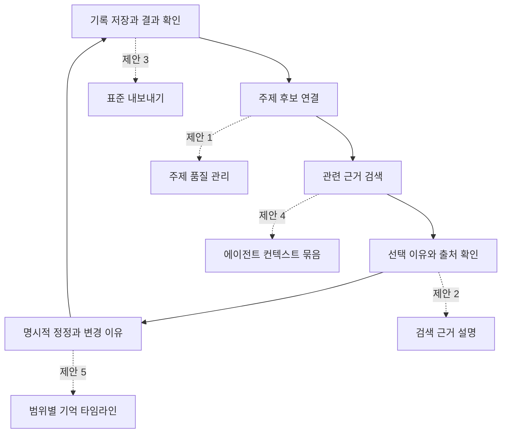

# 제품 발전 제안

- 작성일: 2026-11-02
- 상태: **제안 — 현재 구현 약속이나 승인된 기능 명세가 아님**
- 근거: [공식 서비스 비교·태그 평가](../research/second-brain-comparison-2026-11.md), [MVP 범위](mvp-scope.md), [현재 검증](../guides/testing.md)

## 권장 방향

**AI와 정리한 지식을 내가 확인하고 고치며, 다음 질문과 에이전트 작업의 근거로 다시 쓰는 세컨브레인**에 집중한다.

사람이 쓰는 문서 편집기, 에이전트 기억 SDK, 자료 검색 챗봇의 기능을 모두 따라가기보다 ‘저장 → 근거를 찾음 → 확인·정정 → 다음 재사용’이 이어지는지를 성과 기준으로 삼는다. 로컬 저장·3D 그래프·MCP는 이를 지원하는 수단이며 각각을 독자적 차별점으로 홍보하지 않는다.

기본적인 분류는 지금의 **기록 유형 + 주제 + 선택적 세부 항목**이 맞다. 새 태그 필드나 분야 enum을 추가하기보다 주제의 이름·별칭·설명을 정돈하고 조회 경로의 동작을 일치시킨다. 개념 상세는 [비교 보고서의 태그 평가](../research/second-brain-comparison-2026-11.md#태그주제-구조-평가)를 따른다.

## 먼저 유지할 결정

- 한 번의 검색과 답변, 오른쪽 출처 패널을 유지한다. 다중 채팅 기록 저장은 현재 범위에 넣지 않는다.
- 사용자가 요청한 정리본만 저장하고 원래 AI 대화 전체를 수집하지 않는다.
- 저장·수정 결과를 다시 보여주며 삭제는 재확인 뒤 soft delete한다. 휴지통·복원·자동 삭제를 새로 만들지 않는다.
- [도메인 용어](domain-language.md)에 따라 기록 유형(`RecordKind`)은 재사용 목적, 주제(`Concept`)는 분류 주제, 세부 항목(`Node`)은 본문 속 의미 구간이다. 분야·감정·선호를 하나의 태그에 섞지 않는다.
- 주제가 불확실하거나 자동 연결에 실패해도 본문을 쓸 수 있어야 한다.
- 새 도입안을 선택하면 먼저 별도 SDD 명세와 수용 기준을 작성한다. 아래 난이도는 상대적인 범위 평가이며 기간 약속이 아니다.

## 제안 우선순위

| 순서 | 제안 | 사용자 문제와 현재 근거 | 상대 범위 | 도입 판단 기준 |
| --- | --- | --- | --- | --- |
| 1 | 주제 품질 관리 | 별칭·설명·수동 연결은 있지만 중복·보류·미사용 주제를 정돈하기 어렵다. | 중간 | 실제 주제 선택·정정이 반복되는지 확인. 아래 A의 수용 기준으로 검증한다. |
| 2 | 검색 근거를 설명하는 결과 | 출처는 볼 수 있지만 왜 이 기록이 선택됐고 어느 부분을 못 찾았는지 더 쉽게 이해할 필요가 있다. | 작음~중간 | 답변을 믿기 전에 출처를 여는 사용자가 선택 이유를 설명할 수 있는지 확인한다. |
| 3 | 표준 Markdown·JSON 내보내기와 제한된 가져오기 | SQLite 백업은 있지만 다른 노트 앱 자료와 교환하는 흐름은 부족하다. | 중간~큼 | 내보내기부터 구현하고 왕복 무손실·재가져오기 중복 방지를 검사한다. |
| 4 | 목적별 에이전트 컨텍스트 묶음 | 관련 기록은 검색할 수 있지만 에이전트가 매번 자료를 선별하고 예산을 조절해야 한다. | 중간 | 같은 질문/프로젝트에서 유용한 근거를 더 적은 토큰으로 전달하는지 평가한다. |
| 5 | 범위와 변경 이유가 보이는 기억 타임라인 | 현재 revision만으로 서로 다른 기록의 선호·결정 중 무엇이 지금 유효한지 항상 알 수는 없다. | 큼 | 적용 범위가 다른 정보를 오합치지 않고 명시적 변경 관계를 설명할 수 있는지 확인한다. |

한국어 검색 평가 확대와 네이티브 설치 검증은 새 기능보다 먼저 병행해야 할 **완성도 관문**이다. 현재 소규모 합성 평가의 높은 적중률만으로 새로운 기능의 필요성이 증명되는 것은 아니다.

### A. 주제 품질 관리

첫 단계는 주제의 이름·설명·별칭과 현재 연결된 기록 수를 보고 편집하는 관리 화면이다. 이미 존재하는 주제를 새로 만들기 전에 이름과 별칭으로 후보를 찾고, 동명이의어는 설명과 관련 기록으로 구별한다. 보류된 힌트와 분류 실패는 사용자가 원할 때 한곳에서 처리할 수 있게 한다.

중복 후보 제시는 가능하되 자동 병합은 하지 않는다. 실제 병합을 도입하려면 사전 영향 미리보기, 옮겨질 기록/세부 항목 연결, 별칭 충돌, 작업 중 새 revision, 재시도 멱등성까지 별도 명세로 다뤄야 한다. 첫 버전은 조회·정정만으로도 충분하다.

후속 관리 화면의 수용·회귀 기준 제안이다. 주제 페이지네이션, 동명 주제 설명, 현재 세부 항목의 주제를 포함하는 공통 필터, 이름·별칭 정규화 비교는 현재 구현에 있다. 아래 기준은 이 동작을 유지하면서 관리 기능을 확장하기 위한 것이다. 주제 관리 화면과 승인 병합은 아직 제공하지 않는다.

- 주제 150개 이상에서도 모든 주제를 검색·선택할 수 있고 페이지 경계에서 누락되지 않는다.
- 같은 이름이 다른 의미일 때 설명과 연결 예시로 구별된다. 이름이 같다는 이유로 합쳐지지 않는다.
- `DB`, `데이터베이스` 같은 별칭은 같은 주제를 찾게 하되 사용자의 명시적 선택 없이 기존 기록의 의미를 바꾸지 않는다.
- 기록 주제와 세부 항목 전용 주제를 구분해서 보여주면서 목록·검색·그래프의 동일 필터는 일관되게 동작한다.
- 주제 연결이 보류된 기록도 본문 저장·조회·필터 없는 검색을 계속 이용할 수 있다.
- 수동 정정 직후 늦게 도착한 자동 분류가 덮어쓰지 않는다. 기존 동시성 계약의 회귀 시험을 재사용한다.

### B. 검색 근거 설명

기존 출처 패널 위에 정보를 더 쌓기보다 각 결과에 짧은 선택 이유를 제공한다. 예: ‘본문의 질문 카드 구간’, ‘선택한 프로젝트 주제’, ‘이 결정의 정정 기록’. 기계 점수를 사용자에게 사실 신뢰도처럼 보이지 않는다.

수용 기준 제안:

- 선택 이유는 실제 반환한 본문·필터·관계에서만 생성하고 존재하지 않는 관계를 만들지 않는다.
- 답변의 저장 근거와 AI 보충을 현재처럼 구분한다.
- 검색 준비 중·준비 실패·근거 없음·질문 예산 초과를 다른 상태로 보여준다.
- 질문의 일부만 충분히 찾았다면 해당 부분과 부족한 부분을 짧게 나누어 표시한다. 같은 제한 문구를 여러 번 반복하지 않는다.
- 기록 수정·삭제 뒤 열린 결과가 오래된 출처를 새 근거처럼 보여주지 않는다.

이것은 현재 근거 유효성 검사를 사용자가 이해하도록 드러내는 제안이다. 다른 제품에 ‘설명 가능한 검색’이 없다는 주장은 아니다.

### C. 데이터 이동성

우선 현재 기록을 Markdown과 JSON 메타데이터로 내보내는 읽기 전용 기능을 제안한다. Markdown에는 사람이 읽는 본문을, JSON에는 유형·주제·별칭·관계·출처 식별자와 스키마 버전을 둔다. 이를 SQLite 전체 백업과 구분한다. 가져오기는 미리보기와 명시적 실행을 갖춘 제한된 형태로 후속 도입한다.

수용 기준 제안:

- 한글·이모지·코드 블록·Markdown을 다시 읽었을 때 본문과 Unicode 구간을 보존한다.
- 내보내기에 인증 정보·토큰·실행 로그가 포함되지 않는다.
- 휴지통이나 삭제 기록 조회를 만들지 않는다. 일반 내보내기는 제품에서 현재 조회 가능한 기록만 다룬다. 삭제 이력을 포함할 수 있는 운영 백업은 기존 별도 계약을 따른다.
- 같은 파일을 재가져올 때 중복 여부를 미리 보여준다. 파일 경로를 외부 명령으로 실행하지 않는다.
- 외부 링크·인용문은 저장된 데이터로 유지하고 사용자 지시나 검증 사실로 승격하지 않는다.
- 바깥 도구가 수정한 데이터를 기존 기록에 덮어쓸 때 충돌 검사를 통과해야 한다. 자동 양방향 동기화는 첫 범위에서 제외한다.

### D. 에이전트 컨텍스트 묶음

질문·목적·선택 주제에 맞춰 필요한 근거를 작은 묶음으로 전달한다. 예를 들어 ‘이 프로젝트에서 이미 정한 것’, ‘이전에 실패한 방법’, ‘내가 아직 이해하지 못한 부분’을 기록 유형과 관계에 따라 함께 읽게 한다. 현재 검색/맥락 API를 확장할 수 있으며 별도 그래프 DB 도입이 선행 조건은 아니다.

수용 기준 제안:

- 묶음의 모든 항목에 현재 유효한 SourceRef와 선택 이유가 있다.
- 토큰 예산 때문에 제외한 정보와 불확실성을 표시한다.
- 특정 프로젝트의 제약을 전역적인 개인 선호로 바꾸지 않는다.
- `idea`·`proposal`을 확정 `decision`·실행 결과로 승격하지 않는다.
- 저장된 프롬프트·절차를 읽는 것만으로 도구 실행이 허용되지 않는다.
- 자동으로 모든 대화에 주입하지 않고 에이전트의 명시적 조회에 응답한다.

### E. 기억의 변경·상충 타임라인

사용자가 실제로 바꾼 선호와 결정을 비교할 수 있도록 날짜·적용 범위·변경 이유를 보여준다. 기존 `event_time`, `supersedes`, `corrects`, `contradicts`, `scope_note`를 먼저 활용한다. ‘최근 저장일이 새로우니 참’이라는 규칙은 도입하지 않는다.

수용 기준 제안:

- ‘여행 예산’과 ‘프로젝트 예산’처럼 범위가 다른 두 기록을 충돌로 단정하지 않는다.
- 명시적 정정이 있으면 기존 근거와 변경 이유를 함께 표시한다.
- 한 시점의 감정을 영구적인 성향으로 추론하지 않는다.
- 확정할 수 없는 충돌은 두 근거를 보여주고 선택을 요청할 수 있다.
- 과거의 유효한 상태를 묻는 질문과 현재 상태를 묻는 질문을 구분하는 시험을 통과한다.

## 차별화가 성립하는지 확인할 평가

다음은 도입 전에 정할 평가 설계이며 아직 달성한 수치가 아니다. 사용자 원문을 무단으로 모으거나 외부 평가 서비스에 올리지 않는다.

| 평가 질문 | 자료와 방법 | 기록할 지표 |
| --- | --- | --- |
| 찾고 싶은 기록을 주제를 몰라도 찾는가? | 동의받은 로컬 자료 또는 별도 합성 자료에서 동의어·오타·긴 복합 질문을 분리 | Recall@5, MRR, 무응답·누락 사례 |
| 분류가 도움이 되는가? | 학습·감정·메모·결정이 섞인 사례에 사람이 기대 주제를 표시 | 주제 정정률, 중복 주제 생성률, 연결 보류율 |
| 수정한 지식이 실제 답변에 반영되는가? | 질문 → 기록 정정 → 같은 질문을 반복 | 낡은 근거 사용률, 현재 SourceRef 일치율 |
| 에이전트가 잘못된 개인 사실을 만들지 않는가? | AI 제안·역할극·가정·범위가 다른 선호·시간 변경 사례 | 부당한 사실 승격, 범위 혼동, 상충 누락 |
| CPU에서 기다릴 만한가? | 자료 수·본문 길이·주제 수별 구간, 차가운 시작과 준비 후 구분 | 저장·색인·검색·전체 답변 각각 p50/p95, 메모리 |
| 사용자가 보관한 내용을 다시 활용하는가? | 로컬 사용자가 동의한 관찰과 인터뷰 | 재검색 성공 여부, 출처 확인 후 정정, 재사용 완료 사례 |

처음에는 실제 실패 사례를 재현하는 작은 평가 집합을 쌓고, 모델·청크·후보 정렬을 바꿀 때 같은 집합을 다시 실행한다. 비교 도구와 성능을 직접 주장하려면 동일 자료·질문·언어·기기·모델 비용 조건을 맞춘 별도 시험이 필요하다.

## 후순위로 남길 것

- 다른 사람과의 공유·협업: 사용자 희망은 유지하되 `visibility`만으로 권한·공개 링크·철회·파생 출처 노출이 해결되지는 않는다. 실제 공유를 시작할 때 별도 명세가 필요하다.
- 완전한 오프라인 AI: 현재는 로컬 저장·임베딩과 외부 추론의 조합이다. CPU 답변 모델의 품질·용량·배포 부담을 검증한 뒤 별도 선택지로 다룬다.
- 일정·알림·자동 실행: 현재 명시적으로 제외된 범위다. 계획 기록을 저장하는 것과 일정 관리 제품을 만드는 것을 구분한다.
- 자동 지식 합치기·자동 정정·중요도 감쇠: 잘못된 개인 기억을 만들거나 사용자 기록을 바꿀 수 있으므로 먼저 명시적 정정 경험과 평가를 갖춘다. 자동 삭제는 도입하지 않는다.
- 그래프 전체 상시 표시: 현재 제한된 탐색에서 시작하고 기록 수가 늘 때 검색·선택 중심 확대를 평가한다. 노드 수 자체를 제품 가치 지표로 삼지 않는다.

권장 첫 묶음은 **주제 품질 관리 + 검색 근거 설명 + 한국어 회귀 평가**다. 이 흐름이 유용하다는 근거를 얻은 뒤 데이터 교환과 에이전트 컨텍스트 묶음으로 확장하는 편이 현재 구조와 잘 맞는다.
