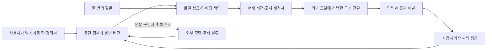

# 세컨브레인 비교와 차별화 검토

- 조사일: 2026-11-02
- 상태: 공식 문서와 현재 코드에 근거한 비교. 경쟁 제품 직접 설치·성능 비교는 하지 않았다.
- 기준: [현재 제품](../project/index.md), [기록 유형](../project/record-types.md), [지식 계층](../architecture/knowledge-layer.md)
- 후속: [제품 발전 제안](../project/evolution-proposals.md)

## 판단

**로컬 저장, 그래프, AI 검색, MCP 연결만으로는 차별성이 충분하지 않다.** 비교 제품들이 이미 이 요소의 일부 또는 여러 개를 제공한다. 우리 제품의 유력한 방향은 **AI 대화에서 남기기로 한 정리본을 사람이 확인·정정하고, 에이전트가 현재 유효한 버전과 정확한 본문 구간을 근거로 재사용하는 경험**이다. 개별 기술이 독점적이라는 뜻이 아니라 이 사용 흐름에 제품 범위를 집중하자는 제안이다.

현재 강점은 정리본·버전·세부 구간·주제·관계·검색 색인의 역할이 분리되어 있고, 웹과 MCP가 같은 도메인 규칙을 사용한다는 점이다. 약점은 데이터 이동성, 주제 품질 관리 화면, 실제 한국어 장기 사용 평가, 설치 경험이다. 홈의 테스트 기록 12개는 동작 확인용 합성 자료이며 제품 수요·분류 정확도·장기 검색 성능의 근거가 아니다.

## 비교 범위

공식 홈페이지, 공식 도움말, 프로젝트 소유 GitHub 문서를 사용했다. 아래 모든 외부 링크의 확인일은 **2026-11-02**다. 문서에 없는 기능을 ‘없음’으로 판정하지 않았다. 베타·프리릴리스와 안정 API, 호스팅 제품과 오픈소스 SDK를 구분한다. 가격·별점·스타 수는 이번 판단의 기준으로 삼지 않는다.

| 제품 | 확인한 중심 경험 | 우리 제품에 주는 시사점 |
| --- | --- | --- |
| Obsidian | 로컬 Markdown 파일, 링크·그래프, 태그·구조화 속성 | 지식 소유권과 이동성은 이미 강한 기준이다. 그래프 자체보다 검색·정정·에이전트 재사용의 편의로 경쟁해야 한다. |
| Logseq | 페이지·블록 기반 지식 관리, DB 버전의 속성 있는 태그, MCP | 태그를 단순 문자열 이상으로 관리하거나 에이전트를 연결하는 것만으로는 고유하지 않다. |
| Anytype | 타입·속성·본문을 가진 객체, 로컬 데이터와 암호화·동기화 | 사용자 정의 객체 체계와 협업을 전부 따라가기보다 지식 재사용에 필요한 분류만 유지한다. |
| SiYuan | 세밀한 블록 참조, 문서 편집, 검색·내보내기·AI 기능 | 본문 구간을 인용하는 것 자체보다 수정 이후 그 근거가 여전히 유효한지 보여주는 경험이 중요하다. |
| Khoj | 개인 자료의 자연어 검색과 근거 노트가 있는 AI 대화 | ‘내 자료에 질문하기’는 이미 직접 경쟁 영역이다. 우리는 명시적 저장·정정과 단일 질문 흐름에 집중할 수 있다. |
| Mem0 | AI 애플리케이션용 지속 기억 계층과 검색 | 에이전트 기억도 별도 시장이 있다. 사용자에게 보이고 정정 가능한 정리본 중심의 제품이라는 차이를 만들어야 한다. |

### Obsidian

Obsidian은 로컬 폴더의 Markdown 파일을 정본으로 사용하며 다른 편집기로도 관리할 수 있다. 태그는 본문 또는 속성에 넣고 중첩 구조로 검색할 수 있다. 별도 속성에는 날짜·체크박스·숫자·링크 등을 둘 수 있고, 그래프는 노트의 연결과 지역 그래프를 보여준다. [저장 방식](https://obsidian.md/help/data-storage), [태그](https://obsidian.md/help/tags), [속성](https://obsidian.md/help/properties), [그래프](https://obsidian.md/help/Plugins/Graph%2Bview)

**해석:** 사용자가 이미 Markdown 자료를 갖고 있다면 우리 제품의 입력·내보내기 부재는 채택 비용이 된다. 현재 SQLite 백업은 복구 수단이지 다른 도구에서 바로 읽는 표준 문서 교환 경험과 같지 않다. 플러그인 전체를 조사하지 않았으므로 Obsidian에 AI 기억 기능이 없다고 주장하지 않는다.

### Logseq

Logseq 공식 저장소는 기존 파일 기반 작업과 새 DB 그래프를 구분하며 DB 버전을 베타로 표시한다. DB 문서의 태그는 속성을 부여하고 부모 태그의 속성을 상속할 수 있다. 같은 문서에는 Streamable HTTP MCP, 검색·생성·편집, 변경 미리보기 기능도 명시되어 있다. [프로젝트와 DB 상태](https://github.com/logseq/logseq), [DB 태그·MCP 안내](https://github.com/logseq/docs/blob/master/db-version.md)

**해석:** ‘MCP로 AI가 노트를 저장한다’는 문구는 충분한 차별점이 아니다. 우리 제품에서는 명시적 사용자 요청, 저장 결과 표시, 충돌 검사, 삭제 재확인, 출처 상태가 함께 일관되게 작동하는지를 강조할 수 있다. Logseq의 베타 상태를 우리 제품의 안정성 우위로 해석하지 않는다.

### Anytype

Anytype은 객체에 타입·속성과 본문을 두고 API로 생성·조회·정정할 수 있다. 공식 FAQ는 로컬 우선 저장, 기기 간 동기화 전 암호화, 로컬 전용 모드와 자체 백업 노드를 설명한다. API v2는 로컬에서 전체 문서를 읽고 일괄 수정하는 에이전트용 형태를 제공하지만 프리릴리스이며 안정성이 필요한 연동에는 v1을 권한다. [객체 API](https://developers.anytype.io/docs/guides/get-started/objects/), [저장·암호화 FAQ](https://anytype.io/faq/), [v2 상태와 계약](https://developers.anytype.io/docs/reference/v2/anytype-api/)

**해석:** 로컬 API와 구조화 객체 역시 기존 영역이다. 반면 우리 제품의 RecordKind는 사용자 정의 데이터베이스 설계 도구가 아니라 ‘후속 질문에서 어떤 목적으로 재사용하는가’를 위한 제한된 분류다. 두 제품의 범위가 다르다. Anytype의 개인용·Business 정책 또는 동기화·AI 호출을 한 가지 보안 속성으로 일반화하지 않는다.

### SiYuan

SiYuan은 블록 수준 참조와 양방향 링크, 사용자 속성, Markdown 편집, SQL 질의, Markdown/PDF/HTML 등의 내보내기, 플래시카드, 외부 OpenAI API를 사용하는 AI 쓰기·질의응답을 공식 기능으로 안내한다. [공식 기능 목록](https://github.com/siyuan-note/siyuan#-features)

**해석:** 편집·참조·내보내기의 폭에서는 기존 제품이 넓다. 우리 제품이 종합 편집기 경쟁으로 확장되면 현재의 좁은 사용 목적과 유지보수 여력이 흐려진다. 작은 정리본에서 출발해 출처를 확인하고 정정하는 흐름을 먼저 완성하는 편이 적합하다.

### Khoj

Khoj는 문서·노트의 자연어 검색, 관련 자료를 활용한 AI 대화, 근거 노트 표시와 자료 필터를 제공한다. 클라우드와 자체 호스팅을 구분하며 자체 호스팅에서는 로컬 모델 또는 외부 모델을 선택할 수 있다. 따라서 자체 호스팅이라는 이유만으로 모든 구성이 외부 전송 없이 동작하는 것은 아니다. [개요](https://docs.khoj.dev/), [근거·필터·대화](https://docs.khoj.dev/features/chat/), [자체 호스팅과 모델 설정](https://docs.khoj.dev/get-started/setup/)

**해석:** 검색 아래 답변과 출처를 두는 화면만으로는 큰 차이가 없다. 우리는 대화 전체 수집을 요구하지 않고 사용자가 남긴 정리본의 의미·출처·수정 상태를 지키는 것이 더 구체적인 선택 이유다. 다중 대화와 웹 조사 기능은 현재 범위로 가져오지 않는다.

### Mem0

Mem0는 AI 앱·에이전트용 지속 기억 계층이다. 현재 공식 저장소는 단일 호출의 추가 중심 추출, 개체 연결, 여러 검색 신호의 결합, 시간 정보를 활용한 검색을 설명한다. 문서의 벤치마크는 관리형 플랫폼 수치로, 오픈소스 SDK에 그대로 적용하지 말라고 명시한다. 플랫폼 문서는 MCP 연결도 안내한다. [공식 저장소](https://github.com/mem0ai/mem0), [플랫폼 빠른 시작](https://docs.mem0.ai/platform/quickstart)

**해석:** 이 프로젝트는 Mem0와 같은 범용 기억 인프라를 새로 이기는 것을 목표로 삼을 필요가 없다. 사용자에게 읽히는 정리본을 정본으로 보존하면서 현재 요청의 근거로 재사용하는 제품을 만들 수 있다. Mem0의 공개 성능 수치와 우리 소규모 한국어 합성 시험은 데이터·모델·예산이 달라 직접 비교할 수 없다.

## 현재 코드로 말할 수 있는 차이

아래는 시장에서 유일하다는 주장이 아니라 **현재 코드에 존재하는 제품 선택의 조합**이다. 개별 검증 근거는 [004 검증](../specs/004-local-runtime/validation.md)과 해당 후속 문서에 둔다.

| 선택 | 현재 구현 근거 | 아직 주장하면 안 되는 내용 |
| --- | --- | --- |
| 원본 대화 전체 대신 명시적으로 저장한 정리본 | `CreateCaptureInput.body_markdown`, 웹 편집기, MCP/스킬 저장 계약 | 대화 원본과 저장본 사이의 사실 일치가 자동 검증된다는 주장 |
| 사람이 읽는 기록과 에이전트가 쓰는 구간을 같은 정본에 연결 | `CaptureRevision`, `KnowledgeNode`, `SourceRef`의 버전·Unicode 위치 | 모든 인용이 사실이라는 주장. 출처 유효성과 주장 지지는 다르다. |
| 수정·삭제 뒤 검색과 답변 근거를 다시 확인 | 검색 후보의 현재 revision·세대 검사, 질문 생성 전후 출처 검사 | 완전한 무오류·무환각 보장 |
| 학습·경험·감정·선호·결정의 재사용 목적을 구분 | 9개 `RecordKind`, `origin`, `verification_state`, 명시적 관계 | 실제 사용자 의도 분류 정확도가 검증되었다는 주장 |
| 웹과 Codex가 같은 기록·충돌·삭제 규칙을 사용 | 공통 `RecordService`, HTTP/MCP 입력 모델 | 모든 에이전트·클라이언트와의 호환성 |
| 한국어 CPU 임베딩과 로컬 정본·색인 | KURE-v2, SQLite, LanceDB | 모든 OS 지원 완료 또는 완전한 오프라인 AI |

‘원문 구간’은 **제품에 저장한 Markdown 정리본의 구간**을 뜻한다. 원래 AI 대화 세션의 원문이 아니다. 이 구분은 출처 UI와 소개 문구에서도 유지해야 한다.

## 로컬 저장과 외부 추론 경계

우리 제품은 기록·버전·검색 색인을 로컬에 둔다. 그러나 현재 주제 분류와 AI 답변은 자체 웹에서 로그인한 **외부 모델**을 호출한다. 분류에는 저장 본문 구간과 후보 주제, 답변에는 질문과 선택된 근거가 전달된다. 따라서 ‘데이터가 절대 기기 밖으로 나가지 않는다’거나 ‘완전 오프라인 세컨브레인’으로 소개하면 실제 구현과 다르다.

`visibility=private`는 향후 공개 범위를 위한 메타데이터이며 현재 외부 모델 호출 차단이나 접근 제어 정책을 뜻하지 않는다. `public` 기본값도 공유 게시의 실행과 다르다. 이 경계를 유지하는 것은 이번 조사에 필요한 사실 정리이며, 보류한 외부 전송 정책이나 공유 기능을 자동 도입하는 결정이 아니다.

## 태그·주제 구조 평가

별도의 `tags: string[]`를 지금 추가하기보다 현재 **Concept를 주제 태그의 정본으로 유지**하는 편이 적합하다. 이름·별칭·설명이 있는 주제 ID는 단순 문자열보다 정정과 동명이의 구별에 유리하다. 사용자에게는 ‘주제’로 보이고, 저장 시 `concept_hints`는 연결을 도와주는 입력이지 확정 태그가 아니라는 점을 명확히 한다.

| 축 | 답하는 질문 | 예시 | 평가 |
| --- | --- | --- | --- |
| RecordKind | 왜 다시 꺼내 쓸까? | 지식, 회고, 결정 | 9개 목적 분류를 유지. 복수 선택과 미분류를 허용하는 것이 적절하다. |
| Concept | 무엇에 관한 내용인가? | 운영체제, 특정 프로젝트 | 동적인 주제·별칭 관리가 적절하다. 분야를 enum에 넣지 않는다. |
| NodeKind | 본문의 이 부분은 어떤 의미인가? | 질문, 가설, 감정, 결과 | 기록 전체 유형과 분리한다. Node 없는 짧은 메모도 정상이다. |
| 출처·검증 상태 | 누가 말했고 무엇을 확인했나? | 사용자 보고, AI 설명, 미확인 | 주제나 유형으로 진실성을 추정하지 않는다. |
| 명시적 Relation | 두 기록은 어떤 관계인가? | 정정, 보완, 상충 | 동일 주제·벡터 유사도를 인과·상충 관계로 자동 확정하지 않는다. |

현재 개선할 지점은 **분류 축을 더 늘리는 것보다 기존 축을 일관되게 관리하는 것**이다.

- 주제 자동 생성은 이름이 같다고 병합하지 않는 보수적 정책을 갖는다. 대신 사용자가 중복 후보를 비교하고 동일 의미인지 결정할 관리 경험은 보완 여지가 있다. 프로젝트명·동음이의어를 자동 합치면 안 된다.
- 이름·별칭 검색과 정정은 있지만 전체 주제의 사용 빈도·미연결·중복 후보·설명 부족을 한눈에 확인하는 관리 화면은 별도 후속이다.
- 저장 후 주제 작업이 실패·보류되어도 본문은 남고 주제 없는 검색은 가능하다는 계약을 유지한다. 실패를 저장 실패처럼 보이게 하거나 자동 분류를 매번 승인하게 만들지 않는다.
- 이번 점검에서 Node 전용 주제가 기록 목록에서 누락되던 차이를 공통 SQL 조건으로 수정했다. 기록 주제와 현재 Node 주제는 데이터상 구분하면서 목록·검색·홈 그래프에 같은 선택 조건을 적용한다. 자동 분류의 신규 후보 충돌 검사와 주제·별칭 검색에는 NFC·대소문자·공백 정규화 비교 키를 적용했고 저장된 이름과 동명이의 주제 ID는 보존한다. 자동 병합을 도입한 것은 아니다.
- 홈 필터가 주제 첫 100개만 읽던 문제는 전체 페이지 로딩으로 보완했다. 주제 로딩 오류와 재시도를 드러내고 저장 후 목록을 갱신한다. 같은 이름에는 가능한 경우 설명을 함께 표시한다. 이 보완과 별도 주제 관리 화면·별칭 편집·승인 병합은 구분한다.
- 현재 자동 분류는 전체 주제 카탈로그에서 문자열 일치·기존 연결·최근 수정 기준으로 상위 100개 후보를 고른다. 주제가 많고 표현이 다를 때 기존 주제를 놓칠 가능성은 있다. 이는 코드 구조에 근거한 위험이며 현재 자료에서 측정된 오류율이 아니다.

주제 계층, 중요도 숫자, 감정 점수, 자동 만료일을 일괄 도입하지 않는다. 실제로 검색 실패가 어떤 축에서 생기는지 수집한 뒤 최소 필드를 선택한다. 권장 순서와 수용 기준은 [발전 제안](../project/evolution-proposals.md)에 정리했다.

## 이번 조사에서 하지 않은 평가

- 경쟁 제품의 플러그인 전체·모든 배포 형태·내부 출처 무효화 구현의 부재를 입증하지 않았다.
- 모든 제품을 같은 한국어 문서와 하드웨어에서 실행해 속도·정확도를 비교하지 않았다.
- 합성 테스트 기록을 실제 사용자의 학습·감정·취향 데이터로 해석하지 않았다.
- 경쟁 서비스의 개인정보·라이선스 법적 적합성 검토는 수행하지 않았다. 공개 저장소로 옮길 코드·자산의 실제 라이선스 점검은 별도 배포 관문이다.
