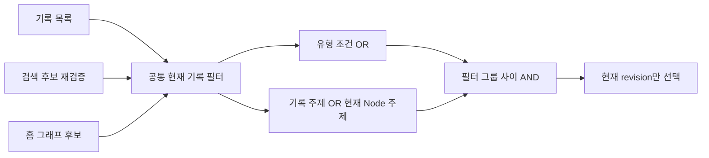

# 리모트 이전 백엔드 최종 점검

- 날짜: 2026-11-02
- 상태: 코드 수정·백엔드 자동 회귀 완료. 대규모 데이터와 네이티브 OS 검증은 별도 과제.
- 범위: 기존 002·004의 도메인 계약, 검색·주제·관계 정합성, 백엔드 유지보수성. 실제 사용자 저장소와 인증 상태는 변경하지 않는다.

## 수정 기준

| 항목 | 기대 동작과 검증 |
| --- | --- |
| 주제 필터 일치 | 같은 주제 필터는 기록 전체 또는 현재 Node에 연결된 기록을 목록·검색·홈 그래프에서 동일하게 선택한다. Node 주제를 기록 주제로 복제하지 않는다. 오래된 Node 연결은 제외한다. |
| 관계 철회 | 끝점·근거 기록이 현재 조회 가능하면, 내용 변경으로 검색 근거 자격을 잃은 관계도 명시적 ID와 이유로 철회할 수 있다. 삭제되거나 다른 brain의 기록은 여전히 접근을 거절한다. 조회 목록은 유효한 관계만 노출한다. |
| 사건 날짜 필터 | 날짜 경계는 `YYYY-MM-DD`만 수락한다. `20261102`나 주차 날짜처럼 문자열 비교와 맞지 않는 형식은 검증 오류로 거절한다. |
| 공유 출처 검증 비용 | 그래프뿐 아니라 기록 상세·저장 검증·관계에서도 같은 상위 출처를 한 읽기 작업 안에서 재검증하지 않는다. 캐시는 요청 간 보존하지 않으며 뒤이은 본문 정정·삭제를 즉시 반영한다. |
| 주제 이름 비교 | 주제 검색·자동 신규 후보의 충돌 확인에는 NFC·대소문자·앞뒤/연속 공백을 정규화한 비교 키를 사용한다. 저장 이름·별칭은 보존하고, 명시적으로 만든 동명이의 주제 ID는 합치지 않는다. |
| 후속 작업 복구 | 주제 작업의 claim/실패 기록 과정에서 일시적 예외가 나도 반복 워커는 종료되지 않고 다음 주기에 재시도한다. 기존 lease·최대 시도 정책과 종료 취소는 유지하며 예외 본문·토큰은 로그에 출력하지 않는다. |

위 항목은 기존 조회·정정 계약을 일관되게 적용하는 보완이며 주제 자동 병합·기록 자동 정정·삭제 정책 변경을 도입하지 않는다. 수정 결과와 추가 위험은 아래에 기록한다.

## 확인한 문제와 변경

| 문제 | 변경 | 구현 위치 |
| --- | --- | --- |
| Node 전용 주제로 필터할 때 목록은 비고 검색·그래프는 나타나는 불일치 | 현재 revision의 기록·Node 주제 합집합과 유형 교집합을 공통 SQL 조건으로 사용한다. 목록의 과거 Node는 조회 대상이 아니다. | `record_filters.py`, `records.py`, `search.py` |
| 공백·Unicode 조합 차이로 자동 주제가 다시 만들어질 수 있음 | 비교 키만 정규화한다. 후보 충돌은 재조회 대상으로 처리하며 다른 의미의 주제를 자동 선택하지 않는다. | `concept_labels.py`, `records.py` |
| 출처 내용이 변경된 관계를 ID로 명시적 철회할 수 없음 | 조회 자격과 현재 근거 적합성을 분리한다. 철회는 접근 가능한 과거 관계를 정정할 수 있고, 검색은 여전히 현재 유효한 관계만 사용한다. | `records.py` |
| 날짜 문자열 비교에 맞지 않는 기본형/주차형 ISO 입력 허용 | 검색 경계와 사건 instant의 달력 날짜를 검증한다. 기존 저장본은 자동 수정하지 않는다. | `schemas.py`, `search.py` |
| 그래프 외 경로의 공유 출처를 분기마다 반복 검증 | 한 상세/저장/관계 검증 안에서 같은 SourceRef 결과를 재사용한다. 후속 요청에서는 다시 계산한다. | `records.py` |
| 주제 워커의 claim/실패 기록 예외가 전체 워커를 종료시킴 | 공통 주기 실행기에서 다음 주기로 복구한다. 취소는 전파하고, 반복 오류는 처음 한 번만 내용 없는 경고로 남긴다. | `background.py`, `main.py` |

## 유지보수성 판단

좋은 기반은 공통 도메인 서비스, 불변 revision과 SQLite 제약/트리거, 예상 버전·멱등성, 정본과 outbox의 같은 트랜잭션, 검색 결과의 현재 출처 재검증이다. HTTP와 MCP가 별도로 저장 의미를 구현하지 않으며 실제 저장소·LanceDB·고정 CPU 모델의 회귀 시험이 있다.

다만 `RecordService`와 `SearchService`에 책임이 집중되어 있고 검색·주제 분류가 private 도메인 메서드에 의존한다. 이번에는 의미가 중복되어 실제 불일치가 난 필터와 주기 실행기를 분리했다. 남은 서비스 전체를 이름만 나누기보다, 다음 작업에서 조회 전용 snapshot/출처 resolver 경계를 먼저 공개 인터페이스로 만든 뒤 분리하는 편이 안전하다.

추가로 확인할 사항:

- 목록은 전체 현재 기록의 snapshot을 만들고 검색은 전체 현재 기록의 적합성을 검사한다. 작은 로컬 MVP에는 동작하지만 대규모 기록을 대상으로 한 비용은 검증하지 않았다. SQL keyset pagination과 후보 우선 검증을 실제 규모 시험과 함께 설계해야 한다.
- 출처 공유 분기의 반복 비용은 줄였지만, 일반 상세 조회의 매우 깊은 출처 체인은 재귀 방식이다. 그래프는 깊이 32/작업 512 예산이 별도로 있다. 일반 상세에도 명시적인 검증 예산 또는 반복형 resolver를 도입할 때에는 ‘미검증’을 ‘무효’로 잘못 표시하지 않는 계약이 필요하다.
- 주제 후보는 구간마다 최대 100개를 모델에 제시한다. 주제가 늘었을 때 관련 후보를 놓치지 않는지는 실제 한국어 데이터로 평가해야 한다.
- 명시적 주제는 동명이의 표현을 허용한다. 자동 비교 키는 중복 생성을 줄이지만 별칭 의미 검토·사용자 승인 병합 기능을 대체하지 않는다.
- Python 형식/정적 분석과 API 타입 생성은 아직 전면 적용되어 있지 않다. 기존 파일 전면 재포맷보다 변경 파일부터 기준을 적용하고 별도 정리 작업으로 분리하는 편이 회귀 검토에 유리하다.

원격 게시 여부와 별개로 Windows·macOS·Linux 네이티브 실행과 사용자가 보류한 실계정 로그아웃/재로그인은 이번 백엔드 자동 시험으로 대체하지 않는다.

## 검증

시험은 임시 SQLite/Lance 저장소에서 실행하며 실제 8000번 서비스 데이터·로그인·설정은 변경하지 않았다. 실행 중인 제품 서버를 이 하위 점검에서 재시작하지 않았다.

- 기준선: 160 passed, 1 skipped(고정 KURE 모델 경로를 지정하지 않은 실행).
- 최종 실제 KURE CPU 포함 회귀: **181 passed, 37.13초**, skip 없음. 고정 모델 snapshot 경로를 `KURE_TEST_MODEL_PATH`에 지정하고 `backend/.venv/bin/python -m pytest backend/tests -q`로 실행했다. 로컬 계정에 새 모델 요청을 보내는 시험이 아니다.
- 추가 시험: 목록/검색/그래프 필터 일치·유형 교집합·과거 Node 제외, 잘못된 날짜, 변경/삭제된 근거의 관계 철회, 이름/별칭 비교와 동명이의 ID 보존, 출처 DAG 요청 내 재사용/다음 요청 무효화, 워커 오류 복구/취소/로그 비밀 비노출.
