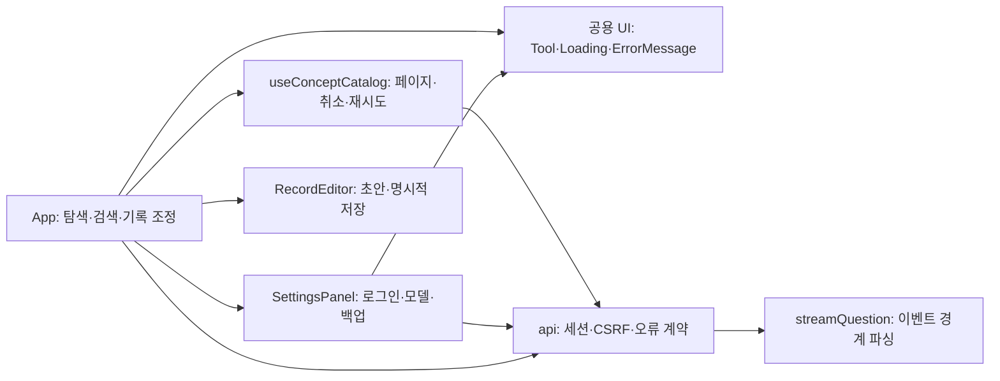

# 프런트엔드 최종 기능·유지보수 점검

2026-11-02 리모트 이전 준비 점검이다. 실제 사용 중인 저장소·로그인 상태는 변경하지 않으며 격리된 브라우저 API fixture로 재현한다.

## 발견과 수정 기준

기존 AC-005의 주제 필터·이전 요청 차단과 AC-008의 재현 가능한 실행을 아래 경계 사례까지 검증한다. 제품 범위를 추가하지 않는다.

| 발견 | 사용자 영향 | 수정·검증 기준 |
| --- | --- | --- |
| 홈 주제는 첫 100개만 읽고 실패를 숨기며 저장 후 갱신하지 않음 | 뒤쪽 주제와 새로 연결된 주제를 필터에서 찾을 수 없음 | 전체 페이지를 읽고 별도 오류·재시도를 제공한다. 저장·자동 연결 완료 후 갱신하고 오래된 조회는 취소한다. |
| 기록 요청 도중 뒤로가기로 홈에 돌아와도 로딩 상태가 남음 | 홈에서 계속 기록 로딩이 보일 수 있음 | 상세 상태와 진행 중 요청 버전을 함께 정리한다. 인코딩이 깨진 딥링크도 화면을 중단하지 않는다. |
| SSE 줄바꿈을 각 네트워크 청크에서 정규화 | CR/LF가 서로 다른 청크로 오면 답변 이벤트를 놓칠 수 있음 | 스트림 버퍼에서 CRLF/LF/CR 경계를 파싱하고 분할 전송을 검증한다. |
| 설정의 오래된 polling 응답이 인증·모델 변경 후 도착할 수 있음 | 로그아웃 이후 이전 로그인 표시가 되살아나거나 모델 변경이 경합함 | 설정 읽기를 취소·버전 검증하고 변경 요청 중 다른 설정 변경을 막는다. |
| 상세를 떠난 뒤 늦게 온 삭제 미리보기 | 현재 보고 있는 위치와 무관한 삭제 확인창이 열림 | 상세 요청 버전이 바뀌면 미리보기를 버린다. 실제 삭제 확인 정책은 유지한다. |
| 읽기 중 그래프 글자가 유리 패널 뒤로 비침 | 본문과 배경 글자가 겹쳐 읽기 어려움 | 그래프를 유지하면서 읽기 중 배경 라벨만 흐리게 한다. |
| 설정 UI와 공용 표시 도구가 2,040줄 App에 결합 | 기록 탐색 변경과 인증·백업 UI 변경의 검토 범위가 커짐 | 설정 컴포넌트와 공용 UI, 주제 목록 hook을 분리하며 공개 API와 기존 UI 동작을 유지한다. |

## 설계



주제는 독립적인 자유 태그 목록이 아니라 ID·이름·별칭을 가진 Concept이다. 유형은 기록의 용도, 주제는 내용 영역을 나타내므로 구분을 유지한다. 주제 힌트는 확정 연결이 아니며 서버가 연결한 실제 주제를 상세에 보여준다. 주제 병합·별칭 편집·품질 대시보드는 별도 제품 제안으로 다루고 이 점검에서 자동 분류 정책을 바꾸지 않는다.

## 검증 결과

- `npm run build`: TypeScript 및 Vite 프로덕션 빌드 성공.
- `npm test`: **57 passed, 3 skipped**. 기본 실행에서 건너뛴 3건은 아래 격리 서버에서 별도로 활성화해 모두 통과했다.
- 마지막 배경 라벨 조정과 요청 완료 시점까지 기다리는 경합 검사 보강 후 `final-review`, `graph-ux`, `home-graph` 관련 **21건 재실행 통과**.
- 추가 회귀 11건: 101개 주제 페이지 연결, 동명 주제 설명 구별, 실패 후 재시도, 저장·자동 연결 후 필터 갱신, 뒤로가기 경합, 깨진 딥링크, CRLF/LF/CR의 바이트 단위 한국어 SSE, 설정 polling 경합, 늦은 삭제 미리보기.
- 사용자 실서비스 `http://127.0.0.1:8000/`에서 **읽기 전용** 홈 그래프·기록 열기 확인. 데스크톱 1440px와 모바일 390px 가로 넘침 없음, JavaScript 오류 0. 로그인·모델·기록은 변경하지 않았다.
- [실서비스 데스크톱](artifacts/final-review/live-desktop.png), [모바일](artifacts/final-review/live-mobile.png), [측정 결과](artifacts/final-review/frontend-smoke.json).

전체 OS·실계정 재로그인 검증과 구분한다. 이번 브라우저 회귀는 Chromium/WSL이며 다른 브라우저나 OS 완료를 뜻하지 않는다.

## 유지보수 평가와 후속 작업

- `SettingsPanel.tsx`, `ui.tsx`, `useConceptCatalog.ts`를 분리했다. `App.tsx`는 2,040줄에서 약 1,760줄로 줄었으며 설정·통신 실패와 기록 탐색의 수정 범위를 분리했다.
- 주제 페이지 로딩을 홈과 주제 정정이 공유한다. 취소·페이지 반복 감지·ID 중복 제거를 한 곳에서 처리하며 같은 이름에 설명이 있으면 홈에서도 구분한다.
- 전체 상태를 관리하는 App과 전역 CSS는 여전히 크다. 다음 기능 추가 때 검색 흐름 hook, 출처 패널, 기록 목록을 책임별로 분리할 가치가 있다. 이번 점검에서 상태관리 라이브러리를 새로 도입하거나 전체 UI를 재작성하지 않았다.
- Vite의 `3d-force-graph` 지연 로딩 청크 약 1.42 MB(압축 전) 경고는 남아 있다. 그래프 없는 검색 경로의 비용 측정, 큰 데이터셋에서 컨텍스트 전환 비용을 먼저 측정한 뒤 조정한다.
- 정적 타입 검사와 브라우저 행동 검사는 있으나 ESLint/hooks 의존성 규칙은 아직 없다. 규칙 도입은 기존 효과의 재호출/취소 의미를 함께 검토하는 별도 작업이 적절하다.
- 대규모 주제 수에서는 전체 목록을 native select에 넣는 방식보다 서버 검색 기반 선택기가 유리하다. 이번 누락 수정은 올바른 전체 목록을 제공하며 검색형 주제 선택기는 후속 UX 기능으로 제안한다.


## 격리된 실제 API 통합 검증

최신 backend와 빌드한 frontend를 빈 임시 데이터 폴더에서 실행했다. 최종 포트는 **8014**, `background_jobs=False`로 AI·임베딩 작업을 실행하지 않았으며 사용자 서비스 8000·실계정은 사용하지 않았다.

실행기는 `tempfile.mkdtemp(prefix="cache-me-final-integration-")`로 데이터 폴더를 만들고 다음처럼 앱을 구성했다.

```python
app = create_app(Settings(
    data_dir=data,
    port=8014,
    frontend_dir=Path("frontend/dist").resolve(),
    background_jobs=False,
))
uvicorn.run(app, host="127.0.0.1", port=8014, log_level="warning")
```

WSL 실행 명령은 저장소 루트에서 `PYTHONPATH=backend/src backend/.venv/bin/python /tmp/cache-me-final-integration-server.py`였다. `frontend/`에서는 아래 환경으로 지정한 세 파일만 실행했다. `SECOND_BRAIN_QA_DATA_DIR`는 이 실행기가 생성한 격리 폴더이며 일반 사용자 데이터 경로를 넣으면 안 된다.

```bash
SECOND_BRAIN_INTEGRATION=1 \
SECOND_BRAIN_TEST_URL=http://127.0.0.1:8014 \
SECOND_BRAIN_QA_DATA_DIR="$qa_data_dir" \
LD_LIBRARY_PATH=/tmp/second-brain-graph-preview-tools/browser-libs/usr/lib/x86_64-linux-gnu \
npm test -- tests/integration.spec.ts tests/management-integration.spec.ts tests/home-graph-integration.spec.ts
```

결과: **3 passed, 0 failed, 0 skipped (21.4초)**. 기록 생성·수정·주제 정정·출처 교체·출처 변경 재검토·확인 소프트 삭제·백업 다운로드·실패 주제 재시도·대상만 병합·Unicode 구간 관계 생성/철회·홈 그래프/모바일 표시를 검증했다. 테스트용 실패 주제 상태는 격리 SQLite에 직접 지정하며 실제 모델 실패를 재현했다고 주장하지 않는다. 테스트 프로세스 종료 후 이 작업이 시작한 서버를 종료했다. [구조화 결과](artifacts/final-review/frontend-integration.json)

첫 실행에서는 홈 그래프 검사가 유일한 기록을 삭제한 뒤에도 Canvas가 남을 것으로 가정해 실패했다. 빈 상태를 표시하는 제품 동작은 올바르다. 검사가 스스로 살아남을 기록을 준비하고 그 기록이 유지되는지 검사하도록 수정한 뒤 **다른 빈 데이터 폴더**에서 세 검사를 모두 다시 실행했다. 기존 QA 데이터에 의존하던 테스트 문제를 제거했다.
