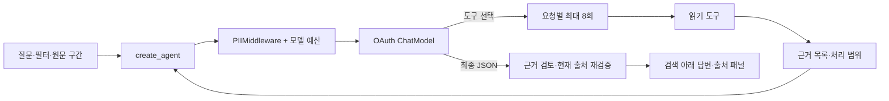

# ReAct 에이전트와 개인정보 미들웨어

상태: 구현·로컬 자동 검증·실계정 도구 응답 확인 완료. 사용자가 요청한 `create_agent` 전환, 도구 호출 최대 8회, 기본 `PIIMiddleware` 적용을 함께 다룬다.

## 요구사항과 수용 기준

1. `langchain.agents.create_agent`로 모델 → 읽기 도구 → 모델 반복을 구성한다. 검색 질의와 재검색 여부는 모델이 선택한다. 저장·정정·삭제 도구는 연결하지 않는다.
2. 요청 하나에서 전체 도구 실행은 최대 8회다. 병렬 호출도 각각 세며 실패한 실행도 소비한다. 9번째 호출은 실행하지 않고 한도 사실을 모델에 전달한다. 8회는 반복 횟수나 `recursion_limit`이 아니다.
3. 에이전트 모델 호출은 최대 9회, 별도 근거 검토 1회를 포함한 전체 최대 10회, 전체 90초다. 한도를 넘거나 취소되면 새 도구·모델 작업을 시작하지 않는다. 모든 카운터와 근거는 요청 내에서만 유지한다.
4. UI 필터는 서버가 도구에 강제한다. 원 질문 구간의 처리 여부는 실제 검색에서 추적하고, 동의어·재작성 검색만으로 원문 전체를 처리했다고 표시하지 않는다. 미검색 구간과 검색 한도를 결과의 제한 사항에 표시한다.
5. 답변 출처는 서버가 실제 읽고 검증한 근거 ID로만 조립한다. 원문·Node 위치·revision·상태 세대·명시적 관계를 최종 응답 전 다시 검사한다. 저장 자료의 지시를 신뢰하지 않는다.
6. 기존 자체 OAuth와 선택 모델을 그대로 사용한다. 모델 도중 변경·로그아웃은 요청을 중단한다. 스트림의 미완료·잘못된 도구 인수·모델 형식 오류를 성공 처리하지 않는다.
7. 공식 `PIIMiddleware`의 `email`, `credit_card`, `ip` 검출과 `redact` 전략으로 질문·도구 결과·모델 응답·도구 인수의 텍스트를 처리한다. 기존 일반 생성 경로(분류·근거 검토)도 같은 모델 경계를 거친다. 원문 식별자·출처 위치는 보존한다.
8. 저장된 원문과 출처 패널의 원문을 소급 변경하지 않는다. 이름·전화번호·주소·한국 주민번호나 문맥상 민감성 판단, 저장 허용 정책, LLM 의미 필터는 이번 범위가 아니다. 검출되지 않는 개인정보가 있을 수 있다.

## 구현 계획

- [x] 자체 OAuth의 Responses tool-call 변환과 LangChain ChatModel 어댑터
- [x] 읽기 도구·요청별 근거 수집과 8회 실행 제한
- [x] 기존 근거 검토·출처 정합성·입력 예산 보존
- [x] 공식 PII 미들웨어와 모델 경계 연결
- [x] 병렬/연속 초과 호출·요청 격리·취소·필터·PII·인증 회귀 검증
- [x] 아키텍처와 실행 흐름 갱신

## 설계

도구가 요청별 근거 목록을 누적하고 모델은 근거 ID를 답변에 인용한다. 사용자에게 공개할 SourceRef는 서버의 목록에서만 가져온다. 도구 결과와 모델 답변을 개인정보 처리한 후 다음 모델 호출 또는 최종 검증으로 전달한다. provider 스트림은 서버에서 모아 처리하며 검증 전 텍스트를 웹으로 직접 보내지 않는다.

| 모듈 | 책임 |
| --- | --- |
| `questions.py` | 원 질문 구간·요청 생명주기·답변 파싱·근거 검토·출처 재검증 |
| `question_agent.py` | `create_agent`·도구/모델 실행 상한·전체 메시지 입력 예산 |
| `question_tools.py` | 필터를 강제하는 `search_knowledge`·이미 찾은 근거의 `read_evidence`·요청별 근거 목록 |
| `chat_model.py` / `auth.py` | LangChain ChatModel과 기존 OAuth Responses의 함수 호출·결과 변환 |
| `privacy.py` | 내장 PII 미들웨어·전체 메시지·도구 인수·JSON 정제 |

한 번의 넓은 검색이 기록 10개 한도를 전부 차지하지 않도록, 미검색 원문 구간이 있으면 남은 기록 자리를 나누어 둔다. 근거를 중간에서 자르지 않고 제외 사실을 표시한다. 후속 검색은 같은 근거 ID를 재사용하며 새 요청에는 근거와 카운터를 넘기지 않는다.

LangChain은 `1.4.7`로 잠갔다. `ToolCallLimitMiddleware(run_limit=8, exit_behavior="continue")`와 실행 직전의 요청 카운터를 함께 적용한다. 한 응답의 10개 호출 중 8개만 실행하며 인수 오류·미등록 도구도 예산을 소비한다. 8회에 도달하거나 마지막 모델 차례가 되면 도구 목록을 제거하고 현재 근거로 끝내도록 요청한다. 모델이 계속 호출을 요구하면 9번째 실행 없이 명시적 한도 오류로 종료한다.

PII는 `before_model`/`after_model`로 반복 적용하므로 첫 `before_agent`에서 한 번만 검사하지 않는다. OAuth 경계에서는 이전 메시지·도구 인수·JSON 이스케이프를 같은 검출기로 처리한다. 정제한 JSON 키가 겹치면 접미사를 붙여 값을 보존한다. 새 정규식이나 의미 판단 LLM은 추가하지 않았다.

검출 한계: 공식 이메일 검출기는 `learner@example.com의`처럼 한국어 조사가 붙으면 놓칠 수 있다. 이름·전화번호·한국 주민번호는 구성한 3종 검출 대상이 아니다. 저장 원문 전체의 익명화 또는 모든 개인정보 탐지를 보장하지 않는다.

## 검증

최종 백엔드 전체 **222개 통과**(실제 KURE 포함, 36.37초), 실행기 검사 **12개 통과**, 의존성 lock 검사를 완료했다. 자동 검사는 병렬 10개 요청·연속 재검색·실패/미등록 도구·도구 제거 후 호출 강행·동시 요청 간 격리·인증 변경·취소·필터·임의 출처 ID·PII·원문 보존을 포함한다. [질문 회귀](../../../backend/tests/test_question_agent.py), [OAuth 어댑터 회귀](../../../backend/tests/test_chat_model.py), [PII 회귀](../../../backend/tests/test_privacy.py)를 사용한다.

실계정 웹 API의 실제 도구 검색과 최종 출처 응답을 확인했다. 단일 주제 질문은 25.58초에 답변 2부분·출처 2개, 복합 질문은 29.79초에 답변 1부분·출처 2개를 반환했다. 두 응답 모두 검색 한계를 반영한 `insufficient` 상태였으며, 일반적인 답변 정확도나 속도 보장으로 해석하지 않는다. 실제 계정 모델에 9번째 실행을 강요하는 검사는 하지 않았으며 실행 상한은 결정적 대체 모델로 검증했다. 로그인·선택 모델·기록 12개의 revision/state는 서버 재시작과 질문 전후 동일했다. 수치와 실행 근거는 [검증 결과](artifacts/react-agent/verification.json)에 기록한다. 004 전체의 네이티브 OS·재로그인 관문은 별도다.

품질 실행기의 삭제된 `gather()` 호출도 현재 읽기 도구로 교체했다. [15개 합성 사례 검색 기준선](quality-react-retrieval-baseline.json)은 Hit@1 1.000, macro Recall@5 0.9667, 근거 맥락 recall 1.000이었다. 처음 실행에서 복합 질문의 뒷부분 근거가 빠져 맥락 recall이 0.9667로 내려가는 문제를 발견했고, 미검색 구간의 기록 자리를 남긴 뒤 같은 자료에서 1.000을 확인했다. 이는 고정 질의 선택의 검색 회귀 평가이며 자율 에이전트의 일반적인 성능이나 모든 질문의 정확도 보장이 아니다.

## 공식 참고

- [LangChain agents](https://docs.langchain.com/oss/python/langchain/agents)
- [PII·도구 호출 제한 미들웨어](https://docs.langchain.com/oss/python/langchain/middleware/built-in)
