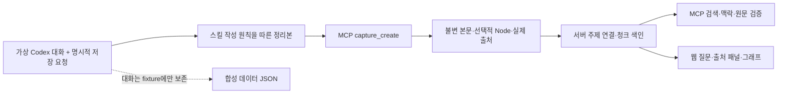

# 여섯 기록 유형과 Codex 저장 시나리오

- 상태: 구현·실제 저장·검증 완료. 자동 주제 연결의 검토 보류 5건은 아래에 구분
- 결정일: 2026-11-02
- 사용자 요청: 유형을 단순화하고 Codex 대화 후 스킬로 저장한 상황을 가정한 충분한 테스트 자료를 실제 저장소에 추가한다.

## 수용 기준

1. 공개 입력 스키마·응답·화면·스킬의 기본 RecordKind는 6개다: `knowledge` 지식, `episode` 경험·회고, `context` 맥락, `idea` 아이디어·계획, `decision` 결정, `artifact` 자료. 복수 유형과 미분류 `[]`는 유지한다.
2. 과거 값은 `procedure → knowledge`, `reflection → episode`, `plan → idea`로 해석한다. 과거 조합의 중복은 하나로 묶고 목록·검색·맥락·그래프·출처 조회에서 같은 의미를 사용한다. 호환 입력을 받더라도 새 저장은 6개 값만 사용하고 공개 도구 스키마는 6개를 안내한다. 알 수 없는 유형은 허용하지 않는다.
3. 기존 기록의 본문·불변 revision·Node·SourceRef·관계·로그인을 유지한다. 이력을 직접 재작성하지 않고 읽기·필터 호환 계층에서 과거 값을 해석한다. DB의 과거 값 허용은 이력 호환 목적이며 새 제품 유형 9개를 유지하는 의미가 아니다. 동등성·멱등성·출처 검증에 변화가 있는지 검사한다.
4. 유형과 본문 템플릿은 일대일로 고정하지 않는다. 지식의 개념 설명/문제 해결, 경험의 사건/회고 등 필요한 섹션만 사용한다. 주체·범위·제안/채택/실행·확인 여부를 본문에 유지하고 빈 형식을 채우려고 사실을 생성하지 않는다. 원문 결과물과 짧은 메모는 보존한다.
5. 새 합성 기록은 40개를 목표로 한다. 6개 유형·미분류·복수 유형, 서로 연결되는 학습/개발/일상/프로젝트 사례, 긴 본문 후반 검색, 미채택 제안, 결정·실행의 구분, 개인과 프로젝트 범위 차이, 재사용 코드·문서 등을 포함한다.
6. 각 사례는 가상 대화 발췌와 명시적인 저장 요청, 스킬이 만들 것으로 기대되는 저장 payload, 검색 질문과 기대 근거를 함께 가진다. 이것은 스킬 호출 상황을 모델링한 합성 자료이며 실제 사용자 대화 이력이나 실제 Codex 모델 실행 결과로 표시하지 않는다. 저장소에는 대화 전체 대신 정리본을 넣는다.
7. 새 기록은 제목에 `[테스트]`를 붙이고 본문에도 가상 인물/프로젝트 등 합성 범위를 명시한다. 공통 안내문으로 모든 본문을 시작하지 않는다. 본문마다 내용에 맞는 첫 문장·구체적인 섹션·주제 힌트를 사용한다. AI 제안을 실제 사용자 선택·경험으로 만들지 않는다.
8. 실제 저장은 정상 MCP `capture_create` 경로를 사용한다. 고정 배치·사례별 request_id와 manifest로 재실행 중복을 막고 커밋된 저장본을 확인한다. 원본 테스트 12개와 다른 기존 기록은 삭제하지 않는다. Node는 정확한 본문 구간에서만 생성하고 출처·관계 ID를 꾸며내지 않는다.
9. 실제 색인 준비·MCP 검색/맥락/원문 왕복·웹 필터/그래프와 표본 질문을 검증한다. 저장·분류·색인 성공과 실모델 답변 품질은 구분해 기록한다. 기존 로그인 로그아웃 검증은 보류 상태를 유지한다.

## 작업

- [x] 유형·호환 해석·공통 필터·출처/멱등성 검증
- [x] 웹 6개 분류·기존 동선·그래프·예시와 테스트 정합성
- [x] 작성 원칙·스킬·설치본 갱신
- [x] 가상 대화·정리본·검색 기대치 40개 작성
- [x] 실제 MCP 저장·색인·검색·웹 검증
- [x] 실행 결과·문서·명세 상태 갱신

## 구현 경계

`record_kinds.py`에서 현재 6개 값과 과거 alias를 관리한다. 입력은 정규화한 뒤 검증·저장하고 SQL 필터는 현재 값에 해당하는 과거 저장값까지 확장한다. 홈페이지와 주변 그래프도 같은 분류를 반환한다. 과거 DB 행이나 불변 revision을 수정하는 migration은 없다.

과거 mutation 영수증은 **원래 alias와 순서까지 같은 요청**을 재시도할 때 검증한다. 과거 요청을 현재 유형으로 바꾸고 같은 request_id를 재사용하면 충돌한다. 새 요청은 정규화한 내용으로 영수증을 만들므로 alias와 현재 값이 같은 의미라면 재시도할 수 있다. 내용·출처가 달라진 요청을 중복 요청으로 허용하지 않는다.



설치된 Codex 스킬도 원본과 함께 갱신했다. 이미 실행 중인 Codex 세션이 예전 도구 스키마나 스킬을 캐시했다면 새 세션/앱 재시작 후 최신 정의를 읽는다. 서버는 과거 유형 입력을 계속 지원한다.

## 시나리오와 재현

[합성 대화·저장본·검색 기대치](artifacts/conversation-data/dataset.json)는 7개 가상 맥락을 다룬다. Python 학습 7개, 별빛 노트 개발 9개, 글쓰기 6개, 모래책장 독서 모임 6개, 일상 기록 4개, 항구 오후 여행 5개, 달팽이 보드 개인 프로젝트 3개다. 실제 사용자의 취향이나 서비스의 확정 기획으로 해석하지 않는다.

주된 유형 기준으로 지식 7개, 경험·회고 7개, 맥락, 아이디어·계획, 결정, 자료는 각각 6개다. 미분류 메모 2개를 포함해 총 40개이며, 4개는 복수 유형을 가진다. 두 개의 긴 본문은 후반부 구간을 검색하는 사례다. 비공개 2개도 로컬 본인 검색에는 포함된다.

[재현 도구](../../../scripts/seed_conversations.py)는 기본 실행 시 자료만 검사한다. `import`는 실제 로컬 저장소에 추가하는 동작이다. 서버가 실행 중이고 MCP 연결·검색 모델이 준비된 환경에서 다음과 같이 실행한다.

```sh
python3 scripts/seed_conversations.py validate
backend/.venv/bin/python scripts/seed_conversations.py import
backend/.venv/bin/python scripts/seed_conversations.py verify
```

Windows에서는 가상환경의 `Scripts/python.exe`를 사용한다. `SECOND_BRAIN_DATA_DIR`·`SECOND_BRAIN_PORT`를 변경한 서버는 같은 환경 설정을 클라이언트에도 전달한다. 실제 저장 manifest는 기본적으로 제품 데이터 디렉터리의 `conversation-imports/`에 보관한다. 다른 저장소의 실행 결과 manifest를 복사해 재사용하지 않는다.

원문 저장 계획과 request_id를 요청 전에 manifest에 고정한다. 실패 뒤 같은 배치로 재실행하면 저장 영수증을 확인하며 중복을 만들지 않는다. 이미 저장한 배치의 본문·유형·Node·출처 계획은 임의로 바꿀 수 없다. 대화 발췌나 평가 질문의 편집은 저장 payload를 바꾸지 않는다.

`verify`는 상위 5개 검색 결과, 맥락 10개 요청 예산, 기대 본문과 출처 구간 왕복, 모든 Node 구간, 본문·메타데이터 보존, 기존 기록 상태와 색인 준비를 검사한다. 이 평가에서 검색과 맥락을 각각 호출하는 것은 두 API의 검증을 위한 것이며 스킬의 일반 조회 흐름에 중복 호출을 요구하지 않는다. `avoid_claims`는 의미 검토용 기대치이며 문자열 검색만으로 답변의 사실성을 자동 판정하지 않는다.

## 검증 결과

- **실제 MCP로 40개 추가, 기존 12개를 포함해 52개.** 새 본문 Node 30개와 실제 선행 기록의 출처 37개를 저장했다. 초기 생성 revision 40개의 경로가 모두 `mcp`이고, 기존 revision의 과거 유형 값은 DB에 그대로 남아 있음을 읽기 전용으로 확인했다. 40번의 실제 Codex 모델 대화를 실행한 결과로 주장하지 않는다.
- 같은 배치 재실행은 **추가 0개·기존 저장본 확인 40개**였다. 본문·제목·유형·공개 범위·시점·완료 상태·Node 의미·원래 출처를 저장 요청과 비교했다. 기존 기록의 revision/state와 로그인·선택 모델을 유지했다.
- 분류 종료 후에도 **검색·맥락·정확한 출처 기대치 40/40 통과**, 현재 본문 확인 40개, Node 출처 왕복 30개, 색인 ready 40개를 확인했다. [최종 MCP 검색·출처 결과](artifacts/conversation-data/retrieval-verification.json). 짧은 질문과 미리 작성한 기대 구절로 검사한 합성 자료의 결과다.
- 백엔드 전체 **260 passed**, 주변 그래프 유형 보강 후 집중 검사 **31 passed**. 웹 빌드 성공, 브라우저 계약 **74 passed / 3 skipped**. 3개는 격리된 실제 API 변경 시험용이며 이번 실행에서 사용자 저장소에 대한 CRUD 시험으로 돌리지 않았다. 스크립트 **20 passed**, 스킬 검증·설치본 일치 확인.
- 실제 웹의 6개 유형 필터, 52개 목록을 **20 → 40 → 52**개로 중복 없이 읽는 ‘더 보기’, 출처 패널, 모바일 가로 넘침 없음, JavaScript 오류 없음 확인. 홈 그래프의 50노드/100간선 상한은 유지한다. 그래프에 전체 기록이 한 번에 나오지 않는 것은 저장 누락이 아니며 유형·주제 필터나 검색·상세 주변 그래프로 이어 탐색한다.
- 자동 주제 연결은 **35개 ready / 5개 needs_review / 0개 failed**, pending/running도 0개로 종료했다. 5개 작업은 서버의 제한된 자동 재시도에서 2회차에 완료됐다. 별도 수동 재시도나 강제 주제 지정은 수행하지 않았다. 본문·Node·출처 의미 필드는 유지했다. [분류 상태와 생성 경로](artifacts/conversation-data/classification-verification.json)
- 실제 선택 모델 표본 3개를 확인했다. 복습 범위를 줄인 이유는 한 문단과 출처 2개로 답했고, 긴 독서 기록의 후반 질문은 정확한 문장을 인용했다. 여행은 가상 구상이며 미예약 상태라고 답하고 예산·미확인 항목을 구별했다. 응답 시간은 각각 19.21/12.53/25.55초다. 제한된 합성 표본의 결과이며 일반 답변 품질 보증이 아니다.

근거: [구현 검사 요약](artifacts/conversation-data/implementation-verification.json), [저장 manifest](artifacts/conversation-data/manifest.json), [초기 검색·출처 확인](artifacts/conversation-data/retrieval-initial.json), [웹 검사](artifacts/conversation-data/web-verification.json), [추가 표본 답변](artifacts/conversation-data/sample-answers.json), [목록 페이지 검사](artifacts/conversation-data/pagination-verification.json).

화면: [실제 홈](artifacts/conversation-data/live-home.png), [검색 답변](artifacts/conversation-data/live-answer.png), [출처 패널](artifacts/conversation-data/live-source.png), [모바일](artifacts/conversation-data/live-mobile.png). 모두 `[테스트]` 기록만 있는 저장소인지 확인한 뒤 캡처했다.

## 주제 분류의 한계와 후속 개선

`needs_review`는 확인한 주제는 연결하고 근거가 불분명한 힌트는 보류한 상태다. 본문 저장·색인 실패와 구분한다. 예를 들어 함수 입력을 비교한 사례에 프로그래밍 언어가 없으면 `Python 학습` 힌트를 사실로 확정하지 않는다. 후보 주제를 모두 태그로 강제 연결하지 않았다.

전체 1,978자 본문이 전달된 별빛 노트 사례에서도 모델이 Node 구간의 주제를 확정하지 못했다. 분류 단위 상한 12,000자 안이므로 실제 구간 잘림 때문이라고 볼 수 없다. 현재 분류 입력은 Node 절대 좌표와 속성을 제공하고 Node 본문 발췌는 제공하지 않는다. 후속으로 서버가 계산한 정확한 발췌·원래 범위·제공 범위·전체 제공 여부를 제한된 예산 안에서 전달할 개선 여지가 있다. 이 변경을 이번 데이터 확장에 포함해 검증했다고 주장하지 않는다.

## 관련 문서

- [기록 유형](../../project/record-types.md)
- [본문 작성 원칙·MCP 보완 제안](../../architecture/record-body-format.md)
- [기존 테스트 12개](demo-data.md)
- [Codex 스킬](../../skills/second-brain/SKILL.md)

MCP 맥락 응답의 제목·헤더 경로 추가는 앞선 별도 제안이며 이 유형 단순화의 선행 조건으로 확대하지 않는다.
